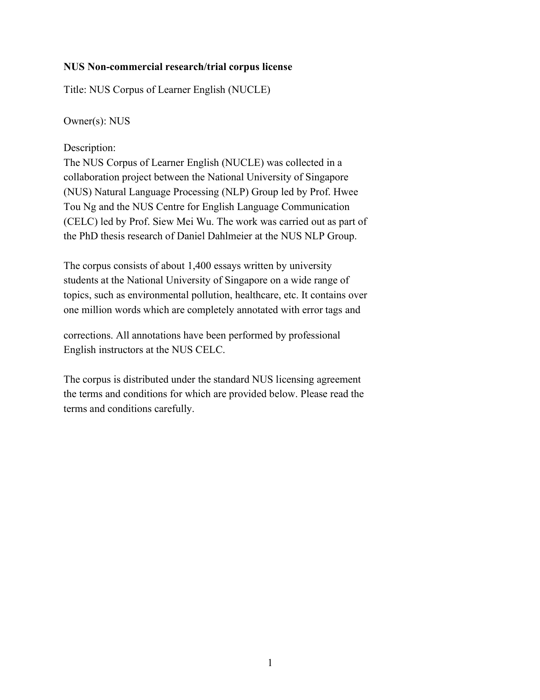
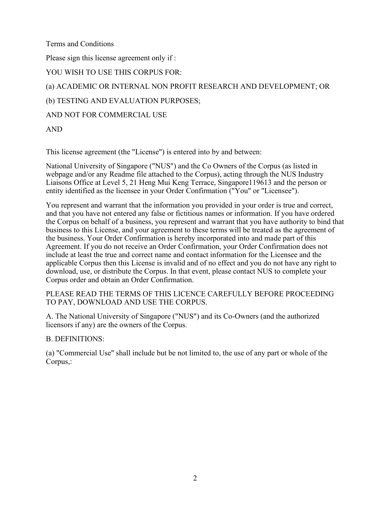
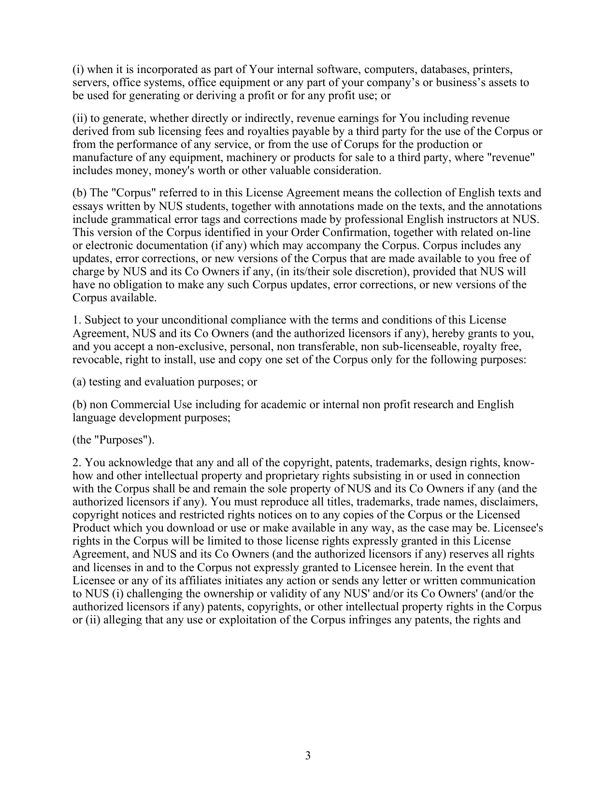
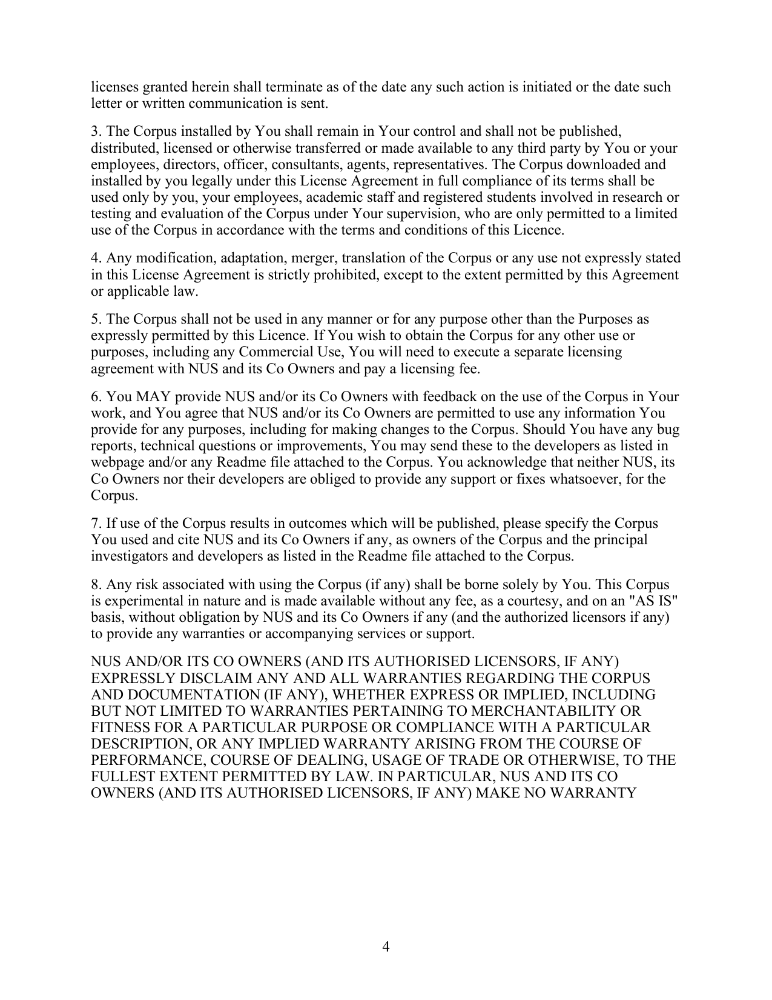

# Data provenance, licence and preparation

Project version: **NUCLE-final-20261117**.

## Source and exact experimental version

The project uses the NUS Corpus of Learner English (NUCLE). The exact source file is **nucle3.2.sgml**, SHA-256 **8441a60060730bdc6af1e79a064c68441ecb24a66da91ea2aab0061a64a130ac**. The publisher's release heading does not replace this experimental file/version; verify the checksum before claiming exact replication.

Official access/terms checked on 17 November 2026:

- [NUS corpus and agreement information](https://www.comp.nus.edu.sg/~nlp/corpora.html).
- [Dataset maintained by nusnlp](https://huggingface.co/datasets/nusnlp/NUCLE).
- [NUS licence agreement](https://huggingface.co/datasets/nusnlp/NUCLE/blob/main/nucle_license.pdf).

Citation: Dahlmeier, Ng and Wu (2013), Building a Large Annotated Corpus of Learner English: The NUS Corpus of Learner English, BEA, pp. 22-31.

NUCLE is governed by the NUS licensing agreement. Public download availability does not itself establish permission to redistribute learner essays or derived text. No redistribution authorisation or approved corpus sample was supplied for this task. The submission therefore contains no raw learner text, source corrections, full lexical encoder/vector exports or private research checkpoints. Credentials and access tokens are not included.

## Licence document

The supplied [NUCLE licence PDF](nucle_license.pdf) is shown in full below. Select any page image to open the complete PDF.

### Page 1 of 6

### Page 2 of 6

### Page 3 of 6

### Page 4 of 6

### Page 5 of 6

### Page 6 of 6

## What is included

This folder contains the access/preparation guide, the supplied licence PDF and images of all six pages. Results/results.json has saved JSON entries for real validation cases 10824, 15390 and 19068 that provide source checksums, offsets, selected nonlexical features, gold and saved predictions, without learner sentences, corrections or identities. These are metadata examples, not approved redistributable corpus samples or complete inputs for checkpoint inference.

Aggregate experimental evidence is consolidated in Results/results.json; the five headline scores are readable in Results/main_results.csv.

## Preparation used by the recorded project

1. Parse stand-off SGML text and annotations: 1,397 essays, 44,912 annotations. Source checksum plus annotation ID identifies a record.
2. Keep the five source TYPE categories ArtOrDet, Prep, Nn, Vform and SVA by identity mapping. There are 15,788 retained target annotations and 29,124 out of scope; correction is audit evidence, never a predictor.
3. Preserve parsed original paragraph characters and Python Unicode code-point offsets. Use half-open [start,end) intervals and require sentence[start:end] == error_span. Keep partial-token and whitespace-edge cases flagged.
4. Apply preparation v2's source-only sentence-boundary rules. Relative to v1, 544 sentence inputs, 533 IDs, thirty context representations and two token-span representations change. These sets overlap; source metadata, labels and original source spans remain fixed.
5. Keep constructible difficult cases. Alignment counts: 14,447 exact, 1,130 partial-token, 211 whitespace-edge. Ninety-six unresolved review flags and two boundary flags describe different conditions. All retained spans are nonempty.
6. Form connected essay groups from duplicate/shared-content evidence and split with seed 20261013: train 11,052, validation 2,368, test 2,368 annotations. Connected essays stay in one partition; groups are not individual learners.
7. Parse 11,272 distinct sentences using spaCy 3.8.7/en_core_web_sm 3.8.0. Extract S/L/P/M/D and fit categories/vocabulary on train only. Full dimension is 16,180; features and targets are separate.

These counts, policies and class supports are saved entries under json["Results/evidence/..."] in Results/results.json. Known error locations are supplied to the classifier; mechanical checks do not certify all linguistic annotations or parses.

## Authorised restoration

Obtain and comply with the publisher's agreement and verify the exact raw checksum. In a separate authorised research workspace rooted at Code/, restore data_set/raw/nucle3.2.sgml. Obtain the original group's permitted historical review/overlap decisions, preparation outputs, split manifest, features/targets, encoder, selected states and row-aligned predictions. The reference list at json["Data/restricted_inputs_manifest.json"] records expected private paths/hashes and additional requirements; it does not provide the private files or certify that every archival entry currently matches.

For BERT, restore the exact pinned revision and the model_source.json/local snapshot expected by the runner. Its source/environment records are under json["Results/reproducibility/..."] in the bundle. Follow README.md's research run order after restoring prerequisites; use matching sample IDs, partition and coordinate order throughout.

The historical record reports missing older reporting sources and prediction-CSV representation differences. Restore exact archival representations in an isolated workspace before asserting byte-identical replay; never rewrite old hashes to make a check pass. Raw SGML alone cannot recover human review decisions. New decisions or retraining under changed inputs constitute a new experiment. The public aggregate reproduction command needs none of these restricted inputs.
