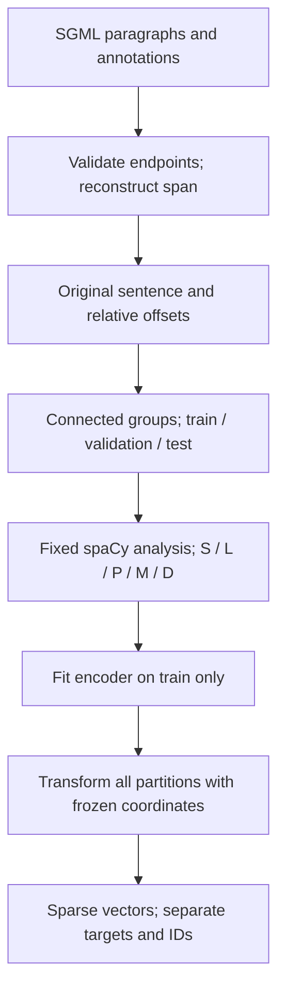

# Quân - Full video script and technical walkthrough: data and features

Project: **NUCLE-final-20261117**. Language: **English**. **No duration limit.**

## How to use this script

Follow the numbered steps in order. Each step contains **On screen / action**, a complete **Spoken script**, and retained **Code, evidence and technical notes**. The spoken passages cover the whole presentation; the notes provide code excerpts, figures, tables and deeper checks beside them. Pause at the indicated evidence. Replace only the marked personal-contribution placeholders with verified facts; do not read unfilled placeholders in the recording.

[README](../README.md) provides setup/run order; [DATA_README](../Data/DATA_README.md) records source, version, access and all six licence-page images. [results.json](../Results/results.json) stores original record names under json, tables and texts; these keys are not additional files. The report is [Final_Report.pdf](../Report/Final_Report.pdf). Research-runner commands use a prepared Code/ workspace. The read-only case view in step 10 runs from Final_Submission/ and uses submitted evidence.

## Step 1 - Task, source and presentation scope

**On screen / action:** Show README, DATA_README source/version/access details, then the five-label task and pipeline diagram.

**Spoken script:**

Hello, I am Quan. This presentation explains the data and feature pipeline for project version NUCLE-final-20261117. The question is whether a model can classify an already located grammatical error into ArtOrDet, Prep, Nn, Vform or SVA. These categories represent articles and determiners, prepositions, noun number, verb form and subject-verb agreement.

One observation is one annotation. The predictor receives the original sentence and a known character span. The source correction and error category are kept outside the predictor input. Several annotations may share a sentence, so treating every row as unrelated would be a poor assumption for splitting and evaluation.

The experimental source is the exact nucle3.2.sgml snapshot identified in the data guide. Access and redistribution are governed by the source terms. The six licence-page images document those terms; the form itself is not proof that any particular user has approval. In this recording I use the submitted text-free evidence and existing outputs.

The pipeline on screen moves from SGML to checked spans, sentence-relative inputs, content groups, linguistic features and a train-fitted encoder. My presentation follows that order. At the end I will trace real validation case 10824 through those representations to its saved prediction and identify a personal action supported by my own records.

### Code, evidence and technical notes

Python blocks below quote the existing project source; surrounding function context is omitted. Use the code and saved results together in a Markdown preview. The diagrams explain processing, not new experimental measurements.

The data pipeline must convert a teacher annotation into a reliable model input without changing what was annotated or exposing the answer to the model.

An observation is one annotation, not one essay. Its predictor is an original sentence with a known character interval. Its target is one category: ArtOrDet, Prep, Nn, Vform or SVA. Several annotations may share a sentence. That creates dependence between rows and affects splitting and later uncertainty estimates.

The categories concern articles/determiners, prepositions, noun number, verb form and subject-verb agreement, respectively. A POS tag describes a token's grammatical role; an error label describes the annotated problem. For example, a VERB tag alone cannot distinguish a verb-form error from an agreement error. The correction/context is relevant to human interpretation even though the correction is excluded from predictor input.

The supplied error location is legitimate input for this task, but makes the task easier than detecting errors in arbitrary text. A good classifier here is not automatically a good detector or corrector. Keep that distinction in your opening explanation.

### Code map

| Stage | File / functions | Input -> output | Reason it matters |
| --- | --- | --- | --- |
| SGML parsing | [src/data/nucle_sgml.py](../Code/src/data/nucle_sgml.py): NucleSGMLParser, load_nucle | Raw text/stand-off annotations -> documents and mistakes | Preserve the coordinate system |
| Annotation table | [src/data/parse_nucle.py](../Code/src/data/parse_nucle.py): reconstruct_span, documents_to_dataframe | Document/mistake -> span, validity, target and audit fields | Separate malformed endpoints from linguistic questions |
| Sentence preparation | [src/data/prepare_nucle.py](../Code/src/data/prepare_nucle.py): segment_paragraph, construct_input, build_dataset | Paragraph coordinates -> sentence-relative sample | Preserve the original annotated substring |
| Boundary repair | [src/data/sentence_boundaries.py](../Code/src/data/sentence_boundaries.py): repaired_starts | Source text/token offsets -> sentence starts | Handle difficult punctuation without target-label information |
| Grouping/split | [src/data/group_split_nucle.py](../Code/src/data/group_split_nucle.py): build_grouping, UnionFind, stratified_group_assignment | Source-content graph -> partition manifest | Prevent related content crossing partitions |
| Linguistic analysis | [src/features/nucle_pos.py](../Code/src/features/nucle_pos.py): load_tagger, align_span | Original sentence/span -> token/POS alignment | Connect character annotations with token analyses |
| Features/encoding | [src/features/nucle_features.py](../Code/src/features/nucle_features.py): extract_features, TrainOnlyEncoder | Linguistic attributes -> fixed sparse coordinates | Learn vocabulary/categories only from train |

All files are under Code/. A useful high-level flow is:

`SGML -> checked annotation -> sentence/span -> group split -> fixed linguistic features -> train-fitted encoder -> vectors and separate targets`



**What to explain while pointing:** the split comes before fitting encoder categories/vocabulary. The fixed parser and train-fitted encoder have different roles. Several annotations can share one parsed sentence while retaining separate vector rows.

## Step 2 - Read SGML without breaking its coordinate system

**On screen / action:** Open NucleMistake/NucleDocument and NucleSGMLParser in src/data/nucle_sgml.py; highlight handlers, buffers, feed and newline stripping.

**Spoken script:**

The first implementation decision is to preserve the text that the annotation offsets refer to. A document stores its paragraphs and mistakes. Each mistake contains start and end paragraph indices, start and end character offsets, a type and correction-related fields.

NucleSGMLParser behaves as a state machine. Opening a paragraph or correction changes which buffer receives subsequent character data. Closing the block commits that buffer to the appropriate object. The paragraph and correction buffers are separate, so correction text does not become part of the sentence fed to the classifier. The parser also handles paragraph boundaries when a previous paragraph tag was left unclosed.

The feed method protects ampersands before HTMLParser processes the source. The replacement and subsequent entity decoding work together to retain literal source characters. At paragraph export, strip removes only formatting newlines and carriage returns at the ends; it does not remove ordinary spaces indiscriminately.

These details matter because offsets are positions in parsed Unicode character strings, not UTF-8 byte positions or positions inside markup. If cleanup removes a space before the target, every later offset can point at the wrong substring. Our parser therefore preserves the coordinate contract rather than trying to improve the learner's text. Once the paragraph structure is available, we can check the annotation endpoints against it.

### Code, evidence and technical notes

Read NucleMistake/NucleDocument first, then follow handle_starttag, handle_data and handle_endtag. The parser maintains flags such as _inside_p and _inside_correction and separate buffers for paragraph/type/correction text.

When a DOC begins, it creates a document. A P or TITLE inside TEXT begins a paragraph-like block. MISTAKE creates an annotation with four endpoints. TYPE and CORRECTION accumulate into the current mistake. Closing blocks commits the buffers to their objects. If a new paragraph starts before the preceding one closes, the code finalises the previous block instead of silently merging them.

This is selective parsing: it extracts the structure needed for annotation coordinates. It is not a claim to implement every SGML convention.

### Two important details to point at

- `feed` protects ampersands before calling HTMLParser. HTML entity handling could otherwise change a literal source sequence and shift character positions. The protection and parser decoding must be understood together; seeing convert_charrefs=True alone does not explain the full behavior.
- Paragraph export strips formatting newlines at the ends with `strip("\n\r")`. That is narrower than stripping all whitespace. Ordinary spaces remain part of the parsed paragraph's offset contract.

Offsets are Python Unicode code-point positions in that parsed paragraph, not byte positions in markup. An accented character can use multiple UTF-8 bytes, and Unicode normalization can change a string's code-point sequence. Therefore replacing characters or globally cleaning whitespace after reading the annotations can point the same integers at different text.

**Source excerpt — NucleSGMLParser.feed**, from [nucle_sgml.py](../Code/src/data/nucle_sgml.py):

```python
def feed(self, data: str) -> None:
    # SGML character offsets refer to literal text. Protect ampersands so
    # HTMLParser neither decodes entities nor adds semicolons to bare &words.
    super().feed(data.replace("&", "&amp;"))
```

**What to point at:** protection occurs before HTMLParser sees the text. Its subsequent entity decoding restores the literal ampersand once. Explain the preservation purpose rather than calling this general text cleanup.

**Explain naturally:** start with a concrete failure: removing one space before an error moves every later position. Then point to the parser's preservation choices. This makes the implementation decision meaningful without narrating every flag.

## Step 3 - Check annotation identity, bounds and correction fields

**On screen / action:** Open reconstruct_span in parse_nucle.py, preparation_summary.json and the source checksum in DATA_README.

**Spoken script:**

The next stage reconstructs the annotated span and checks its mechanics. reconstruct_span verifies that paragraph indices and offsets are in range. For a same-paragraph annotation, slicing from start to end produces the error span. A cross-paragraph annotation can have valid endpoints but still fail the one-paragraph representation, so those conditions are recorded separately.

A missing correction field is also different from an explicitly empty correction. The latter can represent deleting text. Neither condition is a grammatical category to give to the predictor; they are distinctions needed for accurate review.

Identity is tied to the source snapshot. The sequential annotation ID alone is not a permanent identifier across arbitrary corpus releases. The saved sample identity combines source hash and annotation ID. A sentence ID additionally depends on paragraph and segmentation position, which explains why it can change after a preparation-policy change while annotation retention stays unchanged.

The saved inventory contains 44,912 annotations. Of these, 29,124 are outside the five-label scope and 15,788 are retained targets. This filtering defines our classification task; it does not mean the excluded grammatical phenomena are invalid. Mechanical validity also does not establish that every teacher correction is necessary or uniquely interpretable. We preserve the original labels for evaluation and keep linguistic review separate from offset checks.

### Code, evidence and technical notes

reconstruct_span checks paragraph indices and endpoint bounds. For a same-paragraph annotation, it slices `paragraph[start_off:end_off]`. A cross-paragraph annotation can have valid endpoints but no single-paragraph span; the returned flags distinguish those cases.

Do not equate a missing correction with an empty replacement. The missing_correction flag records whether a CORRECTION field was supplied. Empty replacement can be a deletion. These are audit distinctions, not class labels fed to the predictor.

The annotation_id is a sequential index under one exact source ordering. Its meaning is tied to the source checksum. A different source release may assign the same integer to another annotation. The sample identity therefore includes source hash plus annotation ID. Sentence identities additionally depend on sentence segmentation, so they can change between v1 and v2 while the source annotation remains the same.

The pipeline checks mechanics, not whether every teacher decision is uniquely justified. A valid slice is compatible with an ambiguous edit, an optional correction or several operations under one label.

**Evidence:** DATA_README records the exact nucle3.2.sgml checksum. The preparation summary records 44,912 annotations, 29,124 outside the five-class task and 15,788 retained targets. Filtering to five labels defines the study cohort; it is not a detector deciding whether other grammatical phenomena exist.

## Step 4 - Prepare source-preserving sentences and compare v1/v2

**On screen / action:** Show segment_paragraph and construct_input, the authored offset example, repaired_starts and the saved preparation comparison table.

**Spoken script:**

Preparation converts paragraph coordinates into a sentence/span input. segment_paragraph creates intervals over the original characters. Its round-trip check requires the sentence pieces to concatenate back to the parsed paragraph. construct_input then finds a sentence containing the complete annotation and subtracts that sentence's paragraph start.

The authored example on screen makes the arithmetic visible. The second sentence starts at position 20. Paragraph interval [25,28) becomes sentence interval [5,8), and both slices select has. This is a conceptual illustration, not a NUCLE quotation. The require statement checks not only the new bounds but exact substring equality. Preparation later checks that this span also agrees with the earlier reconstruction.

Version two changes sentence-boundary handling while retaining source characters. repaired_starts receives source text and token offsets, not gold categories, corrections or prediction errors. Its conservative rules address citation-like punctuation, abbreviation continuations and related boundary situations. When a boundary crosses a tokenizer token, the segmenter builds matching fragments instead of inserting a character into the source.

The comparison table retains the same 15,788 targets in both versions. It records 544 changed model inputs, 533 cases with changed sentence IDs, 30 changed contexts and two changed token-span representations. These sets overlap. Those numbers demonstrate representation changes, not a measured accuracy gain. The final target set has zero not-constructible cases, but the rules are not a universal sentence grammar for every future input.

### Code, evidence and technical notes

Read segment_paragraph before construct_input. The former creates source intervals for sentences and verifies that concatenating their text reproduces the parsed paragraph. construct_input finds a sentence containing the complete annotation interval, then subtracts its paragraph start.

Conceptual example, authored only for explanation:

`She walk to school. They has books.`

The second sentence starts at paragraph position 20. Paragraph span [25,28) selects `has`; its sentence-relative span is [5,8):

`25 - 20 = 5; 28 - 20 = 8`

The invariant is stronger than checking bounds:

`sentence[relative_start:relative_end] == paragraph[source_start:source_end]`

**Source excerpt — construct_input**, from [prepare_nucle.py](../Code/src/data/prepare_nucle.py):

```python
u, v = start - sent["sentence_start_par"], end - sent["sentence_start_par"]
text, tokens = sent["sentence"], sent["tokens"]
require(0 <= u <= v <= len(text) and text[u:v] == paragraph[start:end], "Span round-trip failed")
```

**Connect code to the example:** u and v become 5 and 8. The check verifies both valid bounds and identical text. Integers within range alone would not establish that the same annotated target survived conversion.

Then preparation also checks that the result equals the span reconstructed during data understanding. This gives a chain of consistent representations rather than one unchecked offset conversion.

A rejection reason such as cross_sentence means the input contract cannot represent that annotation as one sentence/span. It does not mean the error itself is linguistically invalid. The final retained target set has zero not-constructible cases, but that is an observed project count, not a guarantee for every future corpus.

### What v2 changes

v1 relies on the initial sentencizer starts. v2 calls repaired_starts and still slices the original characters. The repair API receives source text/token offsets, not labels, corrections or prediction errors.

The rules handle bounded citation-like regions, abbreviation continuations, opening brackets/quotes and punctuation attached to a following word. A boundary can fall inside an original tokenizer token; segment_paragraph explicitly constructs matching token fragments instead of editing the source to insert a space.

These are conservative heuristics, not a universal sentence grammar. Explain one boundary situation, the character-preservation check and one residual uncertainty. Do not claim the repair understands every citation or grammatical clause.

**Saved evidence:** preparation_comparison.json records 544 changed sentence inputs, 533 cases with changed sentence IDs, thirty changed context representations and two changed token-span representations across the same 15,788 targets. Annotation retention and source offsets are unchanged. The sets overlap. Changed context does not by itself prove a model-performance gain.

| Preparation check | Saved result | What it demonstrates |
| --- | --- | --- |
| Source annotations | 44,912 | Inventory before task filtering |
| Retained targets, v1 and v2 | 15,788 each | Preserved target cohort |
| Changed model inputs | 544 | Input identity is checked separately from retention |
| Cases with changed sentence IDs | 533 | Segmentation-derived IDs can change |
| Changed context representations | 30 | Local context may change |
| Changed token-span representations | 2 | Token-space changes are checked separately |

Source: `json -> Results/evidence/preparation_summary.json` and `json -> Results/evidence/preparation_comparison.json`. Point to the distinct denominators; change categories overlap. This table shows preparation behavior, not a measured model improvement.

## Step 5 - Align character intervals with token analyses

**On screen / action:** Show align_span and the exact/partial/whitespace alignment counts. Trace the two inequalities in the Python excerpt.

**Spoken script:**

The annotation and the linguistic analyser use different coordinate systems. The annotation is a character interval, while POS, morphology and dependencies belong to tokens. align_span connects those layers by selecting every token that overlaps the interval.

The two strict inequalities implement half-open interval intersection. A token ending exactly at the target start is outside the span. A token intersecting only part of it is included. This lets a partial-token annotation keep its original endpoints while still receiving the analysis of its covering token. It does not silently enlarge the teacher's character annotation.

The saved data has 14,447 exact alignments, 1,130 partial-token alignments and 211 whitespace-edge alignments. Those three categories account for the 15,788 retained samples. The 96 unresolved review flags and two boundary flags describe other properties, so they must not be added as if they were separate alignment groups.

Some source functions support insertion boundaries, but all retained project spans are nonempty. Supporting a branch in code is different from having evaluated that kind of sample. The alignment record tells us where a character-to-token conversion is exact and where it relies on approximation. Next, we must keep related inputs together when creating the evaluation partitions.

### Code, evidence and technical notes

align_span in nucle_pos.py selects every token with character overlap:

`token.start < error_end and token.end > error_start`

**Source excerpt — align_span**, from [nucle_pos.py](../Code/src/features/nucle_pos.py). Actual spaCy offsets use token.idx:

```python
selected = [
    (i, token) for i, token in enumerate(tokens)
    if token.idx < end and token.idx + len(token) > start
]
```

**What to point at:** strict inequalities implement half-open interval overlap. A token ending exactly at the error start is excluded; a token intersecting only part of the span is included. Selection does not alter the original character endpoints.

This is interval intersection, not a requirement that annotation boundaries exactly match token boundaries. A partial-token annotation therefore retains its character interval while receiving the analyses of overlapping tokens.

The code distinguishes exact, partial_token, whitespace_edge, whitespace_only and insertion-related states. These states tell the reader how character input relates to a tokenization. They do not redefine the teacher's span.

The final project's counts are 14,447 exact, 1,130 partial-token and 211 whitespace-edge cases. Ninety-six unresolved review flags and two boundary flags are separate concepts and must not be added as disjoint groups. The retained project spans are all nonempty even though some source functions support insertion boundaries.

A useful explanation is: the target is specified in character space; linguistic attributes live in token space; alignment documents the information lost or approximated when connecting them.

## Step 6 - Create connected-content groups and allocate the split

**On screen / action:** Show build_grouping, UnionFind, stratified_group_assignment and the partition table; point to the seven boilerplate exemptions.

**Spoken script:**

Splitting annotations independently could place the same sentence or repeated source content in both train and test. The grouping code therefore treats essays as graph nodes. Exact or normalized full essays, shared normalized paragraphs and identical complete sentence-plus-span inputs create connections. UnionFind puts every connected component into one group, including transitive connections.

Normalization uses NFC, casefolding and collapsed whitespace for comparison only; predictor text is not rewritten. A narrowly defined boilerplate exemption applies to short content repeated in at least ten essays, with at most ten words and eighty normalized characters, and no retained target annotation in any occurrence. Seven exemptions are recorded. Identical model inputs still connect essays. This policy controls specified content overlap, not every semantic paraphrase.

The allocation procedure keeps components indivisible and approximately targets 70, 15 and 15 percent. It uses total sample counts and per-class counts to balance the partitions. The cost measures relative size and class deviations, with class terms weighted by two. A seeded greedy search runs 128 restarts, prioritizing avoiding missing classes and then the objective. This is a heuristic, not a proof of globally optimal allocation.

The saved seed is 20261013. The result is 11,052 training annotations, 2,368 validation annotations and 2,368 test annotations. The represented group counts are 1,045, 99 and 97. The whole source graph also includes components without retained targets, so its 1,280 groups over 1,397 essays are not the same denominator as this supervised table. Label counts are used for stratification; labels are still excluded from predictor values.

### Code, evidence and technical notes

Read build_grouping and UnionFind. Treat essays as graph nodes; duplicate/shared-content rules create edges. UnionFind computes connected components, so if A connects to B and B to C, all three stay together even when A and C are not directly identical.

Links come from exact/normalized complete essays, repeated normalized paragraphs and identical complete sentence-plus-span inputs. The code verifies actual tuples when grouping an input hash, rather than assuming a hash string alone establishes identity.

A narrow boilerplate exemption avoids giant components caused by short repeated noninformative content: at least ten essays, at most ten normalized words/eighty characters, with no retained target annotation in any occurrence. Seven exemptions are recorded. Identical model inputs still connect essays even if a paragraph qualifies for exemption.

Normalization is NFC, casefolding and collapsed whitespace for comparison. It does not replace the predictor text. This protects against exact/normalized content leakage, not every semantic paraphrase or shared author characteristic.

### How allocation works

stratified_group_assignment operates on whole components. A component carries a sample count and a count for each label. The greedy search considers the change in a partition's size/class-balance cost when adding a component. Class deviations have weight two in the implementation. Seeded order/ties vary across 128 restarts; candidate ranking prioritises avoiding missing classes and then lower objective.

Groups cannot be divided to hit perfect percentages. The target is approximately 70/15/15 while preserving the grouping constraint. Gold labels are used for stratification before modelling; that is different from feeding labels into predictors or choosing a split from test performance.

To explain the cost more precisely, let t be a partition's desired sample count and a its currently assigned count. The size term is `((a-t)/max(t,1))²`. Each class adds twice the same kind of relative-error term using that class's desired/actual counts. Relative deviations stop frequent labels from dominating purely through larger absolute counts. The greedy step chooses the smallest increase in cost, rather than the smallest absolute cost of a partly empty partition. The final restart objective also penalizes missing classes; restart ranking first minimizes the number of missing-class partitions. These are heuristics, not a proof of the globally optimal split. The saved split seed is 20261013.

| Partition | Target annotations | Represented essays | Represented groups |
| --- | --- | --- | --- |
| Train | 11,052 | 1,069 | 1,045 |
| Validation | 2,368 | 142 | 99 |
| Test | 2,368 | 144 | 97 |

The complete graph has 1,280 components over 1,397 source essays; some have no retained target samples. Do not confuse those counts with the supervised table, independent learners or the 97 test resampling units.

## Step 7 - Run the fixed linguistic analyser

**On screen / action:** Show load_tagger, spaCy/model version checks, disabled NER and the feature manifest count of distinct sentences.

**Spoken script:**

Preparation used a blank tokenizer and sentencizer, whereas feature extraction uses a trained English analysis pipeline. The recorded versions are spaCy 3.8.7 and en_core_web_sm 3.8.0, with named-entity recognition disabled. The project does not fine-tune that parser on the five target labels.

The feature run parses 11,272 distinct sentences and reuses a sentence analysis when several annotations share its text identity. It still extracts a separate feature row for each annotation's location. Caching therefore reduces repeated work without merging the classification observations or making them independent.

A fixed pretrained analyser and a train-fitted category encoder have different roles. Applying the same fixed parser to original validation or test sentences does not fit the project's lexical vocabulary on those partitions. We still restrict learned term and category selection to train.

The output is an automatic analysis, not a gold syntactic structure. A missing subject feature might reflect the parser or the span aggregation rule rather than a real absence of a grammatical subject. That limitation becomes important when interpreting the engineered feature families.

### Code, evidence and technical notes

Preparation uses a blank tokenizer/sentencizer. Feature extraction uses spaCy 3.8.7/en_core_web_sm 3.8.0 with trained tagger/parser and disabled NER. These are different components with different roles.

The parser is already trained; the project does not fine-tune it on all corpus labels. Parsing all original sentences with a fixed analyser is different from learning a vocabulary from validation/test. The learned encoder must still be fitted only on train.

The code caches 11,272 distinct sentence analyses and extracts a separate row for every annotated location. Sharing a parse does not merge those samples or make them independent. Automatic morphology/dependencies can be wrong; a missing feature may mean an unavailable parser analysis, not absence of a real grammatical phenomenon.

## Step 8 - Explain the S/L/P/M/D feature methodology

**On screen / action:** Show extract_features and the five-family table; trace structural fields, lexical_candidates, morphology aggregation and subject/dependency code.

**Spoken script:**

extract_features first checks that the parsed document equals the original sentence and that its slice equals the prepared error span. It then derives five families using original text and the known location.

S describes structure: sentence and span length, character length, relative position and span kind. Token count and character count are deliberately different quantities. L describes lexical identity using casefolded words, fixed left and right context slots and capped unigram/bigram candidates. The local window has two tokens on each side. N-grams are formed within their regions, not across arbitrary boundaries, and their later activations are binary rather than TF-IDF values.

P contains the ordered POS signature, neighboring tags and a local pattern. The order matters because a sequence of grammatical roles is more specific than an unordered set. M aggregates Number, Person, Tense and VerbForm over covered tokens into sorted unique values. That compact representation loses which token supplied each value, so it cannot preserve every token-specific relation.

D adds dependency and head signatures, linear head distance and direct subject information. Head distance is absolute token-index distance, not dependency-tree path length. Subjects are direct children of covered tokens under the specified subject relations; the code does not search every ancestor or coordination. Subject distance averages the available covered-token/subject distances.

The family names do not represent independent linguistic abilities. D itself includes head or subject POS and morphology, so removing explicit P or M later does not erase every related signal. This matters when the modelling video interprets ablations. We have now created meaningful attributes, but the models still need a fixed numeric coordinate map.

### Code, evidence and technical notes

Use extract_features and real case 10824 side by side.

| Family | Actual mechanism | Information and limitation |
| --- | --- | --- |
| S | Token/character lengths, relative positions and span kind | Structural context; not semantic meaning |
| L | Casefolded unigrams/bigrams in separate span/left/right regions and lexical context slots | Direct lexical identity; can memorise dataset patterns |
| P | Ordered POS signature, context POS and local pattern | Grammatical category patterns; parser errors remain |
| M | Sorted unique Number/Person/Tense/VerbForm values from covered tokens | Compact morphology; loses token-specific attachment/order |
| D | Dependency/head signatures, linear distances and direct subjects | Relations beyond a two-token window; incomplete syntactic coverage |

lexical_candidates forms n-grams inside each region, not arbitrary bigrams crossing region boundaries. The left/right window is two tokens. The representation is not described as TF-IDF: lexical activations are binary and numeric values are kept as their actual numbers.

D deserves careful explanation. head_distance is mean absolute token-index distance to heads, not dependency-tree path length. Subjects are direct children of covered tokens with the specified subject relations; the implementation does not traverse every coordination or long dependency chain. subject_distance averages linear distances over covered-token/subject pairs. Signatures compress analyses; they cannot preserve every token-level relation.

Family names are not disjoint sources of linguistic information. D contains head/subject POS and Number/Person. Dropping P or M later removes explicit columns, not all traces of POS or morphology from the representation.

## Step 9 - Fit the encoder on train, then transform every partition

**On screen / action:** Show TrainOnlyEncoder.fit and transform_one, numeric/category/n-gram mappings, unknown handling and the Full dimension.

**Spoken script:**

TrainOnlyEncoder.fit learns which attributes become numeric coordinates, which categorical values receive one-hot coordinates and which n-grams enter the vocabulary. The first checks require a nonempty training-only set and unique sample IDs. These checks matter because the encoder learns a representation even though it is not the final predictor.

Numeric fields retain their values. Categorical fields activate a coordinate with value one. The n-gram vocabulary is capped at 500 entries, selected deterministically from training frequencies. That cap does not limit all lexical or categorical columns. Lexical position slots also create categories, and the full encoded dimension is 16,180. The intermediate span_unigrams field is explicitly skipped during fit; it is not another bag-of-counts feature.

At transform time, the coordinate map is frozen. An unseen category uses its existing unknown coordinate rather than creating a test-time column. Missing information, not-applicable values and unseen categories have distinct meanings. Unknown n-grams use a shared unknown activation, which preserves shape but loses the identity of unseen terms.

The result is a sparse dictionary of column indices and values. Most coordinates are zero, so sparse storage avoids materializing unnecessary entries. The same integer column must retain the same meaning during training and prediction. A checkpoint without its matching encoder and variant mapping is therefore insufficient, even if its dimension looks correct. IDs are kept for joins and labels for supervision, separately from predictor values. We can now inspect a real case across this complete chain.

### Code, evidence and technical notes

TrainOnlyEncoder.fit first requires nonempty, train-only rows and unique sample IDs. It collects numeric keys, observed categorical values and lexical term frequencies. Vocabulary/category ordering is deterministic. Missing, not-applicable and unknown categories receive explicit sentinels.

**Source excerpt — TrainOnlyEncoder.fit**, from [nucle_features.py](../Code/src/features/nucle_features.py):

```python
require(bool(rows), "Cannot fit encoder on no rows")
require(all(r.get("partition") == "train" for r in rows), "Encoder fit accepts train rows only")
ids = [r["sample_id"] for r in rows]
require(len(ids) == len(set(ids)), "Duplicate sample IDs in fit rows")
self.train_ids = set(ids)
```

**What to point at:** this component learns a representation, so it also needs a fitting boundary. A validation row passed to fit must fail even though the final classifier has not yet been trained.

Three mechanisms become one vector:

- Numeric keys become N-prefixed coordinates with numeric values; there is no fitted standard-scaling stage here.
- Categorical keys become C-prefixed one-hot coordinates.
- The capped n-gram vocabulary becomes binary L coordinates; repeated occurrences do not increase the stored value above one.

The cap is 500 n-gram entries. It is not a cap on all L coordinates: lexical position slots also generate categories. L|span_unigrams is an intermediate field skipped by fit; do not incorrectly describe it as an additional bag-of-counts or whole-span one-hot feature. The actual Full dimension is 16,180.

transform_one uses the fixed index mapping. An unseen category activates __UNK__, not a newly added column. __MISSING__ means missing information; NOT_APPLICABLE and unseen-value handling have different meanings. Unknown n-grams activate a shared unknown coordinate. That fallback avoids shape errors but loses which unseen word occurred.

**Source excerpt — categorical transform_one**, from the same encoder:

```python
for key, values in self.categories.items():
    value = str(features.get(key, SPECIAL))
    if value not in values:
        value = UNK
    out[self.index[f"C|{key}|{value}"]] = 1.0
```

**What to point at:** the category is resolved before coordinate lookup; no new index is created. Distinguish a field's value, its encoded coordinate and the activation 1.0. This explains why test content cannot expand the mapping.

A sparse dictionary `{column_index: value}` is a coordinate representation, not a prediction. It reduces storage/computation when most entries are zero. A model state without the matching coordinate map is unusable even if the vector dimension happens to match.

For a small conceptual illustration, a raw `S|span_tokens` value of 2 becomes the value 2 at the coordinate named `N|S|span_tokens`. A known POS signature activates its categorical coordinate with value 1. If a later row has a signature absent from train, it activates that field's __UNK__ coordinate, still with value 1. Actual column integers come from the fitted encoder; do not invent them for a real case. This illustrates why numeric magnitude, category identity and column position are separate things.

### Leakage controls: explain their scope

extract_features explicitly reads sentence/span fields and checks document text and substring identity. Fit rejects non-train partitions. Features/targets are exported separately with IDs for joins. Keeping IDs for alignment is acceptable; using them as predictor values could memorise provenance.

The bare provenance field alignment is excluded as a generic input field, while a deliberately constructed P|span_alignment feature describes known span/token geometry. Do not claim that every occurrence of the word alignment is forbidden. A guard protects a specified contract, not every conceivable future wrapper mistake.

## Step 10 - Demonstrate real case 10824 from input metadata to saved prediction

**On screen / action:** From Final_Submission/, run the read-only case view below or open its exact bundle key. Highlight offsets, selected coordinates, predictions and then gold; keep the real-case flow table visible.

**Spoken script:**

I am opening Results/evidence/real_example_10824.json inside the submitted evidence bundle. This is real validation annotation 10824, linked to the source snapshot by its checksum. I am displaying a saved record, not executing a new model forward pass.

Its prepared interval is [44,53), so the saved character length is nine. These offsets are already sentence-relative; the original paragraph start is not provided here, and there is nothing further to subtract. The target covers two tokens in a twenty-seven-token sentence. The visible features include DET+NOUN, singular number and the det+nsubj dependency signature.

The numeric span count and the active POS category illustrate the two encoder mechanisms we just examined. The complete Full input has other coordinates, including lexical information not redistributed in this record. The saved LR and Tree predictions both say ArtOrDet, while the source label says Nn.

This is an observed classification mismatch. DET+NOUN describes the target's tokens, whereas the label describes the annotated edit. Seeing a determiner in the representation does not prove that feature caused the prediction. A stronger grammatical interpretation needs the source correction and context; a fitted-route explanation needs the complete vector and model state. The real record supports the data-to-output trace without inventing either missing evidence or a learner sentence.

### Code, evidence and technical notes

Open `json -> Results/evidence/real_example_10824.json` and trace:

1. Source checksum + annotation ID identify the actual row in validation.
2. [44,53) is an exact nine-character interval, covering two tokens in a 27-token sentence.
3. The saved POS signature is DET+NOUN, morphology includes Number=Sing and dependency signature is det+nsubj.
4. Full uses the train-fitted encoder; the public record contains only selected nonlexical coordinates.
5. Both saved LR_03 and Tree_03 predict ArtOrDet, while gold is Nn.

**Saved real-case excerpt:** selected fields from `json -> Results/evidence/real_example_10824.json`, with original values unchanged:

```json
{
  "annotation_id": 10824,
  "partition": "validation",
  "error_start": 44,
  "error_end": 53,
  "gold": "Nn",
  "predictions": {"LR_03": "ArtOrDet", "Tree_03": "ArtOrDet"},
  "nonlexical_features": {
    "N|S|span_chars": 9.0,
    "N|S|span_tokens": 2.0,
    "N|S|sentence_tokens": 27.0,
    "C|P|span_signature|DET+NOUN": 1.0
  }
}
```

**Explain the bridge:** nine characters become two covering tokens and then numeric/categorical coordinates. DET+NOUN describes the tokens; Nn is the edit category. The mismatch is observable, while this subset cannot replace the complete inference input.

This example explains why a multi-token POS signature is not identical to error type: the annotated category concerns the edit, not simply every POS inside its anchor. A DET coordinate does not prove why a particular fitted classifier chose ArtOrDet. Full lexical features, coefficients/branches and surrounding edit evidence would be needed for a stronger interpretation.

Do not invent a readable learner sentence to fill the redaction. Use the conceptual offset example separately and label it accurately.

### Real-case flow to display

| Stage | Evidence or code to point at | What the viewer should understand |
| --- | --- | --- |
| Source annotation | annotation_id=10824 and source_sha256 | Identity refers to one exact source snapshot |
| Prepared input | validation; exact interval [44,53) | These are already sentence-relative offsets |
| Character geometry | 53-44=9; saved span_chars=9 | Span length agrees with the endpoints |
| Linguistic alignment | span_tokens=2; sentence_tokens=27 | Character length and token count measure different objects |
| Feature representation | DET+NOUN; Number=Sing; det+nsubj | Original text is represented by linguistic attributes |
| Encoding | TrainOnlyEncoder.fit/transform_one; Full dimension 16,180 | The train-fitted map fixes the meaning of each coordinate |
| Saved classification | LR_03=ArtOrDet; Tree_03=ArtOrDet | The fitted systems produced the recorded categories |
| Evaluation | gold=Nn | Both disagree with the original label |

Read-only saved-output view from **Final_Submission/**:

```powershell
$bundle = Get-Content -Raw -Encoding UTF8 ./Results/results.json | ConvertFrom-Json
$bundle.json.'Results/evidence/real_example_10824.json' | ConvertTo-Json -Depth 6
```

## Step 11 - Summarize the result, personal contribution and handoff

**On screen / action:** Show preparation/split/feature records, one personally verified contribution artifact and the handoff items. Keep source version and saved-output captions visible.

**Spoken script:**

The data result is a preserved and traceable set of 15,788 five-class annotations, assigned to connected-content partitions and represented using a training-fitted coordinate map. The preparation comparison distinguishes retention from representation changes. The real-case demonstration shows how that representation connects to a saved prediction and an actual error.

For my personal contribution, I worked on [ACTUAL ARTIFACT AND ACTION]. I checked [ACTUAL CHECK] against [SUPPORTING EVIDENCE], and the supported outcome was [OBSERVED RESULT OR CORRECTION]. Shared work or AI assistance covered [SPECIFIC PART], while my own verification covered [SPECIFIC SCOPE]. These details must match my records; the role assignment by itself does not establish authorship of every module.

The handoff to modelling consists of partition identities, feature vectors, the frozen encoder and a precise feature description. The main limits are supplied error locations, imperfect content matching, automatic parser errors and information lost during aggregation. The public metadata demonstrates traceability but cannot substitute for private original text or complete checkpoint inputs. With those boundaries stated, the next stage can compare predictors on a consistent representation.

### Contribution and production checks

Use an actual artifact and distinguish personally performed checks from shared/AI work. Keep code, offsets, table denominators and version captions readable. Technical explanation, evidence and demonstration, personal contribution, and production quality should each be visible in the completed recording.

## Preparation questions and contribution reminders

| Question | Reasoning your answer should contain |
| --- | --- |
| Why not clean all whitespace first? | Offsets refer to a particular character sequence; cleanup changes the target unless a verified coordinate mapping is maintained. |
| Why can a partial-token sample still be valid? | Character annotation and tokenization are different layers; record their relationship instead of changing the annotation. |
| Why graph components rather than essay IDs alone? | Shared content can connect distinct essays transitively. |
| Does grouping use labels? | Allocation uses label counts for stratification; source-only boundary repair does not use labels/corrections; neither puts labels into predictors. |
| Why is vocabulary fitted after splitting? | Test/validation content must not define learned categories or term selection. |
| Why more than 500 dimensions? | The cap applies to n-grams, not numeric/categorical/context coordinates. |
| Does __MISSING__ prove there is no subject? | It describes the available analysis/representation, not a grammatical truth. |
| Can the redacted real case rerun a checkpoint? | It lacks full lexical inputs/encoder/state; it supports traceability, not complete inference. |

For personal contribution, use an artifact from work actually performed: a parser/offset decision, a review correction or an independently executed check. The recorded assignments for Quân are 10824, 11696, 12352, 11501, 12050 and 12301 under audit_summary.json -> validation -> member_ids -> Quan. Those assignments are not a full authorship history. Attribute shared/AI work accurately.

This question table is preparation material. The full spoken presentation is provided in steps 1-11.
