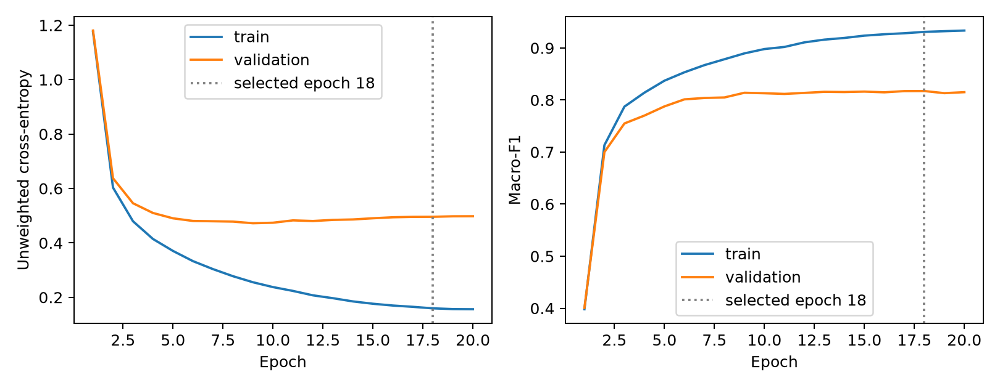

# Duy - Full video script and technical walkthrough: methods and training

Project: **NUCLE-final-20261117**. Language: **English**. **No duration limit.**

## How to use this script

Follow steps 1-14 in order. Every step supplies **On screen / action**, a complete **Spoken script**, and code/evidence notes where available. The spoken passages explain the entire methodology and code flow; use the retained excerpts, diagrams, tables and learning curve as the corresponding views. Replace only marked personal-contribution placeholders with facts supported by your own records.

[README](../README.md) contains setup/run order. [results.json](../Results/results.json) stores json, tables and texts entries under original record names; these are bundle keys. [main_results.csv](../Results/main_results.csv) and [Final_Report.pdf](../Report/Final_Report.pdf) contain the overall comparison. Research-runner commands require a prepared Code/ workspace; the read-only case view in step 13 runs from Final_Submission/.

## Step 1 - Define the modelling problem and inputs

**On screen / action:** Show README role/task, the five classes, Full dimension and source map; distinguish structured features from marked text.

**Spoken script:**

Hello, I am Duy. This presentation covers model construction, training and selection for NUCLE-final-20261117. The input is an original sentence plus a supplied error location, and the output is one of five categories. The task classifies a known location; it does not first detect errors or generate corrections.

The classical models use the fixed sparse Full representation with 16,180 coordinates. BERT instead uses original text with explicit span markers. Both representations refer to the same known annotation location. The correction and category are not inserted into predictor text or feature values.

The target is one category even when a source edit could involve several grammatical operations. For an authored example, go to goes in He go home concerns agreement, whereas went to gone after have concerns verb form. These are teaching examples, not corpus quotations. Both targets can be verbs, which explains why token POS alone does not settle the category.

I will establish simple references, explain how LR and Tree learn from encoded features, then follow validation selection and the ablation interventions. After that I will explain the compact BERT input, pooling, optimization and checkpoint selection. The final demonstration traces actual validation case 15390 to its saved classical predictions and connects the aggregate BERT results to their methodological limits.

### Code, evidence and technical notes

The Python blocks below quote the retained project source, with surrounding context omitted. Pair each block with the corresponding table, figure or example in a Markdown preview. They are code walkthrough material, not additional standalone programs.

One sample is an annotation: original sentence plus known span, with one target category among ArtOrDet, Prep, Nn, Vform and SVA. The classifier must choose one of five mutually exclusive output indices even when an actual correction could involve several grammatical operations.

For an authored illustration, changing marked `go` to `goes` in `He go home` addresses agreement, whereas changing `went` to `gone` in `They have went` addresses verb form. These are conceptual teaching examples, not NUCLE records. Both targets can be tagged VERB, which shows why token category alone does not determine edit category. The actual project taxonomy and source annotation remain the scoring reference.

That distinction explains two limitations: gold locations make the problem easier than detection, and one label may simplify a multi-operation edit. A mismatch with gold is a classification error under this protocol; it is not automatically proof that the model's linguistic interpretation is nonsensical.

Classical learners receive a fixed 16,180-dimensional sparse Full vector. BERT receives marked tokenized original text. These are different representations of the same supplied location, not models solving unrelated input tasks.

### Code map

| Question | File / functions | What to follow |
| --- | --- | --- |
| What do simple references exploit? | [features/nucle_pos.py](../Code/src/features/nucle_pos.py): POSRule; [training/nucle_benchmark.py](../Code/src/training/nucle_benchmark.py) | Train counts, signature lookup and fixed rules |
| How is LR fitted? | [models/nucle_logistic.py](../Code/src/models/nucle_logistic.py): fit_logistic | Sparse logits, cross-entropy/L2, LBFGS closure and stopping diagnostics |
| How is Tree fitted? | [models/nucle_tree.py](../Code/src/models/nucle_tree.py): GiniTree | Weighted impurity, candidate splits, stopping and leaf prediction |
| How are representations compared? | [training/nucle_ablation.py](../Code/src/training/nucle_ablation.py); [training/nucle_final_selection.py](../Code/src/training/nucle_final_selection.py) | VARIANTS, feature_indices, masked_features, make_encoders, fit_one |
| How is the known span tokenized? | [training/bert_span_classifier.py](../Code/src/training/bert_span_classifier.py): encode_span | Three regions, markers, budget and cropping |
| What does span mean calculate? | [models/bert_span_readout.py](../Code/src/models/bert_span_readout.py): target_mask, BertReadout.forward | Hidden states -> selected pooling -> shared head |
| How is BERT trained/selected? | [training/bert_small_experiment.py](../Code/src/training/bert_small_experiment.py) | load_rows, optimizer_for, train_one, save_best, load_best, select, test |

Paths in this table are under Code/src/.

## Step 2 - Establish Majority and POS-rule references

**On screen / action:** Show POSRule.fit/predict, fixed signatures, lookup/fallback and the Majority/POS saved result rows.

**Spoken script:**

Majority learns only the most frequent training category, ArtOrDet, and predicts it for every input. Its test accuracy is about 0.4206, because that class is common. Its Macro-F1 is much lower, about 0.1184, because the other four categories receive zero F1. This makes class imbalance visible.

The POS reference adds a small amount of grammatical structure. Exact ADP signatures map to Prep, and exact DET signatures map to ArtOrDet. For other observed ordered signatures, the model uses the majority label among training examples with that signature. If a signature is unseen, it falls back to the global training majority. Fixed label order resolves ties deterministically.

In the predict method, the fixed-rule branch comes first, then the learned signature table, then the fallback. DET+NOUN is not the exact DET signature, so a multi-token target does not automatically take the determiner rule. No source correction is needed for these decisions.

The POS model reaches about 0.7106 test Macro-F1. That is a substantial reference for judging whether more complex models add useful distinctions. Five categories do not imply a universal random-chance F1 of 0.2; expected F1 depends on label frequencies and prediction behavior. With these references defined, we can examine what a learned linear decision rule adds.

### Code, evidence and technical notes

Majority counts train labels and always predicts the most frequent one, ArtOrDet. It learns a class prior but no input-dependent distinction. Its test accuracy 0.4206 reflects the frequency of that class; its Macro-F1 0.1184 exposes the zero performance on the other four classes.

POSRule is a hybrid rule/lookup model. Exact ADP maps to Prep and exact DET to ArtOrDet. Other observed ordered POS signatures use their majority training label; unseen signatures fall back to the global train-majority label. Ties use fixed label order.

A DET+NOUN span is not the exact DET anchor. This matters when explaining a real multi-token error. Signature categories describe covering tokens, while the target describes an annotated edit. The rule never needs the source correction to make its decision.

Its 0.7106 test Macro-F1 is a meaningful reference: a complex learner should be judged against information available to this simple grammatical lookup. These are project baselines, not external-paper reimplementations.

**Source excerpt — POSRule.predict**, from [nucle_pos.py](../Code/src/features/nucle_pos.py):

```python
def predict(self, row: dict) -> str:
    signature = row["pos_signature"]
    if signature in self.FIXED:
        return self.FIXED[signature]
    counts = self.signature_counts.get(signature)
    return self._winner(counts) if counts else self.majority
```

**What to point at:** exact fixed signatures take precedence, followed by a learned signature majority and then the global fallback. For a multi-token signature, trace the lookup branch rather than pretending it matches the single-tag DET rule.

**Explain in your own words:** what does each baseline know, what does it ignore, and what would an improvement over it demonstrate? Avoid equating five labels with a universal random-chance F1 of 0.2; chance performance depends on class frequencies and prediction behavior.

## Step 3 - Explain multinomial LR, its loss and LBFGS implementation

**On screen / action:** Show shapes X n x d, W d x 5 and b; the softmax/objective; the closure excerpt and saved Full fit diagnostics.

**Spoken script:**

Logistic Regression scores all five classes using XW plus b. Each row of X is a sparse annotation vector, W has one column per class, and b is a five-value bias. With 16,180 Full coordinates, W and b contain 80,905 scalar parameters. Prediction is the largest class logit; softmax gives the corresponding five-class probabilities. These are mutually exclusive choices, not five independent binary labels.

The model is linear in encoded coordinates. A boundary between two classes depends on the difference between their weights and biases. Engineered POS patterns can already encode combinations of original observations, so linearity here does not mean the model sees only isolated words.

The objective is mean cross-entropy plus the squared weight norm divided by two times C times the number of training rows. Cross-entropy penalizes low probability on the gold class. The L2 term discourages large weights; b is not penalized. Larger C weakens that regularization. Balanced loss uses inverse training-frequency class weights, but the selected Full setting uses no weighting. The weighted mean's denominator follows the selected class weights; the L2 denominator still uses C times n.

The closure connects that formula to the code. It clears gradients, computes sparse matrix multiplication, adds the penalty and calls backward. LBFGS can evaluate the closure several times during its strong-Wolfe line search, so clearing gradients inside the closure prevents accidental accumulation. This is full-batch optimization, not the mini-batch loop used later for BERT.

Full selects C=0.1. Its saved fit records 369 iterations under change tolerance. The implementation directly verifies gradient tolerance, while its other below-cap stopping category is inferred from iteration/evaluation counts. I therefore do not claim that the gradient threshold was met. Numerical coordinates are also not standardized here, so coefficient interpretation must account for feature scale and correlated attributes.

### Code, evidence and technical notes

Let X have shape n × d, W shape d × 5 and b shape 5. The code computes:

`Z = XW + b`

`p(y=c|x) = exp(z_c) / sum_k exp(z_k)`

Prediction is the largest logit/probability. This is multinomial softmax, not five independent binary decisions. For Full, d=16,180, so W and b contain 80,905 scalar parameters. The sparse representation makes a high-dimensional row feasible when most coordinates are zero.

For classes a and b, the decision boundary is `(W_a-W_b)·x + b_a-b_b = 0`. Contributions are additive in the encoded coordinates. However, an engineered local POS-pattern category already represents a combination of original observations. A linear classifier over those features is not equivalent to a context-free bag-of-words model.

### Objective and C

The unweighted implemented objective is:

`mean cross-entropy + ||W||² / (2 × C × n)`

Cross-entropy penalizes assigning low probability to the gold class. L2 discourages large weights; the bias is not included in that penalty. Larger C weakens regularization. A differentiable cross-entropy objective is a training surrogate; the model is selected using validation Macro-F1, which is not directly optimized by this loss.

Balanced class loss uses train-frequency weights n/(5×class_count). It increases the influence of rare classes; it does not guarantee better Macro-F1 because the representation, optimization and resulting false positives/negatives also matter. Full actually selects no weighting.

For an unweighted example, cross-entropy is `-log(p_gold)`. Its derivative with respect to a class logit is `p_c - 1[c=gold]`: gradient descent increases the gold score and decreases competing scores according to their probabilities. Averaging rows and adding the L2 derivative `W/(C×n)` connects the loss formula to the gradients computed by backward. With PyTorch's weighted mean, the cross-entropy numerator is the sum of weighted row losses and its denominator is the sum of the selected class weights; it is not simply divided by n. The stated L2 denominator remains C×n.

Feature scale matters: raw lengths/distances and one-hot indicators are not standardized by a fitted scaler here. A coordinate's coefficient cannot be interpreted without its scale, coding and co-occurring features.

### Follow the code, not just the formula

In fit_logistic:

1. Sparse COO input and row/label alignment are checked.
2. W and b start at zero; the seed is fixed.
3. The closure clears gradients, computes sparse matrix multiplication, loss and penalty, then backpropagates.
4. LBFGS with strong-Wolfe line search may call the closure several times while choosing one update. Clearing gradients inside the closure prevents accidental accumulation across trial evaluations.
5. Final objective and maximum absolute gradient are recomputed, and stopping diagnostics are returned with detached state.

LBFGS uses curvature information from recent updates to choose a step. It is appropriate to understand this as full-batch numerical optimization of the fixed feature problem, not a neural mini-batch training loop.

**Source excerpt — fit_logistic**, from [nucle_logistic.py](../Code/src/models/nucle_logistic.py):

```python
def closure():
    nonlocal eval_count
    optimizer.zero_grad()
    logits = torch.sparse.mm(x, w) + b
    loss = F.cross_entropy(logits, labels, weight=weights, reduction="mean")
    objective = loss + 0.5 * w.square().sum() / (c_value * n)
    objective.backward()
    eval_count += 1
    return objective

optimizer.step(closure)
```

**Connect formula to code:** sparse.mm computes XW; the loss consumes logits and gold indices; the penalty affects w, not b. Backward differentiates the complete objective. Because LBFGS calls the closure repeatedly, gradients are cleared inside it. Relate this mechanism to the selected C=0.1 and the saved stopping diagnostics below.

Full selects C=0.1 without weighting. Its recorded fit stops after 369 iterations under change tolerance. The source verifies gradient tolerance directly but labels other below-cap stops as change tolerance. Do not turn that diagnostic into a claim that the gradient threshold was met or every configuration reached the same optimum.

Limits are 1,000 iterations/1,250 evaluations, tolerance_grad=1e-6 and tolerance_change=1e-9. Hitting a cap and satisfying an eligibility criterion are different outcomes. Explain why the selector excludes ineligible LR candidates.

## Step 4 - Explain greedy Gini Tree fitting and inference

**On screen / action:** Show GiniTree._impurity/_build, numeric and one-hot threshold candidates, then predict_one and the selected Full configuration.

**Spoken script:**

The Tree expresses conditional decisions instead of one additive score. At a node, Gini impurity is one minus the sum of squared class proportions. A pure node has zero impurity; two equally weighted classes give 0.5. The fitting procedure greedily chooses a split that reduces weighted child impurity relative to the parent.

For numeric coordinates, candidate thresholds come from gaps between sorted observed values. One-hot coordinates use 0.5 to separate absent and present values. Sparse coordinates that are not stored are read as zero. Ties use deterministic preferences for feature indices and thresholds.

Depth, purity and minimum leaf size control growth. A tiny pure training leaf can memorize a local pattern, so maximizing training purity alone is not evidence of generalization. The grid crosses depths four, eight and twelve, minimum leaves five and twenty, and unweighted or balanced impurity. Full selects depth eight, leaf size five and no weighting.

There is an implementation detail worth making explicit: balanced weights affect split impurity, but leaf labels use raw class-count majority and minimum leaf size uses raw row counts. It is not a completely weighted leaf-voting procedure.

At prediction time, predict_one follows stored thresholds until reaching a leaf label. It learns nothing from the validation gold during that traversal. The code explains the mechanism, but an exact route for a redacted case additionally requires its complete vector and the saved tree. I will not invent a private branch path merely because a feature looks linguistically plausible.

### Code, evidence and technical notes

Read GiniTree._impurity, _build and predict_one. A node's Gini impurity is `1 - sum_c p_c²`; zero means all weighted mass is in one class. Candidate gain compares the parent impurity with the weighted average of child impurities.

A greedy split is chosen at each node. The method does not optimize the entire tree globally. Unlike LR, it can express conditional interactions: a POS signal can lead to different predictions depending on a morphology or structural split further down the route.

As a conceptual calculation, a node with two equally weighted classes has Gini `1-(0.5²+0.5²)=0.5`; a pure node has zero. A useful split reduces the weighted child impurity relative to the parent. Purity on train alone is not the objective of evaluation: a tiny pure leaf can memorize observations and generalize poorly, which motivates depth/leaf constraints and validation selection.

Missing sparse values are zero. One-hot splits use threshold 0.5; numeric candidates come from gaps between sorted observed values. A test `value <= threshold` routes left; otherwise right. Gain ties prefer smaller feature indices/thresholds according to the candidate tuple, making the choice deterministic.

Depth, purity and minimum leaf size stop growth. Small leaves permit more detailed fitting but may be unstable; larger leaves smooth over rare patterns. The grid crosses depth 4/8/12, leaf size 5/20 and none/balanced weighting. Full selects depth 8, leaf size 5, no weighting.

**Implementation detail:** balanced weights affect split impurity. The actual leaf label uses raw class-count majority, and the leaf-size constraint counts raw rows. It is not a fully weighted leaf-voting algorithm. That is why source inspection matters beyond naming the method CART.

A source branch diagram explains the rule, but does not reveal the exact private tree path for a redacted case. Do not invent a route or imply that the most plausible-looking feature caused the prediction.

**Source excerpt — GiniTree.predict_one**, from [nucle_tree.py](../Code/src/models/nucle_tree.py):

```python
def predict_one(self, row: dict[int, float]) -> int:
    if not hasattr(self, "root"):
        raise RuntimeError("Call fit before predict")
    node = self.root
    while "feature" in node:
        node = (
            node["left"]
            if row.get(node["feature"], 0.0) <= node["threshold"]
            else node["right"]
        )
    return node["prediction"]
```

**What to point at:** absent coordinates read as zero; thresholds route to a child until a saved leaf prediction is reached. For a one-hot coordinate and threshold 0.5, absent/present values take different branches. Explaining an actual private route additionally requires its vector and saved tree.

## Step 5 - Separate train fitting, validation tuning and test scoring

**On screen / action:** Show selected_configurations.json, validation columns and the source selection loop; keep test columns clearly labeled.

**Spoken script:**

The training partition adjusts parameters or tree nodes. Validation ranks hyperparameter settings by Macro-F1, and the frozen selected predictor is then evaluated on test. Keeping these roles separate prevents test performance from choosing the model being reported.

The LR grid has four C values and two weighting options, eight settings in total. Tree has three depths, two minimum leaf sizes and two weighting options, twelve settings. Stable candidate order resolves exact score ties. LR convergence eligibility is checked before a candidate can win, so an ineligible fit cannot simply be selected for its apparently attractive validation score.

The selected Full models remain fitted on train; they are not refitted on train plus validation before the test evaluation. Freezing records checkpoint, encoder, selected configuration and relevant input/source identities. A filename alone would not establish that the same predictor was evaluated later.

Selecting the highest validation score is a declared decision rule, not a significance test. It also does not erase earlier exposure to a holdout during project development. That limitation will matter for the later BERT extension. Before discussing it, the ablations let us examine the defined representations under comparable fitting and selection procedures.

### Code, evidence and technical notes

Training adjusts W/b or tree nodes using train labels. Validation chooses settings by Macro-F1. Test measures the selected predictor on the held-out partition. Checkpoint freezing records which state/input/source combination was selected before scoring.

The LR grid has eight settings: four C values × two weight choices. Tree has twelve: three depths × two leaf sizes × two weight choices. Stable candidate order resolves exact validation ties. LR convergence eligibility is considered before a candidate can win. The selected Full predictors remain train-fitted; the project does not refit them on train+validation before test.

A slightly larger validation score does not establish a statistically reliable difference or justify fishing through test results. Selection and uncertainty are different questions. Also, repeated design decisions after seeing the holdout weaken its role as a fresh independent evaluation even if the final selector itself reads validation only.

**Evidence to open:** selected_configurations.json and classical/overall_results.csv under the bundle. Show the chosen settings beside their validation columns, with test columns clearly labelled.

## Step 6 - Explain ablation, masking and coordinate remapping

**On screen / action:** Show VARIANTS, feature_indices/remap_rows, masked_features and make_encoders; display the variant table and aliases.

**Spoken script:**

The incremental variants start with S plus L and then add P, M and D. The removal variants drop explicit families from Full. feature_indices chooses the relevant encoded columns, and remap_rows converts their original indices into local model coordinates. Prediction must apply the same remapping, or a learned coefficient would be multiplied by a different attribute.

Target lexical masking is a distinct intervention. masked_features rebuilds lexical candidates without target token IDs while retaining left/right context slots and the original parser analysis. A new encoder is fitted on the changed training candidates. Its retained vocabulary can therefore differ, and its model is retrained and validation-selected. This is not merely replacing a test-time string or setting one column to zero.

Removing all L is stronger because it removes the lexical family, including context identity. Even masking does not erase every indirect lexical influence: the fixed parser still analyzed the original words. Dependency features also contain POS and morphology information, so family removals do not isolate independent linguistic faculties.

The named results include two baselines and eighteen LR/Tree variants. Two aliases leave sixteen distinct LR/Tree states. The final stage records 52 fits: forty new P/M-removal grid fits and twelve historical-choice refits, not every earlier tuning run. These are comparisons of defined tuned pipelines. A score difference supports a statement about those pipelines, not a pure causal contribution of one feature family.

### Code, evidence and technical notes

| Variant | Mechanism | Interpretation boundary |
| --- | --- | --- |
| S+L, then +P, +M, +D | Keep encoded coordinates belonging to the declared families | Incremental pipelines, not direct measurements of independent linguistic faculties |
| Target-span lexical mask | Rebuild lexical candidates without target tokens, retain contexts/original parse, fit a new train-only encoder | Changes the train representation and its vocabulary; not merely hiding a word at test |
| Remove all L | Drop every lexical-family coordinate | Stronger intervention than target masking |
| Remove P or M | Drop explicit family columns | Related signals can survive in D and other correlated features |
| Remove D | Reuse S+L+P+M | Alias, not another independent fit |

feature_indices parses the encoded feature-family prefix. remap_rows creates local indices so each variant's vectors match its local coefficient/tree feature IDs. Prediction must apply the same keep/remap contract before loading state.

masked_features recomputes lexical candidates with no target-token IDs. It preserves left/right lexical slots and the parse of the original sentence. Automatic POS/morphology/dependencies can still depend indirectly on the original word through the parser. Therefore masking does not erase every lexical influence in the pipeline.

The mask fits a new encoder after changing the train candidates, so even its retained vocabulary can differ. Model weights and sometimes selected hyperparameters also change. A performance difference is evidence about these complete pipelines, not proof of a single causal feature effect.

There are twenty named results: two baselines plus eighteen LR/Tree names. Two aliases leave sixteen distinct LR/Tree states. The final-stage 52 fits comprise forty new P/M-removal grid fits and twelve historical-choice refits; they do not count all earlier tuning. Source make_encoders also checks transformation and POS-rule agreement rather than assuming saved arrays match the current extractor.

## Step 7 - Diagnose the initial compact-BERT failure

**On screen / action:** Show the pinned model-source record and initial_bert_summary.json; distinguish observed failure from proposed diagnostic checks.

**Spoken script:**

The contextual extension uses google/bert_uncased_L-2_H-128_A-2, pinned to revision 30b0a37ccaaa32f332884b96992754e246e48c5f. It is a two-layer encoder with hidden size 128 and two attention heads, not a generative chat model. There is no instruction prompt or chat temperature in the classifier.

The initial selected setting performed poorly, with mean validation Macro-F1 around 0.1984 and sample standard deviation around 0.0030. That failed phase remains in the evidence. It should not be hidden behind the later stronger result or automatically called random-chance performance.

Several explanations are possible. If both training and validation are poor, input alignment, optimization or insufficient adaptation deserve inspection. If training is strong and validation weaker, generalization and label ambiguity deserve attention. Marker consistency, label mapping and checkpoint reload behavior are implementation questions. These are diagnostic hypotheses; listing them is not a claim that every possible diagnostic experiment was executed.

The extension compares explicit readout and learning-rate settings under a declared training protocol. Because both training settings and representation choices changed relative to the initial phase, the entire improvement cannot be credited solely to pooling. I will now trace the actual input and readout so the comparison is technically understandable.

### Code, evidence and technical notes

The actual compact encoder is google/bert_uncased_L-2_H-128_A-2 at revision 30b0a37ccaaa32f332884b96992754e246e48c5f: two layers, hidden size 128, two attention heads. The initial selected setting has mean validation F1 about 0.1984 ±0.0030. Keep that failed phase visible.

Use diagnostic reasoning rather than one retrospective story:

| Observation to examine | Possible explanation | What would distinguish it |
| --- | --- | --- |
| Train and validation both poor | Optimization, input alignment, insufficient adaptation or weak representation | Loss/gradient checks and whether correctly aligned small examples can be fitted |
| Train strong, validation weaker | Overfitting, distribution shift or label ambiguity | Learning curves and source-aware held-out review |
| Readouts differ under matched settings | How location/context is summarized matters | Compare CLS/span mean within the same grid/budget |
| Marker or label handling inconsistent | Implementation error | Follow masks, label mapping, token IDs and reload behavior |

These are methodological questions, not claims that every listed diagnostic was executed in this submission. Low F1 alone does not establish the cause, and the entire initial-to-extension gain cannot be assigned to pooling because training settings also changed.

## Step 8 - Construct marked BERT inputs and contextual representations

**On screen / action:** Show encode_span, its three regional tokenizations and budget; connect the marked input to the attention explanation.

**Spoken script:**

encode_span first validates the original sentence slice, then tokenizes left context, target and right context separately. The sequence contains CLS, left context, SPAN_START, all target subwords, SPAN_END, right context and SEP. Four special-token positions are reserved.

The remaining budget is the maximum length minus four minus the number of target subwords. Context is allocated around the span and reallocated when one side is shorter. The complete target is kept; an impossible target budget raises an error instead of silently truncating it. Separate regional tokenization can differ from tokenizing the full sentence naturally, especially at partial-token boundaries. It is an explicit representation choice.

Input IDs select embeddings combined with position and segment information. Inside the loaded BERT model, each attention head projects queries, keys and values. Here a head has dimension 64, so query/key similarities are scaled by the square root of 64. After padding masks and softmax, attention mixes value vectors. Both directions of sentence context are available because this is a bidirectional encoder.

The head outputs, residual connections, normalization and feed-forward blocks update each token state across two layers. This contextualization is implemented by the loaded encoder called through base.bert. Attention cost grows with the square of retained sequence length, so maximum length 128 controls work but can remove useful distant context. The loader tokenizes only requested partitions, and gold labels stay outside predictor text.

### Code, evidence and technical notes

encode_span tokenizes left text, target text and right text separately. It builds:

`[CLS] left [SPAN_START] target [SPAN_END] right [SEP]`

Four special-token slots are reserved. The remaining budget is max_length - 4 - number_of_target_subwords. Context is cropped around the target, preserving every target subword. If the target cannot fit, the source raises an error rather than silently truncating it.

Separate regional tokenization preserves the intended target even for partial-token annotations, but can differ from tokenizing the complete sentence naturally. That is a representation decision worth naming. Dynamic padding lets a batch use its required length, and attention masks exclude padding from attention.

**Source excerpt — encode_span**, from [bert_span_classifier.py](../Code/src/training/bert_span_classifier.py); this helper is reused by the extension:

```python
left=tokenizer.encode(text[:start],add_special_tokens=False)
span=tokenizer.encode(text[start:end],add_special_tokens=False)
right=tokenizer.encode(text[end:],add_special_tokens=False)
budget=max_length-4-len(span)
if budget<0: raise ValueError('Annotated span exceeds available sequence budget')
nl=min(len(left),budget//2); nr=min(len(right),budget-nl)
nl=min(len(left),budget-nr)
```

**What to point at:** preserve all target subwords first, reserve four special slots, then allocate/reallocate context. The reused tokenization helper does not make the historical initial training loop identical to the extension's training experiment.

The marker embedding rows and classifier head are trained after adding tokens/resizing embeddings. A newly initialized classification head warning is expected when adapting a pretrained encoder to five labels; it is not itself a runtime failure.

The data loader intentionally loads/tokenizes only requested partitions. Train/validation paths do not need to tokenize test rows. IDs remain alongside rows for joining outputs; gold labels are training targets, not words inserted into the sentence.

### Why the encoder produces contextual states

The input IDs select token embeddings, combined with position and segment embeddings. The compact model has hidden size 128 and two attention heads per layer, so each head uses 64-dimensional query/key/value vectors. For a sequence of T tokens, a head computes query/key similarities, scales them by sqrt(64), masks padding, applies softmax and uses those weights to mix value vectors:

`Attention(Q,K,V) = softmax(QKᵀ / sqrt(64) + padding_mask) V`

The score matrix is T×T. A target token can incorporate information from words before and after it; this is bidirectional attention, with no autoregressive causal mask. Concatenating the heads and applying output projection, residual connections, layer normalization and the feed-forward block yields updated token states. The two layers repeat this contextualization. These encoder operations are implemented by the loaded BERT model called through base.bert, rather than handwritten in BertReadout.

This explains both the opportunity and cost: context beyond the local lexical window can affect a target state, while attention work grows quadratically with retained sequence length. Cropping to max length 128 controls that cost but can remove useful distant information. Attention weights alone would not establish a causal explanation of a class prediction, and this project did not run an attention-attribution study.

## Step 9 - Explain CLS versus contextual span-mean readout

**On screen / action:** Show BertReadout.forward, target_mask, tensor shapes and the embedded readout diagram.

**Spoken script:**

Both readouts use the same contextual encoder. CLS uses the first-token pooler output. Span mean instead creates a mask strictly between the start and end markers, intersects it with the attention mask and averages the selected hidden states.

The code's last_hidden_state has shape batch by sequence length by 128. Expanding the target mask lets it multiply all hidden dimensions. Summing over token positions and dividing by the selected-token count gives one 128-dimensional vector per annotation. The shared pooler dense layer and tanh follow that averaging; dropout and the classifier then produce five logits.

The order matters. Averaging token probabilities or averaging after the nonlinear pooler would be a different computation. Markers are excluded from the mean but still occur in the contextual encoder input. Each averaged target state can already attend to surrounding words, so span mean is not a context-free target-only model. CLS can also attend to the markers; its weaker result does not show that attention cannot represent the location.

The mask function checks for exactly one valid start and end marker in the correct order. An empty interior has a fallback, but the retained project spans are nonempty, so that branch does not establish evaluated insertion coverage. Attention weights alone would also not prove a causal explanation of a prediction. With the representation defined, the next question is how its parameters are updated.

### Code, evidence and technical notes

BertReadout first runs the same contextual encoder for either readout. CLS uses the pooler output derived from the first-token state. Span mean builds a mask strictly between the markers, intersects it with attention_mask and averages those hidden states:

`h_span = sum_t(mask_t × h_t) / sum_t mask_t`

It then applies the shared pooler dense+tanh, dropout and classifier. This is not an average of class probabilities or an average after the nonlinear pooler. Those operations are different.

**Source excerpt — BertReadout.forward**, from [bert_span_readout.py](../Code/src/models/bert_span_readout.py):

```python
if self.mode=='cls': pooled=out.pooler_output
else:
    mask=target_mask(input_ids,attention_mask,self.start_id,self.end_id)
    mean=(out.last_hidden_state*mask.unsqueeze(-1)).sum(1)/mask.sum(1,keepdim=True)
    pooled=self.base.bert.pooler.activation(self.base.bert.pooler.dense(mean))
logits=self.base.classifier(self.base.dropout(pooled))
```


**Connect diagram and code:** unsqueeze broadcasts the mask over hidden dimensions; the denominator counts selected states per row. Averaging precedes the nonlinear pooler. These target states already contain sentence context. Use the validation-grid table in step 12 to show the observed difference between the two readouts under matched settings.

Follow the tensor shapes in BertReadout.forward: last_hidden_state is batch×T×128; the Boolean target mask is batch×T and is expanded for elementwise multiplication. Summing over T and dividing by each row's target count produces batch×128. The pooler keeps 128 dimensions, then the classifier returns batch×5 logits. Argmax returns one class index per row; softmax is not required merely to find that index. Pooling connects token-level states to one annotation-level decision.

Crucially, each h_t is contextualized by attention over the input. Averaging target states does not make the model context-free. Markers are excluded from the averaging mask but still participate in the encoder input. CLS can also attend to markers; a poor CLS result does not prove that attention cannot represent a target.

target_mask requires one valid start/end marker and correct ordering. An empty interior falls back to the start marker; the retained project spans are nonempty, so do not claim tested insertion-only coverage from that fallback.

## Step 10 - Explain the BERT optimizer and training loop

**On screen / action:** Show optimizer_for, the configuration file and the extension train_one excerpt in order: remove labels, clear gradients, loss, backward, clipping, step, schedule.

**Spoken script:**

The extension fine-tunes the encoder; it does not freeze BERT into fixed embeddings. optimizer_for assigns one learning rate to embeddings and transformer parameters and another to the pooler and classifier. Head learning rate therefore includes the pooler, not just the final linear layer. Biases and LayerNorm weights have no weight decay; the other parameter groups use the configured AdamW decay.

In each batch, labels are removed from predictor arguments. The model produces logits, cross-entropy compares them with gold indices, and backward computes gradients. The code checks finite loss, clips the gradient norm, performs the optimizer update and then advances the scheduler. Clearing gradients first avoids accumulation from the previous batch.

Warmup and linear scheduling vary the learning rate over planned batch steps. Dropout is active during model.train and disabled during model.eval. Reproducible seed/epoch shuffling changes the training order, while evaluation uses fixed non-shuffled passes. Deterministic settings and recorded identities support repeatability, but do not by themselves prove all environments are interchangeable.

The recorded settings are batch size 32, maximum length 128, up to twenty epochs, patience four, minimum improvement 0.0001, dropout 0.1, weight decay 0.01, warmup fraction 0.1 and clipping threshold 1.0. The extension uses no class weighting and four CPU threads. These settings control optimization and regularization; validation still decides which saved predictor is selected.

### Code, evidence and technical notes

In bert_small_experiment.py, optimizer_for groups pooler/classifier parameters at head_lr and embeddings/transformer at encoder_lr. Biases and LayerNorm weights receive no weight decay; other parameters use the configured AdamW decay. Thus head_lr does not refer only to the last linear classifier.

train_one performs the normal differentiable training sequence: clear gradients -> forward -> cross-entropy -> backward -> clip gradients -> optimizer step -> scheduler step. It checks finite loss. The encoder is fine-tuned, not frozen into fixed embeddings.

**Source excerpt — the extension's train_one**, from [bert_small_experiment.py](../Code/src/training/bert_small_experiment.py):

```python
labels = batch.pop("labels")
optimizer.zero_grad(set_to_none=True)
loss = F.cross_entropy(model(**batch).logits, labels, weight=weights)
if not torch.isfinite(loss):
    raise FloatingPointError("Non-finite training objective")
loss.backward()
torch.nn.utils.clip_grad_norm_(model.parameters(), config["gradient_clip"], error_if_nonfinite=True)
optimizer.step()
scheduler.step()
```

**What to point at:** gold labels are removed from predictor arguments and used for supervised loss. Backward comes before clipping; optimizer.step comes before scheduler.step. This is the actual extension training path, not the old five-epoch loop.

The schedule uses a warmup fraction followed by linear scheduling over planned batch steps. Gradient clipping limits the update-driving gradient norm; it is not a substitute for the loss or weight decay. Dropout is active during model.train and disabled by model.eval for evaluation. Train evaluation uses a fixed non-shuffled pass; training batches shuffle reproducibly by seed/epoch.

The actual extension uses batch 32, max length 128, up to twenty epochs, patience four, min_delta 0.0001, dropout 0.1, weight decay 0.01, warmup 0.1, clipping 1.0, no class weighting and four CPU threads. Explain the role of these settings instead of reciting them as an unconnected list.

## Step 11 - Select and reload a checkpoint; explain the learning curve

**On screen / action:** Show both validation if statements and primary_learning_curve.png; point at epoch 18, then best versus last state contents.

**Spoken script:**

At each epoch the code evaluates train and validation. Any strict increase over the best validation Macro-F1 saves a new best checkpoint and its predictions. Resetting patience uses another reference: the score must exceed reference plus min_delta. A small improvement can therefore save a best checkpoint without resetting the stopping counter.

The figure shows the primary research run, seed 20261013. The left panel is unweighted evaluation cross-entropy and the right panel is Macro-F1. Training loss continues to fall while validation loss levels off and later rises slightly. Validation F1 is comparatively flat, and the dashed line marks selected epoch eighteen.

Selection is based on validation Macro-F1, so that epoch does not have to minimize validation cross-entropy. The train F1 around 0.9309 versus validation around 0.8173 shows a generalization gap, not proof of one uniquely identified cause. This saved research curve is different from the later one-epoch runtime smoke check.

The best state is for selected inference. last.pt is for continuation and includes optimizer, scheduler, history, random state and environment. Restoring weights alone does not restore an optimizer trajectory. After training, the runner reloads the best checkpoint and checks every validation label against the saved predictions. That confirms save/load agreement before configuration selection.

### Code, evidence and technical notes

At each epoch, evaluate train and validation. Any strict improvement over best saves a new best model and validation predictions. Resetting patience uses a different reference: improvement must exceed reference + min_delta.

A small improvement can therefore become the saved best without resetting patience. The best epoch is chosen by validation, not by the last epoch or test score. Reloading the best state must reproduce every saved validation label; save/load consistency is checked explicitly.

**Source excerpt — validation selection inside train_one**, from the same extension:

```python
f1 = val_metrics["macro_f1"]
if f1 > best:
    best, best_epoch = f1, epoch
    save_best(directory / "best", model, tokenizer, variant)
    write_predictions(directory / "validation_predictions.csv", predictions)
    write_json(directory / "best_metrics.json", {"epoch": epoch, "train": train_metrics,
                                                "validation": val_metrics})
if f1 > reference + config["min_delta"]:
    reference, bad_epochs = f1, 0
else:
    bad_epochs += 1
```

### Saved learning curve beside the selection code



**Existing research figure, primary seed 20261013.** Left: unweighted evaluation cross-entropy. Right: Macro-F1. The dashed line marks the selected epoch, 18. Training loss continues to fall, while validation loss levels off and later rises slightly; validation F1 is comparatively flat.

**What to explain while pointing:** selection uses validation Macro-F1, so the chosen epoch need not minimize validation loss. The two if statements use different references: strict best-F1 improvement saves a checkpoint, while reference+min_delta controls patience. This curve supports a generalization gap; it does not isolate a single cause. It is saved research evidence, not the later one-epoch runtime smoke run.

The last.pt state is for continuation and includes optimizer, scheduler, history, random state and environment. The best directory is the selected inference state. They serve different purposes. Restoring only weights or repeating a seed does not recreate an optimizer/scheduler continuation; environment and source/input identity also matter.

Primary seed 20261013 selected epoch 18, train F1 about 0.9309 and validation 0.8173. The gap is still present. Explain it as a generalization gap, not proof of a single overfitting mechanism or evidence that all extended settings failed.

## Step 12 - Select the BERT configuration across seeds and bound the test comparison

**On screen / action:** Show the four-row validation grid, select/test identity checks, primary/seed-mean result rows and the paired interval.

**Spoken script:**

The grid crosses two readouts and two head learning rates, with three declared seeds for each combination: twelve runs. Encoder learning rate stays at five times ten to the minus five. The head rates are one times ten to the minus four and one times ten to the minus three.

At head rate 1e-4, CLS has mean validation Macro-F1 0.716420, while span mean has 0.818324. The other span-mean rate reaches 0.817683. The selected setting is span mean with head rate 1e-4, using the declared highest-mean rule. The two span means are close, so winning this ranking is not evidence of a statistically reliable rate effect.

Selection validates state and prediction identities and uses best-checkpoint validation scores across all three seeds. The first declared seed remains primary; test performance does not choose a seed. The primary test Macro-F1 is about 0.8146, while the selected configuration's three-seed test mean is about 0.8182 with sample SD 0.0038. Averaging run scores is not an ensemble prediction.

Primary BERT minus LR is about -0.0017, with paired interval [-0.0184,0.0182]. This does not establish superiority or equivalence. The extension reused a holdout after classical results were available, so validation-based selection does not make it an independent new test corpus. The honest conclusion is competitive performance under this protocol, with uncertainty and a class-level tradeoff that the evaluation presentation examines.

### Code, evidence and technical notes

The grid is two readouts × two head rates × three seeds = twelve runs. Encoder LR is 5e-5 throughout. Open `tables -> Results/bert/validation_grid.csv` and map each row to its setting:

| Readout | Head LR | Mean validation Macro-F1 | Sample SD across three seeds |
| --- | --- | --- | --- |
| CLS | 1e-4 | 0.716420 | 0.006098 |
| CLS | 1e-3 | 0.722706 | 0.014712 |
| Span mean | 1e-4 | 0.818324 | 0.001129 |
| Span mean | 1e-3 | 0.817683 | 0.002171 |

The winner is span_mean/head 1e-4. The two span-mean means are close; ranking them by the declared rule does not establish a statistically reliable advantage of one rate. Within this extension, matched settings support the usefulness of the readout change. They do not isolate the reason for the entire initial-to-extension improvement.

**Use the table as a result demonstration:** compare readouts at the same rate before comparing rates. Point back to the pooling excerpt to connect a representation choice with an observed result. These are three-seed validation summaries, not test or ensemble scores.

select validates checkpoints/prediction checksums, checks code identity, gathers each declared seed and ranks the mean best-checkpoint validation F1. The first declared seed remains the primary. test verifies the locked selection/state/input identities before opening test rows.

The three-seed mean is not an ensemble prediction. No probability averaging or voting is implied. The primary BERT test F1 is 0.8146; the selected configuration's seed mean is 0.8182 ±0.0038. Replacing the primary with test-best seed 20261015 would introduce post-test selection.

BERT-minus-LR is about -0.0017 with paired CI [-0.0184,0.0182]. Neither superiority nor equivalence is established. The extension reused the holdout after classical results were available; this is not an independent new corpus evaluation.

## Step 13 - Demonstrate real case 15390 through the frozen predictors

**On screen / action:** Open the exact case record or execute the read-only view from Final_Submission/. Show its table, then the original predictor and saved gold/output fields.

**Spoken script:**

I am now opening the submitted record for validation annotation 15390. This is an actual saved case, identified by its source checksum and annotation ID. The read-only command displays existing metadata; it does not execute a model or retrain anything.

The span is [83,88), exactly five characters, covering one token in a twenty-four-token sentence. The visible analysis includes VERB, VerbForm=Inf, a left-neighbor AUX and singular third-person subject information. Those fields describe the original sentence analysis. They do not contain the source correction or gold category as predictor values.

The full train-fitted encoder turns the original attributes into fixed coordinates. At inference, LR computes five saved linear scores and selects the maximum; Tree follows its saved nodes. The public case does not expose all lexical coordinates, coefficients or the exact private branch route, so I am tracing the recorded computation rather than reconstructing hidden scores from a feature subset.

Both saved classical outputs are Vform, while gold is SVA. An infinitive analysis does not by itself decide which grammatical edit category is appropriate; subject and auxiliary context can also matter. A question about surrounding auxiliary edits requires the original correction. No BERT prediction is stored in this case record, so I do not claim BERT corrected this exact example. Its evidence is the separate aggregate grid, curve and test comparison. This example connects a real representation to a recorded modelling error without inventing a causal explanation.

### Code, evidence and technical notes

Open its json entry. It is validation, exact span [83,88), gold SVA, LR_03/Tree_03 Vform. The visible features include VERB, VerbForm=Inf, a neighbouring AUX and singular third-person subject information.

Follow the actual chain: original span -> extracted features -> train-fitted coordinates -> learned class scores/tree route -> saved category. The public record establishes the mismatch, not the complete coefficients/branch route. Morphology describes a parser analysis; the teacher's category describes the edit. They need not have a one-to-one mapping.

A useful review question is whether surrounding auxiliary edits or a multi-operation correction affect interpretation. The public record does not include that correction, so do not turn the question into a new adjudication or claim a causal weight explanation.

### Real-case flow to display

| Stage | Actual saved value or implementation | Explanation to develop |
| --- | --- | --- |
| Identity | 15390; validation; source checksum | Establish which annotation/result is being discussed |
| Prepared location | [83,88); 5 characters | Known error location, not an error detector output |
| Token geometry | 1 covering token; 24 sentence tokens | A single target token still has sentence context |
| Parser signals | VERB; VerbForm=Inf; left-neighbor AUX | Token-level descriptions derived from original text |
| Subject signals | Number=Sing; Person=3 | Available relational attributes, not the source correction |
| Frozen representation | Full train-fitted encoder | Same coordinate meanings at fit and prediction |
| LR/Tree computation | Linear scores and argmax / saved-tree traversal | Fitted parameters turn the full vector into one class |
| Saved output and reference | LR_03=Vform; Tree_03=Vform; gold=SVA | Both systems disagree with the dataset category |

Read-only saved-output view from **Final_Submission/**:

```powershell
$bundle = Get-Content -Raw -Encoding UTF8 ./Results/results.json | ConvertFrom-Json
$bundle.json.'Results/evidence/real_example_15390.json' | ConvertTo-Json -Depth 6
```

No BERT prediction is stored in this case record. The BERT comparison uses the separate aggregate tables and curve.

## Step 14 - State the modelling contribution, outputs and limitations

**On screen / action:** Show one personally supported modelling/review/check artifact, then the selected-configuration, checkpoint and prediction handoff.

**Spoken script:**

The modelling outputs are selected configurations, matching checkpoint and encoder identities, aligned predictions and validation records. Their meaning depends on the representation and selection rules we have traced, not just on a model name.

For my personal contribution, I worked on [ACTUAL ARTIFACT AND ACTION]. The reason for that action was [ACTUAL REASON], and my check used [SUPPORTING EVIDENCE]. It established [SUPPORTED OUTCOME], while shared or AI assistance covered [SPECIFIC PART]. I should fill those details only from work I can demonstrate, rather than treating a role or assigned case ID as proof that I wrote every module.

The main methodological boundaries are known gold locations, overlapping engineered information, automatic parser errors, limited seeds and holdout reuse. The initial failed contextual result remains disclosed. The later compact BERT result does not establish a universal advantage over LR or a causal explanation of every error.

The next presentation can now evaluate frozen outputs using explicit metric definitions, connected-group uncertainty and source-aware review. Keeping those boundaries visible makes the model comparison more useful than presenting a single score without its training and selection history.

### Contribution and production checks

Show an actual action, supporting artifact and personal verification. Technical explanation, evidence and demonstration, personal contribution, and production quality must be reviewable. Keep tensor shapes, configuration names, curve axes and saved/live captions readable.

## Preparation questions and contribution reminders

| Question | Key reasoning |
| --- | --- |
| Why can LR work with more dimensions than samples? | Sparse engineered inputs and regularization constrain fitting; this is not a guarantee of generalization. |
| Why use cross-entropy if reporting Macro-F1? | It is a differentiable surrogate; validation selects the setting using the target metric. |
| Does balanced loss guarantee rare-class improvement? | It changes training influence, not the final precision/recall tradeoff in a guaranteed way. |
| Is Tree leaf voting weighted here? | Impurity is weighted when enabled, but leaf labels/minimum leaf counts are raw. |
| Is target masking a test-time string replacement? | It changes train candidates/encoder while keeping contexts and parse; variants are retrained/tuned. |
| Does span mean ignore the sentence? | Its averaged states are contextual and still attend to the input. |
| Why two learning rates? | Adapt the pretrained encoder differently from pooler/classifier; both groups learn. |
| Why can a checkpoint improve without patience resetting? | Best and min_delta stopping reference are different comparisons. |
| Why not choose the best test seed? | Test must not become a configuration/seed-selection set. |
| What does a checkpoint hash prove? | Identity of expected bytes, not availability, scientific validity or original authorship. |

For the handoff, identify checkpoint/encoder identity, chosen configurations, aligned predictions and validation records. Full private states are not in the public package. Your recorded review IDs are 12314, 14761, 14764, 12019, 14939 and 15390 under audit_summary.json -> validation -> member_ids -> Duy. Show one actual modelling/review/check action and its evidence; distinguish your work from shared/AI assistance and later assistant-executed validation.

The question table is preparation material. Steps 1-14 contain the complete spoken presentation.
