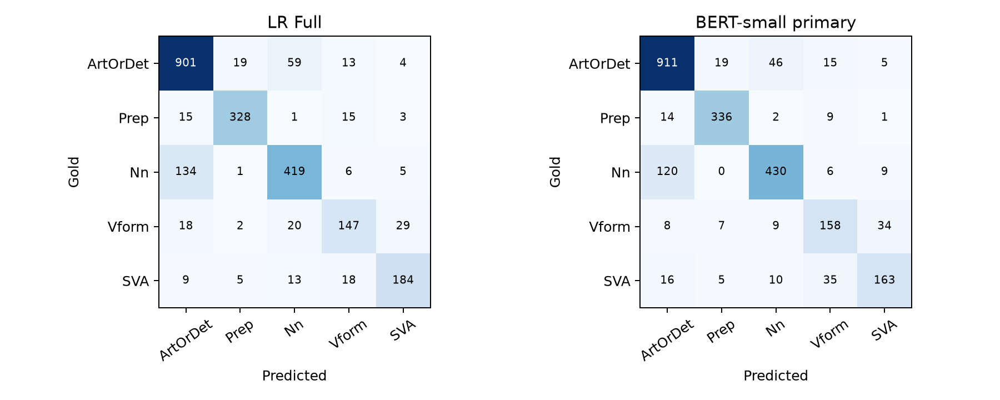
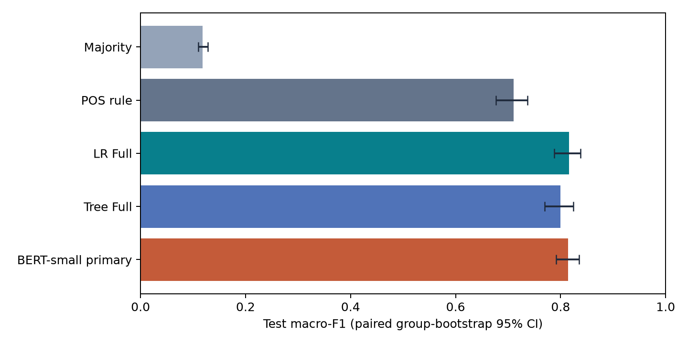
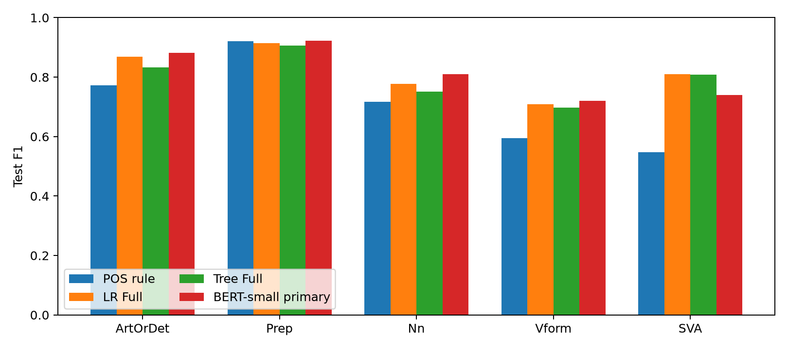
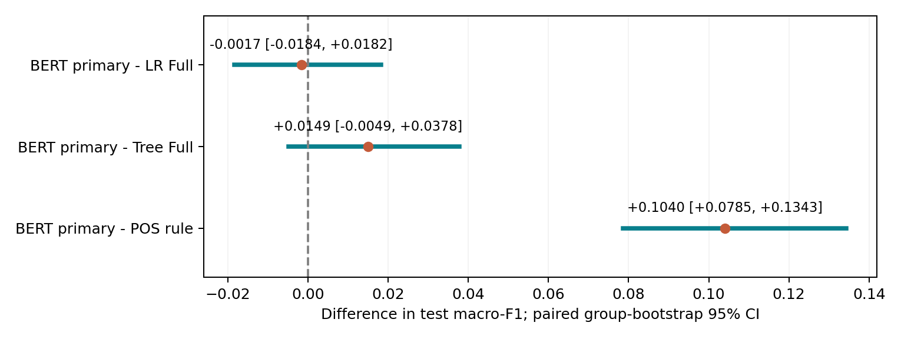

# Công - Full video script and technical walkthrough: evaluation and analysis

Project: **NUCLE-final-20261117**. Language: **English**. **No duration limit.**

## How to use this script

Follow steps 1-14 in order: frozen scoring, metric derivation, observed results, grouped paired uncertainty, case review, reproducibility, Related Work and contribution. Each step contains **On screen / action**, a complete **Spoken script**, and retained code/evidence notes. The former short case-only route has been replaced by a full presentation. Fill personal-contribution placeholders only with supported facts.

Open [README](../README.md), [Final_Report.pdf](../Report/Final_Report.pdf), [main_results.csv](../Results/main_results.csv) and [results.json](../Results/results.json). Original record names are keys inside the bundle json/tables/texts objects. Saved aggregate evidence can be demonstrated without private checkpoint inputs. Read-only JSON/CSV commands run from Final_Submission/; research replay/scoring commands require a prepared Code/ workspace.

## Step 1 - Define the evaluation question and evidence

**On screen / action:** Show the task, project version, README scope and source map; open results.json and main_results.csv in separate panes.

**Spoken script:**

Hello, I am Cong. This presentation explains evaluation and analysis for NUCLE-final-20261117. The task predicts one of five error categories at a supplied location. One row is one annotation; related annotations may share a sentence, essay or connected source-content group.

Evaluation compares a frozen prediction with the original dataset category. The question is agreement under this five-class protocol, not full error detection or correction generation. A disagreement is a classification error for scoring, but it does not by itself establish that the predicted grammatical interpretation is impossible.

I will first trace how frozen predictors are scored, then derive the metrics from actual confusion counts. After reading the headline and class-level results, I will explain why uncertainty is resampled by connected groups and how paired model differences are calculated. A real validation case and the recorded review sets will connect those numbers to error analysis.

The JSON bundle and CSV contain saved evidence. Opening them demonstrates the submitted outputs; it does not execute inference. Source walkthroughs, a saved-output display and a live checkpoint replay support different claims, and I will keep those claims distinct. At the end I will connect the results to Related Work, reproducibility limits and a personally supported contribution.

### Code, evidence and technical notes

Python blocks below quote retained project source, with surrounding context omitted. Render this Markdown to see the embedded saved figures alongside calculations and code. Use the accompanying prompts to interpret them naturally.

The task classifies a supplied error location into ArtOrDet, Prep, Nn, Vform or SVA. The observation is an annotation, not an essay. The predictor receives the original sentence and known span; it does not receive the correction or target label.

Evaluation asks how often a frozen predictor agrees with the original annotation category on held-out content groups. This definition matters: a mismatch is an error against the dataset convention. It does not by itself prove that the predicted grammatical interpretation is impossible. Supplied locations also mean these results do not measure full error detection or correction generation.

### Code map

Paths below are relative to Code/.

| Question | File / functions | What to follow |
| --- | --- | --- |
| How are scores defined? | [src/evaluation/metrics.py](../Code/src/evaluation/metrics.py): scores | Gold-row/prediction-column counts, zero handling, fixed-label mean |
| How are frozen predictors scored? | [src/evaluation/nucle_final_evaluation.py](../Code/src/evaluation/nucle_final_evaluation.py): verify_lock, predict, score_test | Identity checks, feature reconstruction, coordinate remapping, prediction and aligned output |
| How are diagnostic slices defined? | Same file: subset_metrics, matrix_metric | Gold-based filtering, retained outside-pair predictions, selected-class F1 |
| How are intervals calculated? | Same file: bootstrap | Per-group matrices, shared multinomial weights, percentile differences |
| How is BERT compared on the same resamples? | [src/evaluation/bert_final_analysis.py](../Code/src/evaluation/bert_final_analysis.py): group_bootstrap, run | Group/row alignment, historical weights and paired differences |
| How are the forty BERT/LR cases selected? | Same file: balanced_take, choose_audit, create_audit | Outcome quotas, SVA priority, frozen IDs before source review |
| What is the separate classical audit? | [src/evaluation/nucle_final_error_audit.py](../Code/src/evaluation/nucle_final_error_audit.py): choose, run | Different LR/Tree selection, despite a similar case count |
| What does replay verify? | [src/evaluation/nucle_final_evaluation.py](../Code/src/evaluation/nucle_final_evaluation.py): replay | Stored vectors -> saved states -> exact label agreement |

A useful explanation route is `frozen prediction -> aligned gold -> confusion counts -> class scores -> paired group uncertainty -> case review -> bounded conclusion`.

## Step 2 - Trace frozen scoring and output alignment

**On screen / action:** Show verify_lock, score_test, predict, vector equality and scoring guard in nucle_final_evaluation.py; follow the listed operations in order.

**Spoken script:**

Before computing a score, the evaluator verifies which predictor and inputs are being used. verify_lock checks the lock hash and each recorded source, input and state identity. This establishes expected bytes, not scientific correctness or authorship. A marker and existing-output guard reject starting test scoring again in an already scored workspace.

score_test selects test rows from the fixed split and asserts 2,368 samples. It does not fit an encoder on them. The stored full and masked encoders have training IDs checked against train membership. Each distinct sentence is parsed once, features are re-extracted and the Full transformation is compared exactly with the previously stored vector for the same sample ID.

The displayed assertion matters because correct dimension alone would not establish correct coordinates. The predictor remaps selected original feature indices into the local variant indices used in fitting. LR loads saved W and b, computes sparse linear scores and chooses argmax; Tree restores its root and traverses its stored conditions. Alias variants use the appropriate existing predictions.

Predictions are written beside sample ID, gold label, group ID and diagnostic metadata, and encoded rows are stored for later replay. Gold and group fields legitimately enter scoring and resampling after prediction; they are not predictor features. Equal-length label lists are insufficient if their row identities have been shuffled. That is why alignment and provenance are part of metric correctness, not just housekeeping.

### Code, evidence and technical notes

Explain why each check exists, rather than reading the function line by line.

1. **verify_lock:** validate the lock-file hash and every recorded source/input/state hash. A changed encoder or checkpoint can make an old score incomparable even if the filename remains the same. Hashes establish expected byte identity; they do not prove that the scientific method is sound or who wrote the code.
2. **Scoring guard:** reject a workspace already containing test_predictions.csv or test_scoring_started.json. The start marker is written before the expensive operation. This protects the intended frozen evaluation workflow; it is not a mathematical guarantee that nobody has ever seen test results elsewhere.
3. **Select rows by split:** load test samples only and assert 2,368. Fit nothing on these rows. The full/masked encoders' fit-ID sets are checked against train membership.
4. **Reconstruct representation:** parse each distinct sentence once, extract features, transform with the frozen encoder and assert exact agreement with stored test vectors. Reusing a parse reduces repeated work; it does not merge annotations into one observation.
5. **Predict:** build an old-index -> local-index map from the selected keep list. LR uses sparse matrix multiplication plus bias and argmax; Tree restores its root and traverses it. The same coordinate mapping used in fitting must be used at inference.
6. **Align output:** predictions are written alongside sample ID, gold, group and diagnostic metadata. Alias variants reuse the appropriate predictions. The evaluator then computes metrics and saves encoded rows for replay.

A sparse vector coordinate is meaningful only relative to the exact encoder and keep list. Reordering columns without remapping changes the predictor even if every number still looks plausible. That is a useful concrete failure mode to explain while pointing at predict.

Gold and group IDs legitimately enter scoring and resampling after prediction; they must not enter the predictor values. This distinction prevents the mistaken claim that evaluation cannot access labels at all.

**Source excerpt — score_test**, from [nucle_final_evaluation.py](../Code/src/evaluation/nucle_final_evaluation.py):

```python
f=full.transform_one(extract_features(inp,doc));assert {k:v for k,v in f.items() if v}==stored[sid],sid
frows.append(f);mrows.append(mask.transform_one(masked_features(inp,doc)))
```

**What to point at:** re-extracted coordinates must match the stored vector for the same sample ID. The next line builds separate Full/masked rows. Matching only a vector's dimension would be a weaker check. This is source inspection; actual execution also requires the authorised inputs and frozen artifacts.

### Diagnostic slices need a separate explanation

subset_metrics defines all, empty/single-token/multi-token spans, selected label pairs and some POS-conditioned pairs. The present retained samples have nonempty spans; supporting an empty slice in code does not mean the experiment evaluated insertion examples.

For Vform/SVA, rows are filtered by gold membership. Predictions outside the pair stay in the five-by-five matrix and count as missed gold cases. Only the two specified class F1 values are averaged for the pair score. Dropping outside-pair predictions would silently remove errors and inflate performance. A slice metric has a different population/label average from the headline five-class score.

## Step 3 - Derive fixed-label metrics from a real confusion matrix

**On screen / action:** Show confusion_comparison.png, LR_03 counts and matrix_metric; highlight gold Nn row, predicted Nn column and diagonal 419.

**Spoken script:**

The confusion matrix uses gold labels as rows and predictions as columns. For a class, its diagonal is true positives, the row sum is gold support and the column sum is the number predicted in that class. False positives and false negatives follow by subtracting the diagonal from those sums.

For LR's Nn class, true positives are 419, gold support is 565 and predicted count is 512. That gives 93 false positives and 146 false negatives. Precision is 419 divided by 512, about 0.8184, and recall is 419 divided by 565, about 0.7416. F1 is twice true positives divided by support plus predicted count: 838 divided by 1,077, or about 0.7781.

matrix_metric implements that same calculation using row sums, column sums and the diagonal. It supports one matrix or a stack of bootstrap matrices. Undefined denominators receive zero. Macro-F1 averages the five fixed class F1 values; it is not the F1 of averaged precision and recall. Accuracy instead divides all correct predictions by all rows.

The fixed label set keeps Majority's four unpredicted classes in the average. For diagnostic label pairs, rows are filtered by gold membership, but predictions outside the pair remain errors in the matrix. Dropping those predictions would inflate a slice score. Such slices also have a different label average and population from the headline five-class metric. These definitions make the following comparison interpretable.

### Code, evidence and technical notes

Start with `json -> Results/evidence/test_confusions.json -> matrices -> LR_03`. Label both axes explicitly: rows are gold, columns are predictions; order is ArtOrDet, Prep, Nn, Vform, SVA.



**Existing project figure.** Use the left matrix for the Nn calculation below: gold-row sum 565, predicted-column sum 512, diagonal 419. Keep both axis labels visible. The cells contain counts, not row-normalized percentages.

For class k, the diagonal is TP, the column sum is all predicted k, and the row sum is all gold k. Therefore FP = column sum - TP and FN = row sum - TP. This gives:

`precision_k = TP / (TP + FP)`

`recall_k = TP / (TP + FN)`

`F1_k = 2 TP / (2 TP + FP + FN) = 2 TP / (row_sum + column_sum)`

The second form explains the vectorized implementation in matrix_metric. It is the same metric, not a shortcut that changes the definition.

**Source excerpt — matrix_metric**, from [nucle_final_evaluation.py](../Code/src/evaluation/nucle_final_evaluation.py):

```python
def matrix_metric(c, label_indices=None):
    c=np.asarray(c); idx=np.arange(5) if label_indices is None else np.asarray(label_indices)
    support=c.sum(-1); predicted=c.sum(-2); tp=np.diagonal(c,axis1=-2,axis2=-1)
    den=support+predicted; f1=np.divide(2*tp,den,out=np.zeros_like(tp,dtype=float),where=den!=0)
    return f1[...,idx].mean(-1)
```

**What to point at:** sum(-1) gives gold-row support; sum(-2) gives predicted-column support. The diagonal supplies TP, divide calculates 2TP/(support+predicted), and idx selects class scores to average. A leading axis can hold 1,000 bootstrap matrices. Apply these operations to the actual Nn row/column below.

### Worked project example: LR Nn

| Quantity | Observed value | Meaning |
| --- | --- | --- |
| TP | 419 | Gold Nn, predicted Nn |
| Gold support | 565 | Nn row sum |
| Predicted Nn | 512 | Nn column sum |
| FP | 93 | 512 - 419 |
| FN | 146 | 565 - 419 |

Precision = 419/512 = 0.818359375. Recall = 419/565, about 0.741593. F1 = 838/1077 = 0.778087279. Nn recall is lower than precision: more of its gold cases are missed than its predictions are false, relative to the relevant denominators. That is a descriptive error pattern; the matrix does not identify its linguistic cause.

Macro-F1 is `(F1_ArtOrDet + F1_Prep + F1_Nn + F1_Vform + F1_SVA) / 5`. It is not the harmonic mean of macro precision and macro recall. Accuracy is the diagonal total divided by all rows. In this single-label task, micro-F1 would equal accuracy; Macro-F1 gives each class equal influence instead.

### Read scores as an implementation contract

scores rejects empty or unequal-length input sequences and unknown labels. It allocates a fixed five-by-five matrix, increments one cell per aligned observation, computes class precision/recall with zero for undefined denominators, then averages all five class F1 values. Majority's unpredicted classes remain in that average; they are not removed to make the score larger.

The length check cannot detect a shuffled prediction list of the same length. Correct sample-ID alignment must be established upstream. This is why provenance and joins are part of evaluation correctness, not just file management.

## Step 4 - Read the headline and class-level results

**On screen / action:** Show the saved headline CSV/benchmark figure and per_class_f1.png; use the class-difference table and both-correct/only-correct totals.

**Spoken script:**

The five headline test Macro-F1 values are about 0.1184 for Majority, 0.7106 for POS, 0.8163 for LR Full, 0.7996 for Tree Full and 0.8146 for primary compact BERT. The chart refers to 2,368 test annotations in 97 connected groups. Its whiskers are saved group-bootstrap intervals, not variation across training seeds.

An apparent contradiction appears when we read accuracy. BERT gets 1,998 predictions correct, compared with LR's 1,979, so BERT accuracy is higher, 0.84375 versus about 0.83573. Yet its Macro-F1 is slightly lower. The class table explains this because every class receives one fifth of Macro-F1 regardless of frequency.

BERT's Nn F1 rises from about 0.7781 to 0.8098, but SVA falls from about 0.8106 to 0.7392. The SVA decline outweighs the gains across the other classes in the sum of class-F1 differences. This is an arithmetic explanation of the aggregate tradeoff, not a causal explanation of the SVA behavior.

The joint outcomes are 1,860 correct for both, 138 correct only for BERT, 119 correct only for LR and 251 wrong for both. Those totals recover each model's correct count and remind us that the comparison is paired on the same observations. Directional confusion cells tell us which cases to inspect; they cannot establish one grammatical cause. To quantify uncertainty, we must also respect the dependence between related annotations.

### Code, evidence and technical notes

The saved test set has 2,368 annotations in 97 connected groups. The five headline Macro-F1 values are Majority 0.1184, POS 0.7106, LR Full 0.8163, Tree Full 0.7996 and primary BERT-small 0.8146. Keep the primary checkpoint distinct from the three-seed mean.

### Saved headline comparison



| Saved system | Validation Macro-F1 | Test Macro-F1 | Test accuracy |
| --- | --- | --- | --- |
| Majority | 0.118430 | 0.118430 | 0.420608 |
| POS rule | 0.704815 | 0.710590 | 0.744088 |
| LR Full | 0.806683 | 0.816258 | 0.835726 |
| Tree Full | 0.787871 | 0.799649 | 0.809544 |
| BERT-small primary | 0.817262 | 0.814595 | 0.843750 |

Source: Results/main_results.csv, rounded for display. Whiskers are the saved grouped intervals for fixed predictors, not training-seed SD. Use paired-difference intervals for comparisons rather than judging overlap between these whiskers.

Primary BERT gets 1,998 predictions correct, accuracy 0.84375. LR gets 1,979 correct, accuracy about 0.83573. Yet BERT has slightly lower Macro-F1. Show [per_class_f1.png](../Results/figures/per_class_f1.png) and `tables -> Results/bert/per_class_metrics.csv` to resolve this apparent contradiction.

| Class | LR Full F1 | Primary BERT F1 | BERT - LR, approximately |
| --- | --- | --- | --- |
| ArtOrDet | 0.869272 | 0.882324 | +0.013053 |
| Prep | 0.914923 | 0.921811 | +0.006887 |
| Nn | 0.778087 | 0.809793 | +0.031706 |
| Vform | 0.708434 | 0.719818 | +0.011384 |
| SVA | 0.810573 | 0.739229 | -0.071344 |



**Existing project figure.** Read each class cluster using the legend: BERT gains over LR on Nn but falls on SVA. Every class contributes one fifth of Macro-F1, regardless of gold support. Use the table when differences are too small to distinguish from bar height.

The exact Macro-F1 difference equals one fifth of the sum of the five class differences. The SVA decline outweighs the other gains on this metric. Accuracy instead counts each annotation equally, so improving a more frequent class can offset many fewer correct predictions in another class. This is an arithmetic explanation, not a causal account of why BERT loses SVA.

The joint prediction outcomes are both correct 1,860; BERT only correct 138; LR only correct 119; both wrong 251. These add to 2,368; 1,860+138 and 1,860+119 recover the respective correct totals. These are correlated outcomes on the same observations, not two unrelated accuracy samples.

Use [confusion_comparison.png](../Results/figures/confusion_comparison.png) to inspect directions. LR has 134 Nn -> ArtOrDet errors and 59 reverse errors; Vform -> SVA is 29 and SVA -> Vform is 18. A large cell suggests cases to review. It does not establish that every cell contains the same grammatical phenomenon.

Read-only headline view from **Final_Submission/**:

```powershell
Import-Csv ./Results/main_results.csv | Format-Table model, test_macro_f1, accuracy -AutoSize
```

## Step 5 - Choose the connected group as the resampling unit

**On screen / action:** Show the grouped split summary, conceptual three-group multiplicity table and actual 97-group bootstrap metadata.

**Spoken script:**

Annotations can share sentence context, essays or repeated source content. Independent row resampling would ignore that structure. The bootstrap therefore samples connected source-content groups, the same kind of component used to protect the split. A group can contain more than one essay.

The actual test set has 97 groups. A replicate draws 97 group identities with replacement and carries every annotation in a selected group together, repeating them according to the group's multiplicity. Group draws remain fixed, while annotation count can vary because groups have unequal sizes.

The small table explains the mechanism. Suppose A has two annotations, B one and C three. Multiplicities two, zero and one give seven resampled annotations; zero, two and one give five. These are authored arithmetic examples, not executed bootstrap measurements or a confidence interval.

Both models must receive the same multiplicities in each replicate. Otherwise their difference would lose the same-content pairing. Grouping addresses the dependencies represented in this source-content design; it cannot discover every semantic relationship. The next code block implements this mechanism efficiently using group confusion counts rather than copying text rows.

### Code, evidence and technical notes

Multiple annotations can share a sentence, essay or connected source-content component. They are dependent. Treating every annotation as an independent resampling unit can misrepresent uncertainty. The split and bootstrap therefore use connected groups, which can contain more than one essay.

The experiment has 97 test groups. Each bootstrap replicate draws 97 group identities with replacement and includes every annotation in each selected group, repeated according to that group's multiplicity. A group can be omitted or selected several times. The number of group draws stays fixed; the number of annotation rows can vary.

### Conceptual example, not a new experimental result

Let A contain two annotations, B one and C three.

| Multiplicities for (A,B,C) | Group draws | Resampled annotations |
| --- | --- | --- |
| (2,0,1) | 3 | 2×2 + 0×1 + 1×3 = 7 |
| (0,2,1) | 3 | 0×2 + 2×1 + 1×3 = 5 |
| (1,1,1) | 3 | 2+1+3 = 6 |

These three rows only explain the mechanism; they do not estimate a confidence interval. Present the actual recorded 1,000-replicate procedure separately. Group resampling addresses dependence represented by the grouping design; it cannot discover every unrecorded semantic relationship or guarantee external generalization.

## Step 6 - Explain the vectorized bootstrap line by line

**On screen / action:** Show sorted groups, seeded multinomial weights, per-group matrices and matrix_metric; annotate shapes 1000 x 97 and 97 x 5 x 5.

**Spoken script:**

The bootstrap uses 1,000 replicates with saved seed 20261023. Sorting the 97 groups defines a stable index. The multinomial call produces a weight matrix W with shape 1,000 by 97. Each row sums to 97, and each entry says how many times one group is drawn in that replicate.

For a model, cms has shape 97 by five by five. Every annotation increments one cell for its group, gold class and predicted class. Flattening the class axes gives 97 by 25. Multiplying W by that matrix and reshaping produces 1,000 five-by-five confusion matrices, one per replicate.

matrix_metric then recomputes each replicate's fixed-label Macro-F1 from the aggregated counts. We do not average the F1 of sampled groups: F1 is nonlinear, so that would evaluate a different quantity. A single overall confusion matrix can recover the point score but cannot recover the lost allocation of counts to groups, which is necessary for this bootstrap.

The main metric keeps all five labels, even when a class is absent in a replicate, using zero where a denominator is undefined. Missing-class replicates are recorded rather than automatically discarded. Diagnostic slices have original-support eligibility checks: at least twenty rows, ten groups and required class presence. Their CIs additionally need at least 950 valid replicates. That is a completeness threshold, not the meaning of 95 percent confidence. Saving W also allows the BERT analysis to reuse the identical group draws.

### Code, evidence and technical notes

In nucle_final_evaluation.bootstrap, groups are sorted to define a stable group-index map. The generator uses the saved seed 20261023. A multinomial draw is an efficient representation of repeated group sampling:

`W = rng.multinomial(G, [1/G, ..., 1/G], size=B)`

Here B=1,000 and G=97. W has shape `(1000,97)`; every row sums to 97. Entry W[b,g] is how many times group g appears in replicate b.

**Source excerpt — group weights inside bootstrap**, from [nucle_final_evaluation.py](../Code/src/evaluation/nucle_final_evaluation.py):

```python
groups=sorted({r['group_id'] for r in metadata});gindex={g:i for i,g in enumerate(groups)};rng=np.random.default_rng(lock['bootstrap_seed'])
weights=rng.multinomial(len(groups),np.ones(len(groups))/len(groups),size=lock['bootstrap_replicates'])
np.save(OUT/'bootstrap_group_weights.npy',weights)
```

**Read the variable names:** weights is W; lock supplies the recorded seed and replicate count. Saving the weights allows the BERT comparison to reuse exact draws. The sorted group order determines which weight column belongs to which group.

For each model, the code constructs C with shape `(97,5,5)`. C[g,i,j] counts gold i / prediction j in group g. Flatten the two class axes to 25 cells, multiply, then restore them:

`boot = (W @ C.reshape(97,25)).reshape(1000,5,5)`

**Source excerpt — count aggregation in the same bootstrap function:**

```python
cms=np.zeros((len(groups),5,5),dtype=np.int64)
for i in ids:cms[gindex[metadata[i]['group_id']],LABELS.index(metadata[i]['error_type']),LABELS.index(pred[model][i])]+=1
boot=(weights@cms.reshape(len(groups),25)).reshape(-1,5,5);valid=boot.sum((1,2))>0
dist=matrix_metric(boot,li);distributions[(name,model)]=(dist,valid)
```

**What to point at:** each annotation increments one group/gold/prediction cell. Matrix multiplication aggregates counts under the resampled multiplicities; matrix_metric then recomputes F1. This is why averaging per-group F1 would be a different procedure. Relate each axis to the shapes above.

This expression sums the selected group confusion counts for all replicates without physically duplicating text or prediction rows. It does not average scores. matrix_metric computes each replicate's class F1 from its aggregated row sums, column sums and diagonal, then takes the fixed-label mean.

### Why averaging group F1 would be wrong

F1 is a ratio. In general, `F1(C_A + C_B)` differs from `(F1(C_A)+F1(C_B))/2`. Averaging group F1 would give each group an equal score contribution regardless of its confusion counts and evaluate a different estimand. The actual procedure resamples groups but evaluates annotation-level Macro-F1 on the combined resample.

matrix_metric accepts either one matrix or a stack; summing the last two axes and taking the diagonal preserves the leading replicate axis. Its divide operation sets zero where the class denominator is zero. The main score keeps all five labels even if a resample lacks a class. Missing-class replicates are recorded, not automatically discarded.

For diagnostic slices, bootstrap first checks sufficient original support: at least 20 rows, 10 groups and gold presence for each selected class. A replicate is valid when it contains some slice rows. At least 950 valid replicates are required to publish its CI. That threshold is a completeness rule, not the definition of 95% confidence.

A single overall five-by-five confusion matrix cannot reproduce this procedure: it has lost the allocation of counts to groups. Aggregate counts reproduce point scores; group-specific counts or aligned private predictions are needed for grouped uncertainty.

## Step 7 - Calculate and interpret paired percentile differences

**On screen / action:** Show shared historical weights, the da-db quantile expression, contrast table and paired_differences_focus.png zero line.

**Spoken script:**

For each replicate, both predictors are scored on the same resampled groups. We subtract their replicate Macro-F1 values first and then take the 2.5th and 97.5th percentiles of those differences. The observed point difference is calculated separately from the saved test metrics. We do not subtract separate CI endpoints or use a normal mean-plus-or-minus formula.

Pairing retains the covariance caused by evaluating the models on the same content. The variance of a difference equals the two variances minus twice their covariance. Independent resampling would answer a different question; pairing is not a universal guarantee of a narrower interval. The BERT analysis checks group/row correspondence and reuses the saved classical weights.

LR minus POS is about 0.1057 with interval [0.0829,0.1288]. LR minus Tree is about 0.0166 with interval [0.0018,0.0301]. Those paired intervals remain positive under this saved procedure. Primary BERT minus LR is about -0.0017 with interval [-0.0184,0.0182], which spans zero.

The plotted contrasts all put BERT first, so their signs must not be confused with the LR-based table rows. The BERT/LR interval does not establish superiority in either direction or formal equivalence. Equivalence needs a prespecified acceptable margin and appropriate analysis. These intervals are pointwise, without familywise multiplicity correction. They describe resampled observed test groups for fixed predictors, not all uncertainty from training, new corpora or annotation conventions.

### Code, evidence and technical notes

Both predictors must use the same row identities, gold labels, group order and W. In bert_final_analysis.group_bootstrap, group sets, weight shape and prediction lengths are checked. The analysis loads the historical classical resampling weights and checks them against the expected seeded draws, so BERT/LR comparisons share the same replicates.

For each replicate b, compute `d_b = F1_BERT,b - F1_LR,b`. The saved percentile CI is the 2.5th and 97.5th percentiles of these differences. It is not a normal approximation of mean plus/minus 1.96 standard deviations, and it is not obtained by subtracting the endpoints of separate model CIs.

**Source expression — paired interval in bootstrap**, from the same file:

```python
np.quantile((da-db)[valid],[.025,.975]).tolist() if sum(valid)>=950 else None
```

**What to point at:** subtract paired distributions before taking quantiles. The valid mask requires both members of the pair to have a usable replicate. The observed point difference is computed separately from saved metrics; it is not the bootstrap mean. This expression relies on the surrounding function variables.

Pairing retains the covariance from evaluating both models on the same content. The identity `Var(A-B) = Var(A)+Var(B)-2 Cov(A,B)` explains why independently resampling the models answers a different uncertainty question. Do not claim pairing must always make an interval narrower; the covariance matters.

| Contrast, first minus second | Point difference | Saved 95% paired interval, rounded |
| --- | --- | --- |
| LR Full - POS | +0.105668 | [0.082916, 0.128835] |
| LR Full - Tree Full | +0.016609 | [0.001793, 0.030061] |
| Primary BERT - LR Full | -0.001663 | [-0.018410, 0.018153] |

Use [paired_differences_focus.png](../Results/figures/paired_differences_focus.png) to show the zero line. Identify the subtraction direction before interpreting a sign. The first two intervals support a positive difference under this procedure. The BERT/LR interval spans zero; it does not establish BERT superiority, LR superiority or formal equivalence. Equivalence requires a prespecified practically acceptable margin and a suitable analysis, which was not performed.



**Existing project figure.** Every plotted contrast has BERT first. The first row crosses zero for BERT-LR; the bottom remains positive for BERT-POS. BERT-Tree/BERT-POS in this figure are different contrasts from LR-Tree/LR-POS in the preceding table. Keep the subtraction direction visible.

These are pointwise intervals. Many contrasts were inspected; no familywise multiplicity correction is claimed. A confidence interval is not a statement that a fixed true difference has a 95% probability of lying inside this particular observed interval. Present it as uncertainty from the stated repeated-sampling approximation and its assumptions.

The procedure resamples observed test groups, conditional on the fitted predictors. It does not integrate all uncertainty from training seeds, split selection, a new corpus, parsing decisions or disputed annotation conventions.

## Step 8 - Separate seed variation, primary checkpoints and ensembles

**On screen / action:** Show the selected BERT configuration, the three seed rows, primary flag and seed mean/sample SD.

**Spoken script:**

The three BERT seeds address a different source of variation from the test-group bootstrap. The selected configuration is chosen by mean best-checkpoint validation Macro-F1 over the three declared seeds. The first seed, 20261013, remains the primary; the best test seed is not substituted afterward.

Primary test Macro-F1 is about 0.814595. The three-seed test mean is about 0.818173 with sample standard deviation about 0.003829. That SD uses the sample denominator n minus one. It summarizes these three fitted runs, while the grouped interval resamples content for a fixed fitted predictor. One cannot replace the other.

Averaging scores is also not ensembling. An ensemble would combine predictions or probabilities and then score the resulting predictor. No such combined predictor is implied by the reported seed mean. Three seeds provide limited evidence about all possible training variability.

The contextual extension followed classical test findings and reused the holdout. Its own configuration rule used validation, but that history still limits claims of a completely untouched confirmatory comparison. A new external evaluation would support a stronger claim and was not performed here. The same care is needed when reading the ablation contrasts.

### Code, evidence and technical notes

The selected BERT configuration was chosen by mean best-checkpoint validation Macro-F1 over three fixed seeds. The primary seed remains 20261013; it was not replaced by the seed with the best test score.

The primary test Macro-F1 is about 0.814595. The three-seed test mean is about 0.818173 with sample SD about 0.003829. A mean of independently evaluated run scores is not an ensemble prediction. An ensemble would combine outputs and then evaluate the combined predictor; that was not done here.

The sample SD uses three run scores and denominator n-1. It describes variation among these three fits. The group-bootstrap CI describes resampled test-content uncertainty for a fixed fit. Neither is interchangeable with the other, and three seeds are limited evidence about all possible training variation.

The extension reused the holdout after classical test findings were available. Its own configuration selection used validation, but this history still limits claims of a completely untouched, independently confirmatory comparison. A genuinely new external test would answer a stronger question and was not run.

## Step 9 - Compare ablations without overstating causality

**On screen / action:** Show the full classical tables, variant IDs/aliases and paired ablation differences, including zero-crossing M/D intervals.

**Spoken script:**

The ablation table compares defined pipelines. For LR, Full minus target lexical masking is about 0.0134 with interval [0.0049,0.0201]. Full minus removing all L is about 0.0281 with interval [0.0142,0.0394]. These are different interventions: masking retains context and the original parse, while removing L removes the entire lexical family.

Full minus explicit P is about 0.0181 with a positive interval. The M-removal difference is about 0.0040 and the D-removal difference about 0.0060; both intervals cross zero. That does not establish that morphology or dependencies contain no useful information. Related signals remain in other families, and each pipeline involves fitting and selection.

Target masking can change the train-fitted vocabulary and learned weights rather than only changing a test string. The parser also originally saw the target words. These facts prevent a pure causal statement that the score gap measures one isolated linguistic ability.

Tree's masked point score is slightly above Full, with an interval containing zero, so the LR trend is not universal. Full minus D aliases S+L+P+M. Twenty named classical pipelines include only sixteen distinct LR/Tree states; duplicate names are not independent confirmations. Having interpreted the aggregate comparisons, I will now show what a real individual disagreement looks like.

### Code, evidence and technical notes

Use the complete classical tables in the bundle, not just the five-row headline CSV. Identify both variant IDs and whether configurations were separately validation-selected.

| LR Full minus variant | Point difference, approximately | Saved 95% CI, rounded |
| --- | --- | --- |
| Target lexical masking | 0.013423 | [0.004901, 0.020108] |
| Remove all L | 0.028129 | [0.014188, 0.039407] |
| Remove P | 0.018082 | [0.006950, 0.029620] |
| Remove M | 0.003980 | [-0.006562, 0.013566] |
| Remove D | 0.006019 | [-0.005397, 0.019113] |

Target masking removes target lexical candidates while retaining lexical context and the original parser analysis. Removing all L removes the lexical family. These interventions answer different questions. They involve train-fitted encoders and retrained/tuned predictors, rather than zeroing a column at test time.

POS, morphology and dependency families overlap in information: dependency attributes can include POS/morphological signals, and the fixed parser still saw the original words. An ablation difference is therefore not an isolated causal contribution of one linguistic ability. A CI crossing zero does not prove a family contains no information.

Tree's masked point score is slightly above Full and its interval includes zero, so the LR trend is not universal. Full minus D aliases S+L+P+M; duplicate pipeline names are not independent confirmations. The twenty named classical pipelines correspond to sixteen distinct fitted states. Keep those counts separate when describing evidence strength.

## Step 10 - Demonstrate real validation case 19068 from representation to error

**On screen / action:** Open the exact bundle key or run its read-only view from Final_Submission/. Follow the case table; highlight partition, span, features, predictions and gold.

**Spoken script:**

This saved record is validation annotation 19068, identified by its source checksum. Its exact interval is [10,18), eight characters, covering two tokens. The visible parser features include AUX+VERB, an aux+ROOT dependency signature, singular-number information and aggregated finite/participle verb-form values.

The complete original input is encoded under the frozen representation. The saved LR and Tree outputs are both Vform, while the original label is SVA. In a confusion matrix for these validation predictions, the outcome belongs to gold row SVA and predicted column Vform. It is an off-diagonal error under the fixed label convention.

This case is not a member of the test matrix used for the earlier Nn calculation. Its partition field explicitly says validation. Opening the JSON demonstrates a real recorded input/representation/output trace; the public subset cannot reproduce the private lexical input, hidden scores or branch route.

The multi-token auxiliary/verb pattern suggests asking whether the source edit combines agreement and verb form. Answering needs the original correction and neighboring annotations. The record verifies a mismatch, not that gold is wrong or that one feature caused the prediction. We keep gold unchanged and separate observed facts, linguistic interpretation and causal attribution. That is the reason for the more structured audit design shown next.

### Code, evidence and technical notes

Open `json -> Results/evidence/real_example_19068.json`. Follow `annotation ID -> span -> linguistic feature subset -> gold/prediction -> review question`.

| Publicly recorded fact | What it permits you to explain |
| --- | --- |
| Validation annotation 19068; exact [10,18) | Eight-character span with valid sentence-relative reconstruction |
| Two covering tokens | This is a multi-token, not single-token, target |
| aux + ROOT dependency signature; singular-number information | The visible parser-derived representation contains these signals |
| Gold SVA; saved LR/Tree prediction Vform | Both predictors disagree with the dataset category |
| No full sentence/correction/lexical vector in this record | Public metadata alone cannot reproduce inference or adjudicate the correction |

The auxiliary-plus-root pattern suggests a useful review question: might the source correction involve both agreement and verb-form changes? Answering requires the original correction and neighbouring annotations. It is a hypothesis to investigate, not a conclusion established by these fields.

Distinguish three levels: the observed mismatch, a source-supported linguistic interpretation, and a causal explanation of the model's decision. Even a plausible interpretation does not prove that a specific dependency feature caused the prediction. No counterfactual attribution experiment was performed. Gold remains unchanged for reported scoring.

Your assigned validation IDs are 1269, 18774, 19065, 19068, 19069 and 19185 under `json -> Results/evidence/audit_summary.json -> validation -> member_ids -> Cong`. The aggregate team review record documents group decisions; do not attribute a detailed comment about this case to that record if it is not actually present there.

### Real-case flow to display

| Stage | Actual evidence | Interpretation |
| --- | --- | --- |
| Source identity | annotation_id=19068; source checksum; validation | Same case throughout this trace |
| Prepared input | exact [10,18); 8 characters | Sentence-relative target location |
| Representation | 2 covering tokens; AUX+VERB; aux+ROOT | Linguistic features describe a multi-token target |
| Additional signals | Number=Sing; VerbForm=Fin+Part | Aggregated parser attributes, not a correction |
| Saved predictors | LR_03=Vform; Tree_03=Vform | Recorded outputs from fitted systems |
| Reference | gold=SVA | Both disagree with the dataset label |
| Metric placement | gold row SVA; prediction column Vform | An off-diagonal classification outcome |

Read-only case view from **Final_Submission/**:

```powershell
$bundle = Get-Content -Raw -Encoding UTF8 ./Results/results.json | ConvertFrom-Json
$bundle.json.'Results/evidence/real_example_19068.json' | ConvertTo-Json -Depth 6
```

Case 19068 is a validation case. It must not be counted as a member of the separate test confusion matrix.

## Step 11 - Explain validation/test audit selection and overlap

**On screen / action:** Show audit_summary.json, choose_audit/create_audit and the separate classical selector; annotate 18, 40, 22 and overlap 8.

**Spoken script:**

The eighteen validation reviews were purposefully selected from 364 LR errors: three sorted IDs in each of four main confusion directions, plus six multi-token cases. That covers about 4.95 percent of those errors, but it is not a random estimate of error prevalence.

The forty BERT/LR test cases use a different selector. It takes twelve BERT-wrong/LR-correct cases, with six prioritized gold-SVA cases in that stratum, twelve reverse outcomes, ten both wrong and six both-correct controls. balanced_take cycles gold/prediction buckets using seed 20261028. IDs are fixed before source sentences and corrections are looked up, and the source hash, gold and span are checked during packet construction.

Correct-for-both controls are useful because agreement with a label does not establish that the correction is necessary or unique. Automatic insert/delete/replace summaries describe an alignment, not a grammatical adjudication. Missing correction and empty replacement must remain distinct.

The separate classical audit module also creates a forty-case packet, but uses twenty-five LR errors, five LR-correct/Tree-wrong cases and ten LR-correct controls. Its matching total does not make it the BERT/LR selector.

The twenty-two consolidated decisions have nine supported, six reconsider, three boundary, three optional and one multi-operation status. Eight overlap the forty-case set, giving an extended union of fifty-four distinct annotations. The eighteen validation cases remain a separate set. Reconsider is not a confirmed gold error, and the team approval record is not independent expert adjudication. No post-prediction gold change is used to improve the reported score.

### Code, evidence and technical notes

The eighteen validation cases were purposefully chosen from 364 LR errors: three sorted IDs in each of four principal confusion directions, plus six multi-token cases. Eighteen is about 4.95% of those errors, but this is coverage-oriented selection, not a random prevalence estimate.

The required forty BERT/LR test cases use bert_final_analysis.choose_audit:

- Twelve BERT-wrong/LR-correct, with six prioritized gold SVA cases and six additional cases.
- Twelve BERT-correct/LR-wrong.
- Ten both wrong.
- Six both correct controls.

balanced_take cycles gold/BERT/LR buckets with seeded within-bucket ordering, using seed 20261028. The IDs are fixed before looking up learner sentences and source corrections. This makes the selection traceable and reduces the opportunity to choose only persuasive correction stories. It does not turn quota sampling into a random sample of all test errors.

create_audit joins those IDs to source annotations, checks source hash, gold and span identity, then prepares review material. It records edit-operation summaries from casefolded whitespace-token sequences. An automatic insert/delete/replace description is an alignment summary, not a grammatical adjudication. Missing correction and an empty replacement must remain distinct.

### Do not confuse two forty-case code paths

nucle_final_error_audit.choose is a separate classical packet: 25 LR errors across gold/prediction buckets, five LR-correct/Tree-wrong cases and ten LR-correct controls. Its seed and strata differ. A similar total count does not make it the BERT/LR forty-case audit. Point to the relevant selector for the claim being made.

The 22 consolidated decisions contain nine supported, six reconsider, three boundary, three optional and one multi-operation status. Eight overlap the forty-case set, so the extended union has `40 + 22 - 8 = 54` distinct annotations. The eighteen validation cases form a separate set. Reconsider means further review is justified; it does not mean a gold error has been conclusively established.

Correct-for-both controls matter because label agreement does not certify that a correction is unique or necessary. The 1 November approval records team interpretation and follow-up; it is not independent expert adjudication. Neither purposeful quotas nor team agreement supports a population percentage of annotation mistakes. No post-prediction gold changes were made.

## Step 12 - Explain what was reproduced and what replay actually checks

**On screen / action:** Show AI_Log isolated execution, archival lock records and replay code; label any run as saved evidence unless actually executed.

**Spoken script:**

Reproducibility has several levels. Confusion counts can reproduce point scores. Grouped CIs need aligned predictions and group allocation. Frozen replay needs matching states, encoders or coordinates, encoded rows and a valid lock. Feature regeneration and retraining require the authorized source, human-review inputs and actual completed execution. None of these alone establishes external generalization.

The recorded assistant-executed isolated check completed thirteen classical stages, produced sixteen byte-identical checkpoints and matched all twenty named pipelines' 2,368 test labels. That is 47,360 label comparisons, not 47,360 independent observations. Thirty paired CI rows also matched. These checks are attributed to the assistant rather than to my own personal execution history.

The fresh workspace created its own matching lock. The older archival record still has 69 matches out of 74 entries, four missing older reporting sources and a changed validation CSV. A test-CSV representation difference is documented separately. Byte identity, prediction identity and metric agreement are different claims; old hashes were not rewritten merely to manufacture a pass.

The BERT verification was a one-epoch runtime smoke run plus validation inference from the three existing selected checkpoints, reproducing all 2,368 validation labels per seed. It did not retrain the full twelve-run grid or open a new BERT test comparison.

After the canonical-name cleanup, the assistant also reran the single preparation policy through feature extraction from the authorized source. Existing fitted states were restored for a fresh lock, scoring, bootstrap and replay. All test predictions, metrics and bootstrap outputs matched the previously verified final run. This verifies the naming/preparation change without claiming another checkpoint-training grid; the historical records retain their original identifiers.

The replay function checks the lock and row order, predicts from stored vectors and saved states, and asserts zero disagreements before printing its success message. It does not reparse raw text, refit the encoder, retrain models or regenerate CIs. Showing its source explains the mechanism; calling a demonstration live requires actually running it with those prerequisites.

### Code, evidence and technical notes

A useful discussion separates claims that require different evidence:

| Claim | Necessary evidence / scope |
| --- | --- |
| Recalculate a reported point score | Correct confusion counts and fixed metric definition |
| Recompute grouped CIs | Aligned predictions plus group allocation and identical resampling procedure |
| Replay a frozen predictor | Matching checkpoint, encoder/coordinates, encoded rows and valid lock |
| Regenerate features | Authorised raw input, exact preparation/split/parser/encoder and versions |
| Retrain the experiment | Training source/configuration/inputs/environment and actual completed runs |
| Generalize externally | A new suitable evaluation dataset; replay cannot supply this |

The later assistant-executed isolated check completed all thirteen classical stages. It produced sixteen byte-identical checkpoints; all twenty named pipelines' 2,368 test labels matched, 47,360 comparisons in total. All thirty compared paired CI rows matched. These are strong reproduction checks, but 47,360 comparisons are not 47,360 independent observations: the same 2,368 annotations in 97 groups are evaluated repeatedly, and some names alias states.

The fresh execution created its own matching lock. The historical archival check still reports 69 matches out of 74 entries, four missing old reporting sources and a changed validation CSV; a test-CSV representation difference is also documented. Label agreement, metric agreement and byte identity are different claims. Line endings or column formatting can alter a CSV hash without changing its semantic predictions. Do not rewrite old hashes merely to make a check pass.

The BERT check comprised a separate one-epoch smoke run and read-only validation inference from three existing selected checkpoints, reproducing all 2,368 validation labels per seed. It did not retrain the full twelve-run BERT grid or open a new BERT test comparison. Attribute these completed checks to the assistant, as recorded in [AI_Use_Log](../AI_Log/AI_Use_Log.md); they do not establish a student's personal execution history.

### What the existing replay command actually does

From a prepared Code/ workspace with matching private states, stored encoded rows, predictions and source/input lock:

```powershell
.venv/Scripts/python.exe -m src.evaluation.nucle_final_evaluation replay
```

replay verifies the lock, loads saved encoded rows, checks their ID order, obtains predictions from saved states and asserts zero label disagreements. A successful run prints CHECKPOINT REPLAY EXACT. It does not refit the encoder, reparse source text, retrain models or regenerate bootstrap intervals.

**Source excerpt — replay**, from [nucle_final_evaluation.py](../Code/src/evaluation/nucle_final_evaluation.py):

```python
def replay():
    lock=verify_lock();metadata,pred=load_predictions(); encoded=torch.load(OUT/'test_encoded.pt',weights_only=True)
    assert encoded['ids']==[r['sample_id'] for r in metadata];torch.set_num_threads(lock['threads'])
    checks={}
    for e in lock['selected']:
        got=predict(e,encoded['masked'] if e['variant']==MASK else encoded['full']);checks[e['id']]=sum(a!=b for a,b in zip(got,pred[e['id']]))
    assert not any(checks.values());dump(OUT/'checkpoint_replay.json',{'at':now(),'disagreements':checks});print('CHECKPOINT REPLAY EXACT')
```

**Read the asserted result:** row IDs must match, every selected state's labels are compared with stored predictions, and success is printed only after zero disagreements. A code view explains the check; a live replay also needs the stated inputs. Attribute earlier assistant-executed results accurately.

The already prepared isolated workspace is `.cache/submission_runtime_20261118/Final Submission/Code/` in the working repository, outside the submission. A public-only copy is missing replay prerequisites. If you show saved evidence, identify it as saved evidence; do not call it live inference. Do not rerun score in an already scored workspace; the original guard deliberately rejects that operation.

## Step 13 - Compare Related Work and state methodological limits

**On screen / action:** Show Final_Report Related Work, the comparison table below and task/input definitions; use the retained literature reading-scope record.

**Spoken script:**

The report compares methods in the context of what information they receive and what they are asked to produce. Core type-conditioned correction work uses error type to support correction. Our five-class result concerns the typing component at a known span; it does not measure correction quality.

The recent comparisons make this distinction concrete. The 2024 routing study uses classification to support dispatch to correction methods. The 2024 explanation study works with erroneous and corrected pairs, while our predictor does not receive the correction. The 2026 sentence-level TF-IDF/LR study has seven classes and a different evaluation unit and setup. Sharing the LR name does not make its score directly comparable with our annotation-level five-class Macro-F1.

These are methodological comparisons based on the report's recorded source-inspection scope, not external baselines we reran. The references prioritize 2024 onward with documented core and provenance exceptions. I do not import external headline scores into our five-system table or claim that citation establishes causal model behavior.

Our limits include supplied locations, residual content overlap, parser errors, purposeful review sampling, limited seeds and holdout reuse. No independent external-corpus, calibration, causal-attribution or educational-intervention result was produced. The supported local conclusion is that LR Full improves over a strong POS reference, while primary compact BERT is competitive without an established Macro-F1 advantage over LR. The SVA tradeoff and case review explain why one overall number is incomplete.

### Code, evidence and technical notes

Show the final report's Related Work comparison and limitations beside the task definition. Its source-inspection scope is recorded under `texts -> Report/Literature_Verification.md`; citation-year exceptions are under `json -> Report/citation_policy.json`.

| Report comparison | Relevant distinction | Defensible use in this presentation |
| --- | --- | --- |
| Core type-conditioned correction, REF07 | Error type can guide a correction task | Explain why useful typing does not itself demonstrate correction quality |
| 2024 routing study, REF08 | Classification supports dispatch to correction methods | Compare the role of classification rather than rank unlike headline scores |
| 2024 explanation study, REF09 | Erroneous/corrected pairs support edit explanation | Contrast access to a correction with the project's original-text predictor |
| 2026 sentence-level TF-IDF/LR study, REF18 | Seven labels, sentence-level augmented setup and explanation analysis | A shared LR name does not imply the same task, representation or metric |

External systems were not rerun. The report prioritizes 2024 onward with recorded core/provenance exceptions. Do not add unverified paper scores, claim full-paper inspection beyond the saved reading scope, or infer educational benefit. External evaluation, calibration and causal attribution were not performed.

## Step 14 - Present a supported contribution and final evidence handoff

**On screen / action:** Show one personally performed evaluation/review/report artifact, then headline, uncertainty, audit and report outputs.

**Spoken script:**

For my personal contribution, I worked on [ACTUAL ARTIFACT AND ACTION]. I used [SUPPORTING EVIDENCE] to check [ACTUAL ISSUE], and the resulting decision or correction was [SUPPORTED OUTCOME]. My own verification covered [SPECIFIC SCOPE], while shared work or AI assistance covered [SPECIFIC PART]. Those details need evidence; the role assignment or a saved assistant check cannot substitute for my actual action.

The evaluation handoff is the headline table, class and confusion evidence, paired uncertainty, source-aware audit summary and report interpretation. Each conclusion should point back to the appropriate split, predictor and calculation. The saved-output commands demonstrate the submitted files, and the code excerpts show how the underlying operations work.

The practical lesson from this project is to preserve the chain from input identity to frozen prediction, from aligned counts to the metric, and from uncertainty and reviewed cases to a bounded conclusion. Keeping that chain visible makes both the technical explanation and the evidence reviewable. The final video should keep labels, axes, source functions and saved-versus-live status readable throughout.

### Contribution and production checks

Technical explanation, evidence and demonstration, personal contribution, and production quality must all be visible. Use an actual artifact and personal check, accurate captions and a coherent on-screen calculation. No new helper, notebook or recording file is required.

## Preparation questions and contribution reminders

| Question | Reasoning to be able to reconstruct |
| --- | --- |
| Why not just report accuracy? | Frequent classes dominate row totals; equal-class F1 exposes a different tradeoff. |
| Is Macro-F1 the F1 of averaged precision and recall? | No: calculate F1 per fixed class first, then average. |
| Why do prediction IDs matter if list lengths match? | Equal lengths do not establish corresponding observations. |
| Why group resampling? | Related annotations move together; the dependence unit differs from the scoring unit. |
| Why not average the F1 of sampled groups? | F1 is nonlinear; aggregate confusion counts before scoring. |
| Can the overall matrix recover the bootstrap CI? | It lacks row-to-group allocation. |
| Why share W across models? | Paired differences preserve same-content covariance. |
| Is 950 valid replicates the meaning of 95% CI? | No: it is a minimum completeness threshold; percentile endpoints define the interval here. |
| Does a zero-crossing difference CI prove equality? | No; uncertainty includes both directions and equivalence was not tested. |
| Is the three-seed mean an ensemble or CI? | Neither: it is the mean of three run scores with separately reported sample SD. |
| Are forty purposefully selected cases representative percentages? | Their quotas target coverage; prevalence needs an appropriate sampling design. |
| Does exact replay prove successful retraining or generalization? | It verifies saved-state label reproduction under its prerequisites. |

For personal contribution, prepare one supported action: a metric check, an audit decision with its evidence, a figure interpretation/correction, or a reproduction check you actually performed. Explain the input, your reasoning, the resulting artifact and what you checked personally. An assigned role or review ID is not proof that you implemented every evaluator; distinguish shared work and AI assistance. Add no invented authorship, run or numerical improvement.

The question table is preparation material. Steps 1-14 contain the complete spoken presentation.
