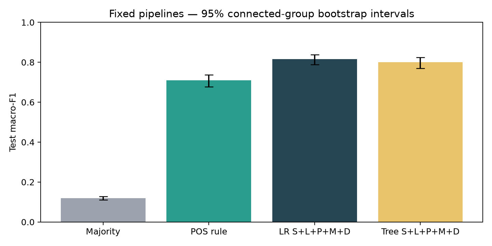
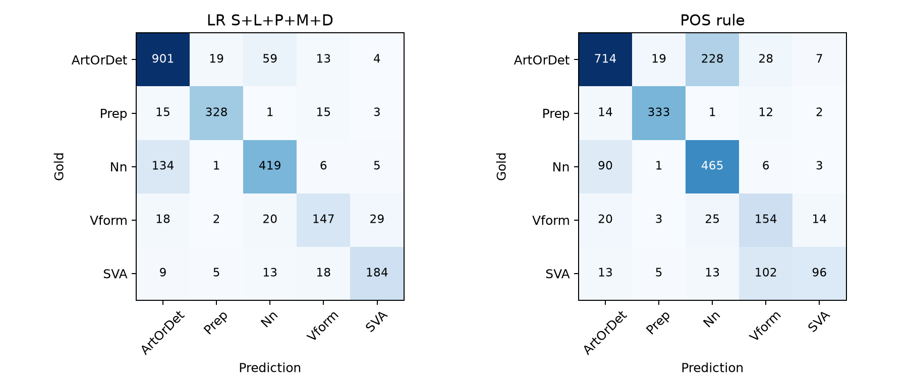

# Đánh giá mô hình: bổ sung đặc trưng, test, bootstrap và phân tích lỗi

Báo cáo ghi lại đợt đánh giá ngày 23/10/2026, từ bổ sung các biến thể đặc trưng đến khóa cấu hình, chấm test và đọc lỗi. Nội dung tập trung vào những bước đã thực hiện và bằng chứng kiểm tra tại thời điểm đó. Phần tổng hợp trả lời RQ1–RQ3 được trình bày trong báo cáo tổng kết sau này.

# 1. Phạm vi task và đầu ra đã có

LR Full đạt test macro-F1 0,8163, CI95% [0,7876; 0,8382], vượt Majority 0,1184, POS 0,7106 và Tree Full 0,7996. Chênh LR–POS là 0,1057 [0,0829; 0,1288]; LR–Tree Full là 0,0166 [0,0018; 0,0301]. Đây là CI pointwise từ cùng 1.000 mẫu bootstrap theo 97 connected groups, không phải khoảng tin cậy từ nhiều seed huấn luyện.

Các phép loại bỏ đặc trưng cho thấy POS bổ sung nhiều thông tin cho mốc S+L, còn từ vựng vẫn hữu ích trên test. Khi bỏ toàn bộ L, macro-F1 của LR giảm 0,0281, lớn hơn mức giảm khoảng 0,0103 trên validation. Hình thái đem lại bằng chứng rõ hơn ở Tree. Với LR, CI của chênh lệch liên quan M và D còn chứa 0, nên chưa đủ cơ sở khẳng định mức cải thiện ổn định; điều đó cũng không có nghĩa các thông tin này vô ích.

Hai cặp nhãn dễ nhầm nhất vẫn là Nn/ArtOrDet và Vform/SVA. So với POS, LR phân biệt tốt hơn ở một số nhóm có cùng POS, nhưng vẫn gặp khó với span rộng, lỗi thiếu từ neo vào token khác từ loại và những ca nhãn/bản sửa cần xem lại. Mẫu audit 40 ca giúp đọc kỹ các hiện tượng này. Các ghi chú có hỗ trợ AI, chưa phải kết luận độc lập của chuyên gia.

| Hạng mục | Trạng thái / bằng chứng |
|---|---|
| Ablation còn thiếu | 40 fit grid mới Full−P/M, 12 refit cấu hình cũ; Full−D alias của S+L+P+M |
| Replay trước khóa | 12 checkpoint cũ tái tạo đúng mọi prediction validation; Full encoder khớp 13.420 train/validation rows; POS validation khớp |
| Khóa và test | 18 tên LR/Tree + Majority/POS, 16 checkpoint LR/Tree riêng; test 2.368 sample, 97 groups, 144 essays |
| Bootstrap | 1.000 lần, seed20261023; 30 contrast/slice đủ điều kiện, ngưỡng và missing-class được ghi |
| Audit | 25 lỗi LR + 5 lỗi Tree khi LR đúng + 10 mẫu LR đúng, giữ ID và ghi chú |
| Tái lập | Fresh venv nạp lại checkpoint từ encoded test, predictions khớp; không phải chạy lại toàn grid trong fresh env |
| BERT | Giữ kết quả validation/chẩn đoán cũ; không chạy thêm hoặc chấm BERT trên test |

# 2. Đầu vào và điều kiện thực hiện

Đợt đánh giá dùng lại preparation v2, grouped split với seed 20261013, các tệp đặc trưng và sáu biến thể đã có. Cách chia tập, nhãn và tiền xử lý được giữ nguyên; BERT chưa được bổ sung trong đợt này. Mô hình nhận câu gốc và vị trí lỗi đã biết, còn bản sửa chỉ phục vụ phân tích sau dự đoán.

| Input | Vai trò |
|---|---|
| data_set/processed/nucle_preparation_v2 | Câu/span và metadata nguồn |
| data_set/split/nucle_group_split | Train11052 / validation2368 / test2368; partition cố định |
| data_set/features/nucle_features_v1 | Encoder train-only và Full feature matrix16180 chiều |
| reports/nucle_feature_ablation_v1 | Configs/predictions validation sáu variants cũ để replay |
| docs/final_evaluation_protocol.md | Protocol ghi trước chạy; không sửa lại theo điểm test |

Đặc trưng ngôn ngữ được trích bằng spaCy 3.8.7 và en_core_web_sm 3.8.0. Các giá trị số giữ thang gốc; giới hạn 500 chỉ dành cho kênh n-gram dùng chung. Nhóm D cũng chứa POS và hình thái của head hoặc chủ ngữ, nên bỏ P hay M chưa loại hết mọi thông tin cùng loại. Train gồm 1069 bài và 1045 nhóm, validation gồm 142 bài và 99 nhóm, còn test gồm 144 bài và 97 nhóm.

# 3. Phép tính dùng trong các task

```text
(1) p(y=k|x)=exp(xᵀw_k+b_k)/Σ_j exp(xᵀw_j+b_j); ŷ=argmax_k p(y=k|x)
```

```text
(2) J(W,b)=[Σ_i α_(y_i)(−log p(y_i|x_i))/Σ_i α_(y_i)] + ||W||²_F/(2Cn)
```

LR dùng code hiện hành: α=1 hoặc balanced α_k=n/(5n_k); intercept không L2. PyTorch LBFGS strong_wolfe,10 threads,seed 20261013,max_iter1000/max_eval1250,tolerance_grad1e−6/change1e−9. Change-tolerance không đồng nghĩa gradient-converged.

```text
(3) Gini(t)=1−Σ_k p²_(k,t); gain=Gini(t)−(w_L/w_t)Gini(L)−(w_R/w_t)Gini(R)
```

Tree giữ implementation Gini weighted khi balanced; nhãn lá là majority raw counts. Không đổi thuật toán sau test.

```text
(4) Precision_k=TP_k/(TP_k+FP_k); Recall_k=TP_k/(TP_k+FN_k)
```

```text
(5) F1_k=2TP_k/(2TP_k+FP_k+FN_k); MacroF1=(1/K)Σ_k F1_k
```

```text
(6) Accuracy=số prediction đúng/n
```

K=5 cho toàn tập/span bins, K=2 cho cặp gold; predictions vẫn năm lớp, ngoài cặp gây false negative. Zero denominator dùng0; subset rỗng ghi N/A. Công thức bootstrap ở mục8.

# 4. Task bổ sung ablation, tái tạo checkpoint và khóa

Sáu variants cũ chỉ lưu summary/predictions nên cần refit đúng config để có checkpoint. Tất cả 12 refit khớp validation predictions cũ ở10 threads. Full−D chính là S+L+P+M: giữ alias để trình bày RQ2, không chạy thêm20 fit và không tính hai bằng chứng độc lập. Hai variants mới chạy40 fit; tổng phiên52 fit, khoảng 8.90 phút gồm kiểm/tạo encoder. Bốn LR C=10 mới chạm iteration limit và không eligible; mọi LR được chọn dừng change_tolerance.

Grid LR C={0,01;0,1;1;10} × class_weight={None,balanced}; Tree depth={4,8,12} × leaf={5,20} × class_weight. Chọn max macro-F1 validation trong eligible, hòa lấy cấu hình đầu theo grid. Từng variant tune riêng, nên đo pipeline theo cùng ngân sách tuning, không cô lập tác dụng feature ở cùng hyperparameters.

| Pipeline | Số chiều | Config chọn | Val F1 |
|---|---|---|---|
| LR S+L | 9203 | {"C": 1.0, "class_weight": null} | 0.7164 |
| Tree S+L | 9203 | {"max_depth": 12, "min_samples_leaf": 5, "class_weight": null} | 0.5832 |
| LR S+L+P | 15271 | {"C": 1.0, "class_weight": null} | 0.7956 |
| Tree S+L+P | 15271 | {"max_depth": 12, "min_samples_leaf": 5, "class_weight": null} | 0.7548 |
| LR S+L+P+M | 15302 | {"C": 1.0, "class_weight": null} | 0.8048 |
| Tree S+L+P+M | 15302 | {"max_depth": 12, "min_samples_leaf": 5, "class_weight": "balanced"} | 0.7929 |
| LR S+L+P+M+D | 16180 | {"C": 0.1, "class_weight": null} | 0.8067 |
| Tree S+L+P+M+D | 16180 | {"max_depth": 8, "min_samples_leaf": 5, "class_weight": null} | 0.7879 |
| LR Full_mask_span_lexical | 16180 | {"C": 0.1, "class_weight": null} | 0.8016 |
| Tree Full_mask_span_lexical | 16180 | {"max_depth": 12, "min_samples_leaf": 5, "class_weight": "balanced"} | 0.7876 |
| LR S+P+M+D_nonlexical | 6986 | {"C": 1.0, "class_weight": null} | 0.7964 |
| Tree S+P+M+D_nonlexical | 6986 | {"max_depth": 8, "min_samples_leaf": 20, "class_weight": "balanced"} | 0.7862 |
| LR Full_minus_P | 10112 | {"C": 1.0, "class_weight": null} | 0.8001 |
| Tree Full_minus_P | 10112 | {"max_depth": 8, "min_samples_leaf": 5, "class_weight": "balanced"} | 0.7711 |
| LR Full_minus_M | 16149 | {"C": 0.1, "class_weight": null} | 0.8015 |
| Tree Full_minus_M | 16149 | {"max_depth": 12, "min_samples_leaf": 5, "class_weight": "balanced"} | 0.7751 |
| LR Full_minus_D | 15302 | {"C": 1.0, "class_weight": null} | 0.8048 |
| Tree Full_minus_D | 15302 | {"max_depth": 12, "min_samples_leaf": 5, "class_weight": "balanced"} | 0.7929 |

Full_mask_span_lexical loại lexical identity của token giao span trước khi fit encoder masked riêng trên train; giữ context, POS/morph/dependency của câu gốc, không nối n-gram qua phần bị che. Nonlexical loại toàn L, không gọi structural-only.

Lock ghi lúc 2026-10-23T08:39:33.193583+00:00; test bắt đầu 2026-10-23T08:39:42.953706+00:00. SHA256 lock: 2f2f9fd1ff19805255f300d4eaf646aa964e3e643ce692027f528ba5b9c198ee. Lock chứa hashes source/preparation/split/code/encoders/checkpoints/protocol và label order. Test scorer kiểm hash trước chạy. Không refit train+validation, không chọn model/seed/nhóm phân tích sau điểm test.

# 5. Task chấm test: kết quả và kiểm tra

| Model | Val F1 | Test F1 | CI95% | Accuracy | Macro P | Macro R |
|---|---|---|---|---|---|---|
| Majority | 0.1184 | 0.1184 | [0.1104; 0.1279] | 0.4206 | 0.0841 | 0.2000 |
| POS rule | 0.7048 | 0.7106 | [0.6766; 0.7365] | 0.7441 | 0.7387 | 0.7184 |
| LR S+L+P+M+D | 0.8067 | 0.8163 | [0.7876; 0.8382] | 0.8357 | 0.8271 | 0.8073 |
| Tree S+L+P+M+D | 0.7879 | 0.7996 | [0.7693; 0.8246] | 0.8095 | 0.8064 | 0.7937 |

Hình 1. Macro-F1 test và CI95% theo connected group; model/config đã khóa trước test.



| So sánh | Chênh F1 | CI95% |
|---|---|---|
| LR Full - Majority | 0.6978 | [0.6655; 0.7212] |
| Tree Full - Majority | 0.6812 | [0.6470; 0.7073] |
| LR Full - Tree Full | 0.0166 | [0.0018; 0.0301] |
| LR Full - POS | 0.1057 | [0.0829; 0.1288] |

Diễn giải bảng test (bằng chứng cho RQ1): cả LR và Tree vượt Majority rõ rệt trong task known-span này. LR Full vượt POS và Tree Full; các CI paired chính không chứa0. So LR/Tree dùng cùng Full, không chọn Tree variant theo điểm test. Tree masking có điểm test nhỉnh Full rất nhỏ, nhưng không dùng quan sát đó để thay model đã chọn.

Macro-F1 LR tăng so validation trong khi accuracy giảm: metric macro cân bằng năm lớp, còn accuracy chịu trọng số theo support. F1 Nn test0,7781 thấp hơn validation khoảng0,8383, trong khi Vform/SVA tốt hơn; đây không phải mâu thuẫn metric. Không suy test cao hơn là hết overfitting.

| Nhãn | Support | LR P | LR R | LR F1 | POS F1 | Tree Full F1 |
|---|---|---|---|---|---|---|
| ArtOrDet | 996 | 0.8366 | 0.9046 | 0.8693 | 0.7731 | 0.8329 |
| Prep | 362 | 0.9239 | 0.9061 | 0.9149 | 0.9212 | 0.9065 |
| Nn | 565 | 0.8184 | 0.7416 | 0.7781 | 0.7170 | 0.7519 |
| Vform | 216 | 0.7387 | 0.6806 | 0.7084 | 0.5946 | 0.6979 |
| SVA | 229 | 0.8178 | 0.8035 | 0.8106 | 0.5470 | 0.8090 |

# 6. Task đối chiếu ablation/masking

| Variant | LR val | LR test | Tree val | Tree test |
|---|---|---|---|---|
| S+L | 0.7164 | 0.7203 | 0.5832 | 0.5850 |
| S+L+P | 0.7956 | 0.7968 | 0.7548 | 0.7520 |
| S+L+P+M | 0.8048 | 0.8102 | 0.7929 | 0.7967 |
| S+L+P+M+D | 0.8067 | 0.8163 | 0.7879 | 0.7996 |
| Full_mask_span_lexical | 0.8016 | 0.8028 | 0.7876 | 0.8006 |
| S+P+M+D_nonlexical | 0.7964 | 0.7881 | 0.7862 | 0.7894 |
| Full_minus_P | 0.8001 | 0.7982 | 0.7711 | 0.7811 |
| Full_minus_M | 0.8015 | 0.8123 | 0.7751 | 0.7826 |
| Full_minus_D | 0.8048 | 0.8102 | 0.7929 | 0.7967 |

| Đối chiếu | Chênh test F1 | CI95% |
|---|---|---|
| LR S+L+P minus S+L | 0.0766 | [0.0581; 0.0975] |
| LR S+L+P+M minus S+L+P | 0.0134 | [-0.0004; 0.0256] |
| LR S+L+P+M+D minus S+L+P+M | 0.0060 | [-0.0054; 0.0191] |
| LR S+L+P+M+D minus Full_mask_span_lexical | 0.0134 | [0.0049; 0.0201] |
| LR S+L+P+M+D minus S+P+M+D_nonlexical | 0.0281 | [0.0142; 0.0394] |
| LR S+L+P+M+D minus Full_minus_P | 0.0181 | [0.0069; 0.0296] |
| LR S+L+P+M+D minus Full_minus_M | 0.0040 | [-0.0066; 0.0136] |
| LR S+L+P+M+D minus Full_minus_D | 0.0060 | [-0.0054; 0.0191] |
| Tree S+L+P minus S+L | 0.1670 | [0.1400; 0.1897] |
| Tree S+L+P+M minus S+L+P | 0.0447 | [0.0275; 0.0648] |
| Tree S+L+P+M+D minus S+L+P+M | 0.0029 | [-0.0077; 0.0124] |
| Tree S+L+P+M+D minus Full_mask_span_lexical | -0.0010 | [-0.0117; 0.0086] |
| Tree S+L+P+M+D minus S+P+M+D_nonlexical | 0.0103 | [-0.0014; 0.0205] |
| Tree S+L+P+M+D minus Full_minus_P | 0.0186 | [0.0049; 0.0328] |
| Tree S+L+P+M+D minus Full_minus_M | 0.0171 | [0.0008; 0.0360] |
| Tree S+L+P+M+D minus Full_minus_D | 0.0029 | [-0.0077; 0.0124] |

Thêm POS vào S+L tăng LR 0,0766 và Tree 0,1670; CI đều dương. Trên nền Full, bỏ nhóm P chỉ giảm khoảng0,018 vì feature groups chồng thông tin. Hai phép đo trả lời hai câu hỏi có điều kiện khác nhau, không mâu thuẫn.

Với LR, che lexical span giảm0,0134 [0,0049;0,0201], bỏ toàn L giảm0,0281 [0,0142;0,0394]. Lexical giúp ích trên test dù POS/nonlexical đã mạnh. Với Tree, chênh Full−masked là−0,0010 với CI chứa0; không khẳng định masking làm Tree tốt hơn. Không gọi masking là kiểm chứng model hiểu ngữ pháp.

Thêm M sau P giúp LR 0,0134 nhưng CI[−0,0004;0,0256] chứa0; bỏ M khỏi Full giảm0,0040 với CI cũng chứa0. Tree tăng0,0447 khi thêm M, giảm0,0171 khi bỏ M khỏi Full, các CI dương. Cấu trúc model và tuning tạo khác biệt; không gán hiệu ứng chung giống nhau cho LR/Tree.

Thêm D giúp LR 0,0060 và Tree 0,0029, cả CI chứa0. Chưa đủ bằng chứng lợi ích tăng thêm ổn định của D trong cấu hình hiện tại; không kết luận chủ ngữ/ngữ cảnh toàn câu vô ích. Extractor chỉ lấy subject child trực tiếp và parser có thể sai trên câu lỗi.

## F1 từng lớp và Δ so Full — LR

| Variant | ArtOrDet | Prep | Nn | Vform | SVA |
|---|---|---|---|---|---|
| S+L | 0.8358 (-0.0335) | 0.8728 (-0.0421) | 0.7251 (-0.0530) | 0.5152 (-0.1932) | 0.6525 (-0.1581) |
| S+L+P | 0.8664 (-0.0028) | 0.9177 (+0.0028) | 0.7868 (+0.0087) | 0.6748 (-0.0337) | 0.7385 (-0.0721) |
| S+L+P+M | 0.8669 (-0.0024) | 0.9152 (+0.0002) | 0.7856 (+0.0076) | 0.7048 (-0.0037) | 0.7788 (-0.0318) |
| S+L+P+M+D | 0.8693 (+0.0000) | 0.9149 (+0.0000) | 0.7781 (+0.0000) | 0.7084 (+0.0000) | 0.8106 (+0.0000) |
| Full_mask_span_lexical | 0.8580 (-0.0113) | 0.9119 (-0.0030) | 0.7551 (-0.0229) | 0.6927 (-0.0158) | 0.7965 (-0.0141) |
| S+P+M+D_nonlexical | 0.8426 (-0.0267) | 0.9086 (-0.0063) | 0.7318 (-0.0463) | 0.6729 (-0.0355) | 0.7848 (-0.0258) |
| Full_minus_P | 0.8564 (-0.0128) | 0.9101 (-0.0048) | 0.7729 (-0.0052) | 0.6856 (-0.0229) | 0.7659 (-0.0447) |
| Full_minus_M | 0.8733 (+0.0040) | 0.9149 (+0.0000) | 0.7874 (+0.0093) | 0.6990 (-0.0094) | 0.7868 (-0.0238) |
| Full_minus_D | 0.8669 (-0.0024) | 0.9152 (+0.0002) | 0.7856 (+0.0076) | 0.7048 (-0.0037) | 0.7788 (-0.0318) |

## F1 từng lớp và Δ so Full — Tree

| Variant | ArtOrDet | Prep | Nn | Vform | SVA |
|---|---|---|---|---|---|
| S+L | 0.7335 (-0.0994) | 0.8146 (-0.0919) | 0.5532 (-0.1987) | 0.2959 (-0.4020) | 0.5281 (-0.2809) |
| S+L+P | 0.8343 (+0.0014) | 0.9035 (-0.0030) | 0.7370 (-0.0149) | 0.5906 (-0.1073) | 0.6947 (-0.1143) |
| S+L+P+M | 0.8447 (+0.0118) | 0.9020 (-0.0046) | 0.7385 (-0.0134) | 0.7028 (+0.0049) | 0.7955 (-0.0135) |
| S+L+P+M+D | 0.8329 (+0.0000) | 0.9065 (+0.0000) | 0.7519 (+0.0000) | 0.6979 (+0.0000) | 0.8090 (+0.0000) |
| Full_mask_span_lexical | 0.8420 (+0.0091) | 0.9020 (-0.0046) | 0.7429 (-0.0091) | 0.7100 (+0.0121) | 0.8062 (-0.0028) |
| S+P+M+D_nonlexical | 0.8300 (-0.0029) | 0.9109 (+0.0044) | 0.7091 (-0.0428) | 0.6890 (-0.0089) | 0.8079 (-0.0010) |
| Full_minus_P | 0.8158 (-0.0171) | 0.9070 (+0.0005) | 0.7123 (-0.0397) | 0.6747 (-0.0232) | 0.7957 (-0.0133) |
| Full_minus_M | 0.8394 (+0.0065) | 0.9063 (-0.0002) | 0.7395 (-0.0124) | 0.6698 (-0.0281) | 0.7578 (-0.0511) |
| Full_minus_D | 0.8447 (+0.0118) | 0.9020 (-0.0046) | 0.7385 (-0.0134) | 0.7028 (+0.0049) | 0.7955 (-0.0135) |

Diễn giải ablation (bằng chứng cho RQ2): P và L có bằng chứng hỗ trợ rõ ở LR; M thể hiện tác dụng rõ hơn với Tree; tác dụng tăng thêm của D và của M trong LR chưa chắc chắn. Các Δ trong bảng từng lớp là descriptive, không có CI từng lớp đã hiệu chỉnh. Full−D lặp S+L+P+M chỉ để thuận đối chiếu, không nhân đôi bằng chứng.

# 7. Task phân tích span, cặp nhãn, POS và audit lỗi

| Subset | n | Groups | POS F1 | LR F1 | Tree F1 | Δ LR−POS CI95% |
|---|---|---|---|---|---|---|
| empty | 0 | 0 | N/A | N/A | N/A | N/A |
| single_token | 2102 | 97 | 0.7173 | 0.8320 | 0.8145 | [0.0886; 0.1406] |
| multi_token | 266 | 57 | 0.4921 | 0.5370 | 0.4489 | [-0.0401; 0.1262] |
| Vform/SVA | 445 | 76 | 0.6095 | 0.8021 | 0.7959 | [0.1407; 0.2394] |
| Vform/SVA@VERB | 220 | 64 | 0.3548 | 0.8416 | 0.8412 | [0.4214; 0.5405] |
| Vform/SVA@AUX | 105 | 44 | 0.4670 | 0.8477 | 0.8677 | [0.1145; 0.4900] |
| Vform/SVA@NOUN | 37 | 21 | 0.0000 | 0.1667 | 0.1071 | [0.0400; 0.2895] |
| Vform/SVA@DET | 1 | 1 | 0.0000 | 0.0000 | 0.0000 | N/A |
| Nn/ArtOrDet | 1561 | 95 | 0.7663 | 0.8453 | 0.8148 | [0.0463; 0.1195] |
| Nn/ArtOrDet@VERB | 33 | 22 | 0.0000 | 0.3864 | 0.4843 | [0.2500; 0.4706] |
| Nn/ArtOrDet@AUX | 3 | 3 | 0.0000 | 0.0000 | 0.0000 | N/A |
| Nn/ArtOrDet@NOUN | 682 | 86 | 0.4044 | 0.8142 | 0.7028 | [0.3555; 0.4685] |
| Nn/ArtOrDet@DET | 343 | 64 | 0.4827 | 0.4827 | 0.4827 | [0.0000; 0.0000] |

Span một token n2102, nhiều token n266; LR macro5 tương ứng0,8320 và0,5370. Δ LR−POS trên multi-token có CI chứa0, nên không khẳng định cải thiện chắc chắn ở mọi span rộng. Span rỗng support0 ghi N/A; không loại mẫu chỉ vì thiếu POS.

Gold Vform/SVA n445: LR macro2≈0,8021 so POS≈0,6095; trên primary POS VERB n220, LR≈0,8416 so POS≈0,3548. Nn/ArtOrDet n1561: LR≈0,8453 so POS≈0,7663; giao NOUN n682: LR≈0,8142 so POS≈0,4044. Những kết quả này cho thấy đặc trưng ngoài signature POS có ích, chưa chỉ ra riêng feature nào là nguyên nhân.

Primary POS chỉ có giá trị khi span đúng một token theo contract. NOUN slice không phải parser-confirmed noun phrase. Cặp Nn/ArtOrDet@DET có macro2≈0,4827 dù phần lớn là ArtOrDet: trung bình vẫn tính cả Nn và giữ prediction ngoài cặp; không đọc điểm này như accuracy thấp tương ứng. Subset ít mẫu không có CI vẫn được giữ trong bảng.

Hình 2. Confusion test của LR Full và POS; hàng gold, cột prediction.



| Gold → prediction | Số lỗi |
|---|---|
| Nn → ArtOrDet | 134 |
| ArtOrDet → Nn | 59 |
| Vform → SVA | 29 |
| Vform → Nn | 20 |
| ArtOrDet → Prep | 19 |
| Vform → ArtOrDet | 18 |
| SVA → Vform | 18 |
| Prep → Vform | 15 |
| Prep → ArtOrDet | 15 |
| SVA → Nn | 13 |

Nn→ArtOrDet134 và ArtOrDet→Nn59 là hai hướng nhầm lớn nhất; Vform→SVA 29, SVA→Vform18. Số lượng chịu ảnh hưởng support nên đối chiếu per-class recall/F1, không chỉ xếp count. Chưa có span rỗng nên không thể nói phần lớn Nn→ArtOrDet nằm trong nhóm span rỗng; audit cho thấy missing-word edits có thể có span không rỗng.

## 7.1 Audit sau prediction và cách giải thích

Chọn trước khi đọc correction:25 lỗi LR round-robin gold/pred,5 lỗi Tree khi LR đúng,10 controls LR đúng. Seed20261023; không chọn ngẫu nhiên đại diện toàn corpus. audit_selection.json lưu IDs; private_error_audit_packet.json giữ câu/correction/parse local; manual_error_review.json chỉ giữ ID/nhận xét không trích câu. Tất cả40 ca được đọc sau prediction. Confidence là mức chắc chắn nhận xét, không phải xác suất model.

| Quan sát | ID minh họa | Ý nghĩa và giới hạn |
|---|---|---|
| Thiếu từ, span không rỗng | 38087,24747,17826,348,44388,34548 | POS của token neo có thể khác POS của từ thiếu; không phải lỗi offset |
| Parser/POS đáng ngờ | 24526,9351,41235,35455,211,37624 | Noun/verb/adjective bị gán khác cách đọc; cần chuyên gia để xác nhận lỗi parser |
| Partial-token | 17814 | Ký tự gold thuộc token ADP bao phủ, không phản ánh đúng loại edit số danh từ |
| Span rộng/nhiều edit | 19312,34483,32904 | Một nhãn bao phủ đổi determiner/number hoặc cấu trúc mệnh đề |
| Phối hợp/subject gián tiếp | 18531,36821,17311 | D chỉ tìm subject child của target, không truyền qua auxiliary/conj |
| Gold/edit cần adjudication | 34539,12324,26635,32705,37909,18501,201 | Không tự sửa nhãn. Prediction khớp gold cũng chưa chứng minh phán đoán ngữ pháp đúng |
| LR vượt POS ở missing determiner | 11916,44353,6079 | Có ca LR phân biệt được dù token NOUN; chưa xác định nhân quả của feature |

Diễn giải audit (bằng chứng cho RQ3): nhầm lẫn liên quan taxonomy trong cụm danh từ/động từ, độ rộng span, token neo của missing-word edits, chất lượng parse và sự phù hợp của gold với edit. Không suy tỷ lệ từng nguyên nhân từ audit chủ đích, không loại các ca này rồi báo lại test đẹp hơn.

# 8. Task bootstrap: công thức và kiểm soát

```text
(7) m^(b) ~ Multinomial(G; 1/G,…,1/G), G=97; C_model^(b)=Σ_g m_g^(b) C_(g,model)
```

```text
(8) Δ^(b)=MacroF1(C_A^(b))−MacroF1(C_B^(b)); CI95%=[Q_0.025(Δ),Q_0.975(Δ)]
```

C_(g,model) là confusion5×5 của connected group; cùng m^(b) cho mọi model/subset. Group có nhiều essay vẫn là một đơn vị bootstrap. Với subset, lọc annotation bên trong group sau khi lấy cùng group weights. Không resample riêng từng annotation; điều đó sẽ bỏ phụ thuộc trong bài.

Ngưỡng subset CI: ≥20 samples, ≥10 groups và có đủ labels cần tính. Replicate thiếu lớp vẫn tính trên fixed labels (zero denominator→0), ghi missing-class count; replicate subset empty bị bỏ và CI chỉ báo nếu≥950/1000 hợp lệ. Các CI pointwise không hiệu chỉnh multiplicity; không có p-value hoặc kết luận significance đồng thời.

| Subset | Eligible CI | Valid | Empty | Missing-class |
|---|---|---|---|---|
| all | True | 1000 | 0 | 0 |
| empty | False | N/A | N/A | N/A |
| single_token | True | 1000 | 0 | 0 |
| multi_token | True | 1000 | 0 | 0 |
| Vform/SVA | True | 1000 | 0 | 0 |
| Vform/SVA@VERB | True | 1000 | 0 | 0 |
| Vform/SVA@AUX | True | 1000 | 0 | 0 |
| Vform/SVA@NOUN | True | 1000 | 0 | 0 |
| Vform/SVA@DET | False | N/A | N/A | N/A |
| Nn/ArtOrDet | True | 1000 | 0 | 0 |
| Nn/ArtOrDet@VERB | True | 1000 | 0 | 1 |
| Nn/ArtOrDet@AUX | False | N/A | N/A | N/A |
| Nn/ArtOrDet@NOUN | True | 1000 | 0 | 0 |
| Nn/ArtOrDet@DET | True | 1000 | 0 | 0 |

# 9. Phạm vi BERT trong đợt task này

Không chạy thêm BERT và không chấm BERT trên test. Các kết quả BERT-small validation/học thuộc/gradient/span thuộc đợt trước, xem contextual_model_validation_report.docx và bert_learning_diagnostics_report.docx. Chúng được giữ như thử nghiệm chưa thành công, không dùng kết luận ngữ cảnh vô ích.

# 10. Task kiểm chứng, tái lập và bàn giao artifact

| File | Input → output / vai trò |
|---|---|
| src/training/nucle_final_selection.py | Feature/split/old predictions → train-only encoder,52fit,16checkpoints,validation replay,lock |
| src/evaluation/nucle_final_evaluation.py | Lock + test → saved predictions/metrics; bootstrap từ predictions; checkpoint replay |
| src/evaluation/nucle_final_error_audit.py | Saved predictions → deterministic IDs → private source/correction/parse packet |
| src/reporting/build_evaluation_tasks_report.py | JSON/CSV + manual notes → báo cáo task DOCX/Markdown; tái dùng hình đã có |
| docs/final_evaluation_protocol.md | Protocol ghi trước test, quy tắc alias/selection/subsets/bootstrap |
| reports/final_evaluation/lock.json | Hash input/code/encoders/checkpoints, thời điểm và cấu hình |
| test_predictions.csv, test_metrics.json | Prediction từng sample/pipeline và metrics theo subsets |
| bootstrap.json, bootstrap_group_weights.npy | CI paired, số lượt thiếu lớp và resampling weights |
| overall_results.csv, per_class_results.csv, per_class_deltas.csv | Bảng tổng thể, từng lớp và Δ so Full |
| manual_error_review.json | 40 ghi chú không có câu nguồn; private packet giữ riêng local |
| reproducibility/README.md | Lệnh chạy, dependencies và phạm vi kiểm tái lập |

13 tests phù hợp đã qua, gồm5 tests mới cho metric ngoài cặp, group bootstrap, serialization encoder, loại nhóm/alias và từ chối lock bị sửa. Các tests model/feature hiện có cũng qua. Checkpoint reload18 tên LR/Tree không bất đồng prediction. Fresh venv dùng Python3.13.7, NumPy2.5.3, PyTorch2.14.0+cpu; inference trên encoded test khớp tuyệt đối. Kiểm này không thay toàn bộ re-training, spaCy reparse hoặc cài lại mọi dependency trong môi trường sạch.

Gói hỗ trợ tái lập task đóng code/protocol/summary/hash/hướng dẫn; không chứa corpus, câu/correction audit, encoder vocab hoặc checkpoint. Người tái lập đầy đủ cần quyền truy cập NUCLE và artifact nguồn phù hợp. Không upload/push trong lượt này. Restore gói vào thư mục mới được kiểm hash; manifest cũ giữ nguyên, report chỉ dẫn đến artifact mới.

# 11. Hạn chế và công việc để lại

| Hạng mục | Trạng thái |
|---|---|
| Các task thí nghiệm | Ablation bổ sung, khóa/test, bootstrap và audit đã chạy; số liệu giữ nguyên |
| Báo cáo task này | Ghi mục tiêu, input/code/output, kết quả, giải thích và kiểm chứng của đợt vừa làm |
| Final report của dự án | Chưa thực hiện theo yêu cầu mới; chưa tổng hợp thành báo cáo nộp cuối hoặc chốt lập luận RQ |
| Slide tổng kết | Chưa chốt; bản đã tạo trước đây được lưu như bản nháp lịch sử, không là đầu ra của task report |
| Tái lập end-to-end | Fresh venv mới kiểm checkpoint inference từ encoded test và metric; chưa chạy toàn preprocessing/grid từ raw |
| Audit chuyên gia | 40ca do AI hỗ trợ review, chưa adjudication độc lập |

Một grouped split, một seed mô hình cổ điển; CI pointwise chưa hiệu chỉnh nhiều so sánh. Tập audit chủ đích không đại diện tỷ lệ nguyên nhân toàn corpus. Token/parser tự động và gold/edit mơ hồ vẫn là giới hạn. Không sửa model/labels theo test đã xem; các hướng mở rộng cần đánh giá mới.

# 12. Tài liệu và artifact đối chiếu

Kế hoạch: note.md. Protocol trước chạy: docs/final_evaluation_protocol.md. Phương pháp dữ liệu/mô hình đã có: docs/note_project_guide.md, reports/summaries/data/data_preprocessing_report.docx, reports/summaries/classical/modeling_ablation_results_report.docx. Nguồn học thuật: reference.md. Task report không thay thế các tài liệu này hay viết lại toàn bộ related work. Bảng số liệu được lấy từ reports/final_evaluation; không dùng kết quả chưa chạy.

# Phụ lục A. Ghi chú audit theo ID

## ID 19312 — ArtOrDet; LR=Nn, Tree=Nn, POS=ArtOrDet

Nhóm: multi_token_semantics; confidence: medium. Span DET+NOUN gồm mạo từ và danh từ không đếm được; edit loại determiner. POS đúng nhưng LR/Tree chọn Nn. Cần phân biệt khả năng đếm với số danh từ; không quy toàn bộ lỗi cho POS.

## ID 38087 — ArtOrDet; LR=Prep, Tree=Prep, POS=Prep

Nhóm: missing_word_nonempty; confidence: high. Gold ArtOrDet nhưng span nguồn là ADP; edit thêm determiner sau giới từ. Cả ba dự đoán Prep. Đây là thiếu từ được neo vào span không rỗng, không phải lỗi offset.

## ID 34539 — ArtOrDet; LR=SVA, Tree=Vform, POS=Vform

Nhóm: annotation_ambiguity; confidence: medium. Gold ArtOrDet nhưng edit thêm particle cho động từ; khác với mô tả nhãn mạo từ. Cần người chuyên môn xác minh taxonomy/annotation; giữ nguyên gold.

## ID 24526 — ArtOrDet; LR=Vform, Tree=ArtOrDet, POS=SVA

Nhóm: parser_suspected; confidence: medium. Cụm danh từ hai token bị gán NOUN+VERB, token sau có VerbForm=Part. Edit thêm determiner. Tín hiệu verb sai có thể liên quan dự đoán Vform, chưa chứng minh quan hệ nhân quả.

## ID 34483 — Nn; LR=ArtOrDet, Tree=ArtOrDet, POS=ArtOrDet

Nhóm: multiple_edits; confidence: high. Gold Nn với span DET+NOUN; correction vừa bỏ determiner vừa đổi danh từ sang số nhiều. Cả ba chọn ArtOrDet; một nhãn bao phủ nhiều thay đổi.

## ID 17814 — Nn; LR=Prep, Tree=Prep, POS=Prep

Nhóm: partial_token_parser; confidence: high. Gold Nn trên một ký tự cuối token; tokenizer/POS biểu diễn token bao phủ bằng ADP. Edit thêm dấu số nhiều cho danh từ ghép bị tách. Phân biệt offset hợp lệ với biểu diễn token không phù hợp.

## ID 9351 — Nn; LR=SVA, Tree=Nn, POS=Vform

Nhóm: parser_suspected; confidence: medium. Danh từ chỉ sự trợ giúp bị phân tích thành VERB hữu hạn ngôi ba, có nsubj giả theo cách đọc ngữ cảnh. Edit bỏ số nhiều phù hợp Nn; LR bị hút sang SVA, Tree đúng.

## ID 41235 — Nn; LR=Vform, Tree=SVA, POS=Vform

Nhóm: parser_suspected; confidence: medium. Trong vị trí bổ ngữ của động từ, target có nghĩa danh từ nghiên cứu nhưng POS là VERB dù dependency là dobj. Morph sing/finite không phù hợp cách đọc danh từ; cả ba sai.

## ID 24747 — Prep; LR=ArtOrDet, Tree=ArtOrDet, POS=ArtOrDet

Nhóm: missing_word_nonempty; confidence: high. Gold Prep nhưng target là DET; correction thêm giới từ trước determiner. Cả ba chọn ArtOrDet theo token neo, không biểu diễn trực tiếp từ thiếu.

## ID 17826 — Prep; LR=Nn, Tree=Nn, POS=Nn

Nhóm: missing_word_nonempty; confidence: high. Gold Prep nhưng target là NOUN; correction thêm giới từ trước danh từ. Cả ba chọn Nn; cần quan hệ kết hợp động từ–giới từ.

## ID 348 — Prep; LR=SVA, Tree=SVA, POS=Vform

Nhóm: missing_word_nonempty; confidence: high. Gold Prep nhưng target là VERB hữu hạn; correction thêm giới từ sau verb. Subject sing/3 và verb sing/3 đang nhất quán trong parse; SVA prediction không phản ánh nhu cầu bổ sung giới từ.

## ID 19434 — Prep; LR=Vform, Tree=Vform, POS=Vform

Nhóm: missing_word_nonempty; confidence: high. Span PART+VERB infinitive giữ nguyên trong correction và được thêm giới từ ở cuối. Cả ba chọn Vform; pattern động từ không đủ cho lỗi thiếu giới từ.

## ID 12324 — SVA; LR=ArtOrDet, Tree=ArtOrDet, POS=ArtOrDet

Nhóm: annotation_ambiguity; confidence: medium. Gold SVA nhưng span ADJ và edit thêm từ chỉ thời gian, determiner, punctuation. Không thấy chỉnh agreement trực tiếp trong edit; cần adjudication, không đổi gold.

## ID 35455 — SVA; LR=Nn, Tree=Nn, POS=Nn

Nhóm: parser_suspected; confidence: medium. Target đóng vai trò vị ngữ cần hòa hợp nhưng parser gán NOUN/pobj và mất subject. Correction thêm đuôi ngôi ba; cả ba chọn Nn.

## ID 26635 — SVA; LR=Prep, Tree=Prep, POS=Prep

Nhóm: annotation_ambiguity; confidence: medium. Đã kiểm source có correction field thật, không phải missing: edit xóa ADP nhưng gold SVA. Cần review nhãn/quan hệ với lỗi khác; không quy đây là model không hiểu agreement.

## ID 18531 — SVA; LR=Vform, Tree=Vform, POS=Vform

Nhóm: coordination_scope; confidence: medium. Verb nằm trong cấu trúc phối hợp dài; parser coi infinitive/conj và D|has_subject=0 vì chỉ lấy child trực tiếp, không lan truyền subject từ head. Edit chọn dạng ngôi ba; scope phối hợp/gold cần review.

## ID 211 — Vform; LR=ArtOrDet, Tree=ArtOrDet, POS=ArtOrDet

Nhóm: parser_suspected; confidence: medium. Sau auxiliary, edit tạo past participle; target bị gán ADJ/acomp nên mất VerbForm. Cả ba chọn ArtOrDet; câu có nhiều vấn đề cú pháp.

## ID 37631 — Vform; LR=Nn, Tree=Nn, POS=Nn

Nhóm: long_context_ambiguity; confidence: medium. Target đồng hình danh từ/động từ trong danh sách dài, head distance21; parser NOUN/conj trong khi correction dùng dạng verb. Vượt cửa sổ local, nhưng edit vẫn cần xem phạm vi cấu trúc; chưa chứng minh chỉ thiếu ngữ cảnh.

## ID 37624 — Vform; LR=Prep, Tree=Vform, POS=Vform

Nhóm: parser_suspected; confidence: medium. Target POS VERB/Part nhưng dependency prep; correction đưa về vị ngữ finite. LR chọn Prep, POS/Tree đúng Vform; loại dependency có thể cạnh tranh với POS/morph.

## ID 32904 — Vform; LR=SVA, Tree=SVA, POS=ArtOrDet

Nhóm: multi_token_semantics; confidence: medium. Span SCONJ+PRON+AUX chuyển từ mệnh đề hữu hạn sang infinitive; một nhãn Vform mô tả đổi cấu trúc. LR/Tree chọn SVA dựa cấu trúc hữu hạn đang quan sát.

## ID 44388 — ArtOrDet; LR=Nn, Tree=Nn, POS=Nn

Nhóm: missing_word_nonempty; confidence: high. Gold ArtOrDet trên NOUN không rỗng; edit thêm determiner. LR/Tree/POS đều Nn. So với ID44353, cùng loại target nhưng context dài hơn cho prediction LR khác.

## ID 32705 — ArtOrDet; LR=Prep, Tree=Prep, POS=Prep

Nhóm: annotation_ambiguity; confidence: medium. Gold ArtOrDet nhưng edit thay một giới từ bằng giới từ khác; cả ba chọn Prep. Cần adjudication trước mọi khẳng định sai ngữ pháp của model.

## ID 34548 — ArtOrDet; LR=SVA, Tree=SVA, POS=Vform

Nhóm: missing_word_nonempty; confidence: high. Gold ArtOrDet neo vào VERB; correction thêm determiner sau verb trước cụm danh từ. LR/Tree chọn SVA, POS Vform; tín hiệu POS của token neo không phải POS của từ thiếu.

## ID 23239 — ArtOrDet; LR=Vform, Tree=Vform, POS=ArtOrDet

Nhóm: missing_word_nonempty; confidence: high. Span VERB+ADJ không rỗng, edit chèn determiner giữa hai token. LR/Tree chọn Vform, POS đúng; span rộng chứa cả verb và vị trí thiếu mạo từ.

## ID 37909 — Nn; LR=ArtOrDet, Tree=ArtOrDet, POS=ArtOrDet

Nhóm: annotation_ambiguity; confidence: medium. Đã xác minh correction không bị thiếu: edit xóa DET nhưng gold Nn. Mọi mô hình chọn ArtOrDet; nhãn và thao tác edit không trùng định nghĩa đơn giản.

## ID 18501 — ArtOrDet; LR=ArtOrDet, Tree=Vform, POS=ArtOrDet

Nhóm: annotation_ambiguity; confidence: medium. LR đúng gold ArtOrDet nhưng correction là đảo vị trí auxiliary trong mệnh đề gián tiếp, không chỉ sửa determiner. Prediction đúng gold không chứng minh hiểu ngữ pháp; Tree chọn Vform.

## ID 11916 — ArtOrDet; LR=ArtOrDet, Tree=Nn, POS=Nn

Nhóm: missing_word_recovered; confidence: medium. Gold ArtOrDet trên NOUN; edit thêm determiner. LR đúng, Tree/POS Nn. Context phủ định/động từ và cấu trúc danh từ có thể hỗ trợ, chưa xác định feature gây quyết định.

## ID 29485 — Nn; LR=Nn, Tree=ArtOrDet, POS=ArtOrDet

Nhóm: possessive_number; confidence: medium. Span NOUN+PART với edit đổi số danh từ sở hữu; LR đúng Nn, Tree/POS ArtOrDet. Cần phân biệt possession và number trong cụm danh từ.

## ID 44353 — ArtOrDet; LR=ArtOrDet, Tree=Nn, POS=Nn

Nhóm: missing_word_recovered; confidence: medium. Gold ArtOrDet trên NOUN; LR đúng trong khi Tree/POS Nn. Đối chiếu ID44388 cho thấy cùng target/parse cục bộ gần giống vẫn có prediction khác khi sentence/context thay đổi.

## ID 6079 — ArtOrDet; LR=ArtOrDet, Tree=Nn, POS=Nn

Nhóm: missing_word_recovered; confidence: medium. Gold ArtOrDet neo vào NOUN làm nsubj, edit thêm determiner. LR đúng, Tree/POS Nn. Không cần span rỗng để quan sát lỗi thiếu mạo từ.

## ID 36485 — ArtOrDet; LR=ArtOrDet, Tree=ArtOrDet, POS=ArtOrDet

Nhóm: correct_control; confidence: high. Gold ArtOrDet neo vào PROPN trong danh từ ghép; edit thêm determiner. Cả ba khớp gold; trường hợp đúng vẫn là thiếu từ trên span không rỗng.

## ID 34533 — ArtOrDet; LR=ArtOrDet, Tree=ArtOrDet, POS=ArtOrDet

Nhóm: correct_control; confidence: high. Gold ArtOrDet trên ADJ bổ nghĩa danh từ, correction thêm determiner. Cả ba đúng; POS signature ADJ có thể mang prior thiếu determiner.

## ID 19466 — Prep; LR=Prep, Tree=Nn, POS=Prep

Nhóm: correct_control; confidence: high. Span NOUN+ADP, edit thay giới từ; LR/POS đúng Prep, Tree Nn. Span nhiều token không mặc định không thể phân loại.

## ID 17862 — Prep; LR=Prep, Tree=Prep, POS=Prep

Nhóm: correct_control; confidence: high. Target ADP, edit thay giới từ; cả ba đúng Prep. Đây là trường hợp POS phù hợp trực tiếp taxonomy.

## ID 42947 — Nn; LR=Nn, Tree=Nn, POS=Nn

Nhóm: correct_control; confidence: medium. Target NOUN/Sing, correction đổi số nhiều; cả ba đúng Nn. Quan hệ agreement với phần còn lại của câu vẫn cần đọc rộng, không suy grammatical correctness toàn câu.

## ID 26421 — Nn; LR=Nn, Tree=Nn, POS=Nn

Nhóm: correct_control; confidence: high. NOUN/Sing sau cụm chỉ nhiều loại, correction đổi số nhiều; cả ba đúng Nn. Context lexical có thể hỗ trợ nhưng POS đã đủ cho nhãn trong mẫu này.

## ID 201 — Vform; LR=Vform, Tree=Vform, POS=Vform

Nhóm: correct_gold_ambiguity; confidence: medium. Cả ba đúng gold Vform, correction thêm dấu infinitive. Cấu trúc pseudo-cleft có thể cho phép bare infinitive; cần adjudication, không coi khớp gold là chứng minh câu bắt buộc sửa.

## ID 34128 — Vform; LR=Vform, Tree=Vform, POS=Vform

Nhóm: correct_control; confidence: medium. Span AUX+VERB gerund/participle được đổi voice/form, cả ba đúng Vform. Cần đọc construction rộng để giải thích edit.

## ID 36821 — SVA; LR=SVA, Tree=SVA, POS=SVA

Nhóm: correct_control; confidence: medium. Target AUX hữu hạn, correction đổi số; cả ba đúng SVA dù D|has_subject=0 vì subject gắn vào verb head thay vì auxiliary. Prediction đúng không chứng minh D trực tiếp tìm chủ ngữ.

## ID 17311 — SVA; LR=SVA, Tree=SVA, POS=SVA

Nhóm: correct_control; confidence: medium. Auxiliary trong chuỗi bị sửa agreement; cả ba đúng SVA, D|has_subject=0. Pipeline hiện chỉ lấy subject child trực tiếp của target, bỏ qua quan hệ qua head.

# Phụ lục B. Danh mục toàn bộ fit và CI

52 dòng fit (gồm cả cấu hình không eligible) ở fit_progress.json. 20 pipeline rows ở overall_results.csv;100 dòng metric từng lớp ở per_class_results.csv;90 Δ class/variant ở per_class_deltas.csv. Alias được gắn rõ; không bỏ kết quả âm. Toàn bộ CI và số lượt thiếu lớp ở bootstrap.json. Các artifact này là nguồn dựng lại bảng, không phải nhập số tay.
