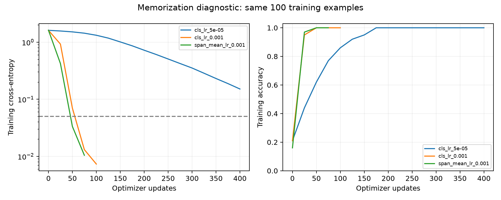
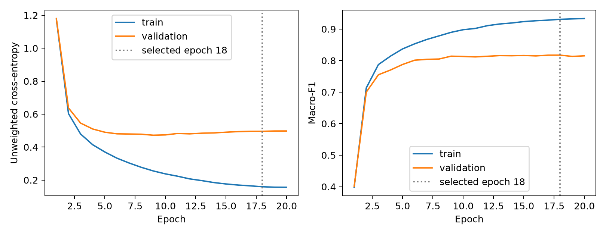
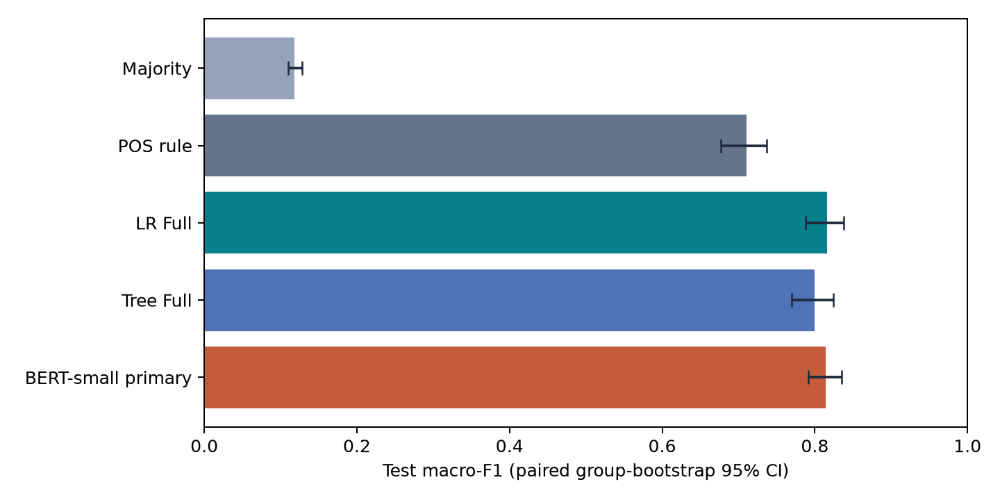
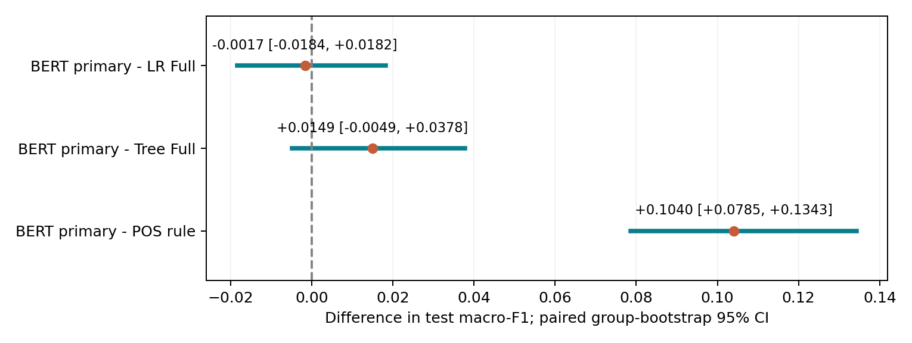
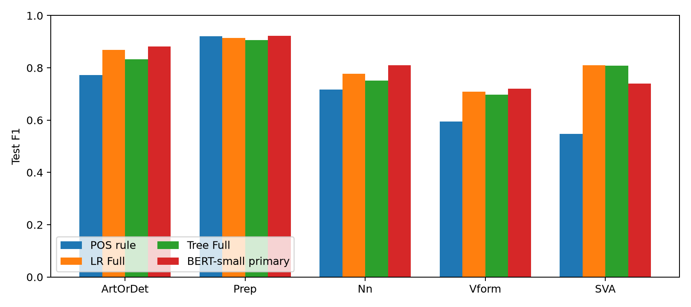
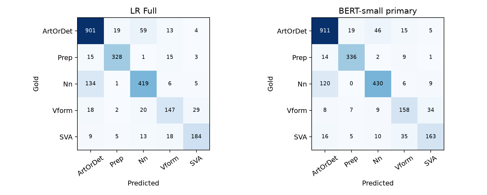

# Báo cáo tổng kết dự án

Phân loại năm loại lỗi ngữ pháp tiếng Anh trên NUCLE

Câu gốc và vị trí lỗi đã biết • Đặc trưng ngôn ngữ • Logistic Regression • Decision Tree • BERT-small

Báo cáo cập nhật ngày 28/10/2026, tổng hợp kết quả các mô hình cổ điển và đợt BERT-small mở rộng. Các thí nghiệm cổ điển và chẩn đoán ban đầu được thực hiện ngày 23/10; BERT được huấn luyện, chọn cấu hình và đánh giá test ngày 28/10. Phần tổng hợp dưới đây sử dụng kết quả đã lưu, không thực hiện thêm lượt huấn luyện hoặc dự đoán test nào.

## Tóm tắt

Dự án xem xét khả năng phân loại lỗi ngữ pháp tiếng Anh khi vị trí lỗi trong câu đã được xác định. Mỗi lỗi được gán vào một trong năm nhóm: ArtOrDet, Prep, Nn, Vform và SVA. Từ 44.912 annotation trong 1.397 bài viết của NUCLE, quy trình giữ lại 15.788 mẫu thuộc năm nhóm này, tương ứng 11.272 câu. Dữ liệu được chia theo nhóm bài viết để hạn chế rò rỉ, gồm 11.052 mẫu train, 2.368 validation và 2.368 test.

Trên tập test, LR Full đạt macro-F1 0,8163; Tree Full đạt 0,7996; POS rule đạt 0,7106; Majority đạt 0,1184. LR cao hơn Tree 0,0166, với CI95% [0,0018; 0,0301], và cao hơn POS 0,1057, với CI95% [0,0829; 0,1288]. Các thí nghiệm loại bỏ đặc trưng cho thấy thông tin từ vựng và POS có ích trong thiết kế đã thử. Vai trò bổ sung của hình thái và dependency thay đổi theo mô hình và cách so sánh.

BERT-small ở đợt ban đầu chỉ đạt validation macro-F1 0,1984 ± 0,0030. Đợt mở rộng thử hai cách lấy biểu diễn và learning rate riêng cho encoder và classifier, đồng thời theo dõi validation để dừng sớm. Cấu hình span mean được chọn có validation macro-F1 trung bình 0,8183 ± 0,0011 và test 0,8182 ± 0,0038 qua ba seed. Với seed chính đã xác định trước test, BERT đạt macro-F1 0,8146 và accuracy 0,8438. Chênh lệch BERT−LR là −0,0017, CI95% [−0,0184; 0,0182], nên chưa đủ bằng chứng để kết luận mô hình nào tốt hơn.

Phân tích lỗi cho thấy hai cặp Nn/ArtOrDet và Vform/SVA vẫn khó phân biệt. Một số ca có span rộng, nhiều chỉnh sửa cùng lúc hoặc lỗi thiếu từ được neo vào một đoạn văn bản không rỗng. Phần kiểm chứng đã tái lập 52 lượt huấn luyện của đợt đánh giá cổ điển và tái tạo đúng dự đoán test đã lưu. Các nhận xét ngôn ngữ có hỗ trợ AI; 22 ID trong hàng đợi hợp nhất vẫn cần chuyên gia xem lại. Vì vậy, báo cáo phân biệt kết quả đo được với những cách giải thích còn cần kiểm tra.

## Hướng dẫn đọc và quy ước

Trong báo cáo, **span** là đoạn văn bản được đánh dấu là vị trí lỗi. **Validation** dùng để chọn cấu hình, còn **test** dùng để đánh giá sau khi đã chốt lựa chọn. **Seed** xác định các yếu tố ngẫu nhiên của một lượt huấn luyện; **checkpoint** là trạng thái mô hình được lưu để đánh giá hoặc tiếp tục chạy. Các tên này được giữ trong bảng để dễ đối chiếu với mã nguồn.

Các chỉ số precision, recall, F1 và accuracy được báo cáo trên thang 0–1; chênh lệch 0,01 tương đương một điểm phần trăm. CI là khoảng tin cậy bootstrap theo nhóm bài viết. Dấu ± ở kết quả BERT biểu thị độ lệch chuẩn mẫu giữa các seed, không phải CI. N/A nghĩa là chưa có dữ liệu hoặc chưa đủ điều kiện ước lượng, thay vì điểm số bằng 0. Các bảng giữ dấu chấm thập phân như trong tệp kết quả để thuận tiện đối chiếu.

Kết quả BERT mở rộng được đối chiếu với các bảng và tệp kiểm chứng trong reports/bert_final_analysis; delivery_manifest.json ghi nguồn của bản báo cáo cập nhật. Với các mô hình cổ điển, bảng reviewed_overall_results.csv và báo cáo rà soát là nguồn ưu tiên. Khi đọc tài liệu cũ, cần chú ý mốc thực nghiệm: chẳng hạn, test_scored=false trong selection_summary.json chỉ cho biết tệp được tạo trước lúc chấm test. Các tệp test_metrics.json và kiểm chứng sau đó ghi nhận kết quả đã hoàn tất.

Mục lục nội dung: 1. Bài toán; 2. Nghiên cứu liên quan; 3. Dữ liệu; 4. Phương pháp; 5. Thiết kế thực nghiệm; 6. Kết quả test; 7. Ablation; 8. Phân tích lỗi; 9. BERT; 10. Tái lập; 11. Thảo luận và kết luận; Phụ lục và tài liệu tham khảo.

# 1. Bài toán và câu hỏi nghiên cứu

Mỗi mẫu tương ứng với một annotation, nên hai lỗi trong cùng một câu có thể tạo hai mẫu với nhãn khác nhau. Đầu vào gồm câu gốc, vị trí bắt đầu và kết thúc lỗi, cùng đoạn văn bản tại vị trí đó: x=(sentence, error_start, error_end, error_span). Mô hình cần chọn một trong năm nhãn. Vị trí lỗi đã được cung cấp; nghiên cứu chưa đánh giá khả năng tự tìm lỗi, viết lại câu hoặc đưa phản hồi cho người học. Bản sửa chỉ được dùng khi rà soát dữ liệu và đọc lỗi sau dự đoán.

Bảng 1. Năm nhãn và nội dung phân loại

| Nhãn | Ý nghĩa |
| --- | --- |
| ArtOrDet | Mạo từ và từ hạn định |
| Prep | Giới từ |
| Nn | Số danh từ |
| Vform | Dạng động từ |
| SVA | Hòa hợp chủ ngữ–động từ |

Nguồn: docs/note_project_guide.md; src/data/constants.py

Bảng 2. Câu hỏi nghiên cứu

| RQ | Câu hỏi | Bằng chứng |
| --- | --- | --- |
| RQ1 | LR và Tree tốt đến đâu so với Majority/POS? | Test, metric từng lớp, paired bootstrap |
| RQ2 | Lexical/POS/morphology/dependency đóng góp thế nào? | Incremental, masking, nonlexical, bỏ P/M/D |
| RQ3 | Những nhầm lẫn nào nổi bật và đặc điểm nào liên quan? | Confusion, span/POS slices, audit theo ID |

Nguồn: docs/note_project_guide.md; docs/final_evaluation_protocol.md

Dự án xây dựng một quy trình có thể truy vết từ annotation nguồn đến dự đoán, giữ nguyên offset và chia tập theo nhóm bài viết. Trên cùng thiết lập, LR, Tree và các đối chứng được so sánh qua nhiều nhóm đặc trưng. Phần BERT giữ cả kết quả chưa thành công ban đầu và kết quả mở rộng sau chẩn đoán. Phân tích định lượng được bổ sung bằng rà soát từng ca, trong khi nhãn gốc vẫn giữ nguyên sau khi xem test.

# 2. Cơ sở nghiên cứu và tài liệu liên quan

NUCLE [REF01] là nguồn annotation của nghiên cứu. CoNLL-2013 [REF02] và tổng quan GEC [REF03] giúp đặt bài toán trong bối cảnh xử lý lỗi của người học. Thay vì xây dựng một hệ sửa câu hoàn chỉnh, dự án tập trung vào câu hỏi hẹp hơn: từ câu gốc và vị trí lỗi đã biết, có thể nhận ra loại lỗi tốt đến đâu? Vì mục tiêu và thước đo khác nhau, macro-F1 năm lớp ở đây không được so trực tiếp với F0.5 của hệ sửa câu hoặc điểm chất lượng giải thích.

Bảng 3. Nghiên cứu liên quan được vận dụng và giới hạn so sánh

| Nguồn | Input → output | Dữ liệu/đánh giá | Vận dụng và giới hạn |
| --- | --- | --- | --- |
| [REF01, NUCLE](https://aclanthology.org/W13-1703/) | Bài người học → annotation lỗi | Corpus learner English | Nguồn dữ liệu và taxonomy; không phải baseline phân loại. |
| [REF04, Davis 2022](https://aclanthology.org/2022.conll-1.25/) | Token trong ngữ cảnh → phát hiện lỗi | Probe kiến thức SVA | Động cơ đánh giá riêng SVA; detection khác five-class span classification. |
| [REF07, LET](https://aclanthology.org/2023.findings-acl.371/) | Câu → loại lỗi theo token và câu sửa | ERRANT, benchmark GEC; F0.5 | Loại lỗi có vai trò trong GEC; không so F0.5 với macro-F1 của nhóm. |
| [REF08, MoECE](https://aclanthology.org/2024.findings-emnlp.997/) | Câu → câu sửa, router dự đoán loại lỗi | GEC với error-type loss và ablation | Tham khảo ablation; không triển khai MoE. |
| [REF09, GEE!](https://aclanthology.org/2024.findings-naacl.49/) | Cặp sai–sửa → giải thích edit | Đánh giá giải thích lỗi | Bối cảnh ứng dụng, không dùng correction vào predictor. |
| [REF10, Coyne 2025](https://arxiv.org/abs/2508.06810) | Annotation upstream đã biết → feedback | Phản hồi học tập | Không coi oracle annotation là năng lực phân loại lỗi. |
| [REF11, Nagata 2022](https://aclanthology.org/2022.findings-acl.324/) | Token ngữ cảnh → đúng/sai hoặc loại lỗi giả lập | Learner corpora: nhị phân; giả lập: nhiều loại | Cơ sở thử BERT. Năm loại giả lập khác năm nhãn NUCLE; thiết kế span marker là điều chỉnh riêng. |
| [REF12, Koyama 2025](https://aclanthology.org/2025.acl-long.1026/) | Cặp câu tối thiểu → đánh giá khả năng sửa từng hiện tượng | CTSEG do giáo viên xây dựng | Cơ sở báo kết quả theo nhóm ngữ pháp; các lát cắt NUCLE không phải CTSEG. |
| [REF13, SERCL](https://aclanthology.org/2020.conll-1.7/) | Parse câu sai và câu sửa → loại edit | Phân loại cấu trúc của edit | Giải thích POS/morph/dependency; không tương đương classifier chỉ dùng câu gốc. |
| [REF14, BERT](https://aclanthology.org/N19-1423/) | Token/subword ngữ cảnh → representation và task head | Pretraining rồi fine-tuning | Cơ sở mô hình; không bảo đảm hơn LR. |
| [REF15, parser robustness](https://aclanthology.org/D16-1182/) | Câu sai/câu sửa → đối chiếu parse | Độ bền parser | Lý do audit parser; không suy tỷ lệ lỗi của spaCy từ parser khác. |

Nguồn: docs/literature/contextual_models_related_work.md; reference.md

LET [REF07] và MoECE [REF08] củng cố động cơ nghiên cứu thông tin loại lỗi và ablation. GEE! [REF09] dùng cặp câu sai–sửa, còn Coyne et al. [REF10] nghiên cứu feedback với annotation upstream đã biết. Các thiết lập đó không phải đối chứng cùng đầu vào với dự án. Nagata et al. [REF11] cùng BERT [REF14] tạo cơ sở thử biểu diễn ngữ cảnh; checkpoint compact gắn với [REF20]. Koyama et al. [REF12] hỗ trợ đánh giá theo hiện tượng. SERCL [REF13] và nghiên cứu độ bền parser [REF15] giúp xác định giới hạn của đặc trưng tự động.

Phần tài liệu liên quan dựa trên các nguồn đã được tổng hợp trong repository. Nó giúp giải thích lựa chọn phương pháp và giới hạn so sánh, chưa phải một tổng quan hệ thống hoặc quy trình PRISMA hoàn chỉnh. Dự án không triển khai LET, MoE, XGEC hay SHAP. Các nguồn mới ở bước sàng lọc và chưa được dùng trong lập luận được giữ ngoài danh mục trích dẫn chính.

# 3. Dữ liệu, chất lượng và tiền xử lý

Bảng 4. Quy mô dữ liệu sử dụng

| Đại lượng | Giá trị |
| --- | --- |
| Annotation toàn nguồn | 44912 |
| Bài có annotation | 1397 |
| Loại lỗi toàn nguồn | 28 |
| Annotation thuộc năm lớp | 15788 |
| Bài có ít nhất một lỗi mục tiêu | 1355 |
| Câu đầu vào preparation v2 | 11272 |
| Annotation ngoài phạm vi | 29124 |
| Mẫu mục tiêu không dựng được | 0 |

Nguồn: reports/summaries/data/nucle_data_understanding.md; preparation v2 summary.json

Bảng 5. Phân bố nhãn toàn tập và từng partition

| Nhãn | Toàn tập | Tỷ lệ % | Train | Validation | Test |
| --- | --- | --- | --- | --- | --- |
| ArtOrDet | 6640 | 42.06 | 4648 | 996 | 996 |
| Prep | 2413 | 15.28 | 1689 | 362 | 362 |
| Nn | 3768 | 23.87 | 2638 | 565 | 565 |
| Vform | 1443 | 9.14 | 1011 | 216 | 216 |
| SVA | 1524 | 9.65 | 1066 | 229 | 229 |

Nguồn: data_set/split/nucle_group_split/split_summary.json

Nguồn: preparation v2 summary.json

ArtOrDet chiếm 42,06%, cao khoảng 4,60 lần Vform. Vì mất cân bằng này, accuracy đơn lẻ dễ che khuất thất bại ở lớp nhỏ: chỉ luôn dự đoán ArtOrDet đã đạt accuracy 42,06%, nhưng macro-F1 chỉ 0,1184. Macro-F1 được dùng làm chỉ số chọn mô hình để mỗi lớp có trọng số ngang nhau. Validation và test có cùng số lượng mỗi nhãn do thiết kế chia tập, nhưng là những bài/nhóm riêng biệt.

Bảng 6. Cờ chất lượng dữ liệu, không đồng nghĩa lỗi annotation

| Quality flag | All annotations | Target annotations |
| --- | --- | --- |
| invalid_offset | 0 | 0 |
| cross_paragraph | 4 | 0 |
| missing_label | 0 | 0 |
| missing_correction | 0 | 0 |
| no_op | 30 | 6 |
| empty_edit | 0 | 0 |
| long_span | 387 | 2 |
| same_span_different_label | 47 | 11 |
| duplicate_candidate | 0 | 0 |
| overlapping_span | 531 | 170 |

Nguồn: reports/summaries/data/nucle_data_quality.md

Có 455 cặp span chồng lấp trên toàn nguồn; số cặp khác số annotation được gắn cờ. Các cờ có thể đồng thời xuất hiện nên không cộng để suy số mẫu lỗi. Không có offset sai hoặc bản sửa bị thiếu trong audit; 4 annotation qua paragraph đều nằm ngoài năm lớp. Tập mục tiêu giữ cả 6 no-op, 170 annotation overlap, 11 same-span-different-label và 2 long-span. Các quyết định không tự xóa hoặc sửa nhãn giúp tránh làm đẹp dữ liệu bằng phán đoán sau thực nghiệm.

## 3.1. Bảo toàn offset và thay đổi preparation v1 → v2

Parser đọc paragraph từ SGML; offset dùng chỉ số Python str theo khoảng nửa mở [start, end). Không phải byte offset SGML. Invariant bắt buộc: sentence[error_start: error_end] = error_span. Không bỏ stopword, dấu câu, mạo từ hoặc chuẩn hóa lại source text. Một token giao span khi token_start < error_end và error_start < token_end. Partial-token được giữ nguyên span ký tự nhưng dùng token bao phủ làm biểu diễn.

Bảng 7. Alignment trong preparation v2

| Kiểu | Số mẫu | Tỷ lệ % |
| --- | --- | --- |
| exact | 14447 | 91.51 |
| partial_token | 1130 | 7.16 |
| whitespace_edge | 211 | 1.34 |

Nguồn: data_set/processed/nucle_preparation_v2/summary.json

Preparation v2 bổ sung luật text-only cho citation, abbreviation, ellipsis và dấu câu dính từ, không đọc gold/correction để quyết định biên câu. So v1, 544/15.788 mẫu đổi đầu vào (3,45%), 533 đổi sentence ID, 30 đổi context và 2 đổi tokenization span; số câu tăng từ 11.262 lên 11.272. Offset nguồn và thông tin mô tả nguồn không đổi; không mất mẫu mục tiêu. Hai ca boundary 31297/39538 vẫn unresolved, khác với 96 annotation unresolved trong quality review.

Không có span rỗng trong tập mục tiêu. Thống kê edit cơ học ban đầu ghi 12.821 replacement và 2.967 deletion; replacement dựa trên span/correction không rỗng vẫn có thể là thêm từ bên trong hoặc quanh span. Audit sau này xác minh 16/40 ca có bản sửa chỉ thêm từ theo phép đối chiếu token đã quy định. Do đó không diễn giải “0 empty span” thành “0 lỗi thiếu từ”.

## 3.2. Grouped split và kiểm soát trùng lặp

Bảng 8. Phân chia dữ liệu theo nhóm

| Partition | Samples | Essays | Groups | Tỷ lệ % |
| --- | --- | --- | --- | --- |
| test | 2368 | 144 | 97 | 15.00 |
| train | 11052 | 1069 | 1045 | 70.00 |
| validation | 2368 | 142 | 99 | 15.00 |

Nguồn: data_set/split/nucle_group_split/split_summary.json

Các bài có nội dung trùng được nối thành những nhóm liên thông, sau đó chia tập với seed 20261013 theo mục tiêu 70/15/15. Toàn bộ 1.397 bài tạo thành 1.280 nhóm; nhóm lớn nhất có 34 bài và 338 mẫu. Tập có nhãn mục tiêu gồm 1.355 bài thuộc 1.241 nhóm, nên tổng số nhóm ở các partition không đại diện cho toàn corpus. Bảy nhóm boilerplate được miễn theo quy tắc đã định và không chứa mẫu mục tiêu. Không có bài hoặc nhóm đi qua nhiều tập. Cách chia này giảm rò rỉ do những dạng trùng đã kiểm tra, nhưng chưa loại trừ mọi trường hợp gần trùng về nghĩa.

# 4. Đặc trưng và mô hình triển khai

Bảng 9. Năm nhóm đặc trưng

| Nhóm | Thông tin | Số chiều Full |
| --- | --- | --- |
| S | Độ dài câu/span, vị trí tương đối, span kind | 9 |
| L | Lexical slots và unigram/bigram của span/context | 9194 |
| P | POS signature, alignment, POS slots và local pattern | 6068 |
| M | Number, Person, Tense, VerbForm | 31 |
| D | Dependency, head, subject và quan hệ hình thái/POS | 878 |

Nguồn: src/features/nucle_features.py; số chiều suy từ các subset selection_summary.json

Biểu diễn Full có 16.180 chiều. Thông tin từ vựng lấy trong span và tối đa hai token ở mỗi phía; thông tin cú pháp được trích từ bản phân tích cả câu. Các giá trị số giữ thang gốc, không chuẩn hóa z-score. Giới hạn 500 chỉ áp dụng cho kênh n-gram dùng chung, còn các vị trí từ vựng trái/phải có từ vựng riêng. Encoder chỉ học từ train và có cách xử lý giá trị chưa gặp hoặc bị thiếu. Nhãn, bản sửa, ID và quyết định review không được đưa vào đầu vào dự đoán. Vì có dependency từ cả câu, LR vẫn sử dụng một phần thông tin ngữ cảnh ngoài cửa sổ từ vựng cục bộ.

## 4.1. Majority và POS rule

Majority luôn dự đoán nhãn phổ biến nhất trong train. POS rule dùng hai ánh xạ cố định ADP→Prep và DET→ArtOrDet. Với các POS signature khác, nó chọn nhãn phổ biến nhất đã học từ train; nếu chưa gặp signature đó, nó quay về Majority. Vì vậy, đây là đối chứng kết hợp quy tắc với thống kê train. POS signature của cả span và primary_upos dùng cho các lát cắt được xử lý riêng trong mã.

## 4.2. Multinomial Logistic Regression

p(y=k|x) = exp(xᵀwₖ+bₖ) / Σⱼ exp(xᵀwⱼ+bⱼ); prediction = argmaxₖ p(y=k|x).

J(W,b) = [Σᵢ α(yᵢ)·(−log p(yᵢ|xᵢ)) / Σᵢ α(yᵢ)] + ||W||²/(2Cn). Với balanced, α(k)=n/(5nₖ); nếu không, α=1. Intercept không bị L2. Code dùng sparse COO PyTorch và LBFGS strong_wolfe, không phải gọi sklearn LogisticRegression.

max_iter=1000, max_eval=1250, tolerance_grad=10⁻⁶, tolerance_change=10⁻⁹. Run cuối dùng 10 CPU threads và seed 20261013. “Converged” theo quy tắc đã định có thể là dừng change_tolerance, không đồng nghĩa gradient đạt ngưỡng. Các cấu hình chạm giới hạn không đủ điều kiện lựa chọn cho lựa chọn.

## 4.3. Decision Tree

Cây CART tự triển khai dùng Gini(t)=1−Σₖpₖ² và gain = Gini(t)−(wL/wt)Gini(L)−(wR/wt)Gini(R). Khi balanced, impurity và gain dùng sample weight; nhãn lá vẫn là majority của raw counts. Cây xác định với cùng input/config. Các giới hạn depth/min_samples_leaf giúp kiểm soát độ phức tạp. Chi tiết này quan trọng để tái lập và tránh mô tả implementation như một estimator thư viện khác.

# 5. Thiết kế thực nghiệm và phép đo

Bảng 10. Grid và ngân sách lựa chọn

| Hạng mục | Thiết lập |
| --- | --- |
| LR | C={0.01,0.1,1,10} × class_weight={None,balanced}: 8 cấu hình/variant |
| Tree | depth={4,8,12} × min_leaf={5,20} × class_weight: 12 cấu hình/variant |
| Tiêu chí | Macro-F1 validation lớn nhất; LR phải eligible; hòa theo thứ tự grid |
| Đợt đánh giá cuối | 40 grid fit mới Full−P/M + 12 refit cấu hình cũ = 52 fit |
| Alias | Full−D = S+L+P+M; 18 tên LR/Tree nhưng 16 checkpoint riêng |
| Fit cuối | Giữ model fit train, không refit train+validation |
| Test | 20 tên pipeline gồm Majority/POS; 18 predictor riêng khi loại alias |

Nguồn: docs/final_evaluation_protocol.md; selection_summary.json

Thí nghiệm che từ vựng bỏ danh tính các từ giao với span trước khi xây dựng encoder riêng từ train, nhưng vẫn giữ ngữ cảnh và phân tích POS, hình thái, dependency của câu gốc. Hai phía không được nối thành n-gram giả qua vùng bị che. Biến thể nonlexical bỏ toàn bộ nhóm L. Các phép bỏ P, M hoặc D chỉ loại nhóm đặc trưng mang tên đó; thông tin tương tự vẫn có thể còn trong nhóm khác. Hơn nữa, mỗi biến thể được chọn tham số riêng. Chênh lệch vì thế phản ánh hiệu quả của cả quy trình dưới ngân sách đã định, chưa cô lập tác động nhân quả của một nhóm đặc trưng.

Precisionₖ=TPₖ/(TPₖ+FPₖ); Recallₖ=TPₖ/(TPₖ+FNₖ); F1ₖ=2TPₖ/(2TPₖ+FPₖ+FNₖ); Macro-F1=(1/K)ΣₖF1ₖ. Accuracy là tỷ lệ dự đoán đúng. Mẫu số 0 được gán 0; subset rỗng ghi N/A. Toàn tập và span bins dùng K=5. Cặp gold và POS slices dùng hai nhãn gold cố định; prediction vẫn năm lớp, prediction ngoài cặp vẫn tạo false negative.

Lock lúc 2026-10-23 08:39:33 UTC, test bắt đầu 08:39:42 UTC. Hash lock: 2f2f9fd1ff19805255f300d4eaf646aa964e3e643ce692027f528ba5b9c198ee. Cấu hình, encoder, code và đầu vào được ghi hash trước scoring. Không chọn lại mô hình theo điểm test hoặc sửa annotation sau khi xem lỗi.

## 5.1. Khoảng tin cậy theo nhóm

Các mẫu trong cùng bài viết có liên hệ với nhau, nên khoảng tin cậy được tính bằng bootstrap theo nhóm thay vì lấy lại từng dòng độc lập. Với B=1.000, seed 20261023 và G=97 nhóm test, mỗi lần lấy mẫu giữ toàn bộ annotation trong nhóm được chọn. Cùng trọng số nhóm được dùng cho mọi mô hình để tính chênh lệch paired. Nếu Cg,m là ma trận nhầm lẫn của nhóm g và mô hình m, thì Cᵇm=Σg wᵇg Cg,m và Δᵇ=F1(CᵇA)−F1(CᵇB). CI95% lấy hai percentile 2,5% và 97,5%.

CI subset yêu cầu ít nhất 20 các mẫu, 10 groups và đủ hai nhãn gold theo phép so sánh; cần ít nhất 950/1.000 replicate hợp lệ. Thiếu lớp vẫn giữ label set cố định; subset rỗng được loại replicate và đếm. Các CI là pointwise, chưa hiệu chỉnh nhiều so sánh. Bootstrap không đo biến thiên do seed huấn luyện hoặc thay split; CI không phải bảo đảm hiệu quả trên corpus mới.

# 6. Kết quả đánh giá test

Bảng 11. Benchmark chính trên test và validation

| Mô hình | Val F1 | Test F1 | CI95% test | Accuracy | Macro P | Macro R |
| --- | --- | --- | --- | --- | --- | --- |
| Majority | 0.1184 | 0.1184 | [0.1104; 0.1279] | 0.4206 | 0.0841 | 0.2000 |
| POS rule | 0.7048 | 0.7106 | [0.6766; 0.7365] | 0.7441 | 0.7387 | 0.7184 |
| LR Full | 0.8067 | 0.8163 | [0.7876; 0.8382] | 0.8357 | 0.8271 | 0.8073 |
| Tree Full | 0.7879 | 0.7996 | [0.7693; 0.8246] | 0.8095 | 0.8064 | 0.7937 |
| BERT-small primary | 0.8173 | 0.8146 | [0.7919; 0.8350] | 0.8438 | 0.8221 | 0.8094 |

Nguồn: reports/bert_final_analysis/overall_results.csv. BERT dùng seed chính 20261013 đã khóa; mean test ba seed là 0,8182 ± 0,0038, không dùng seed tốt nhất để thay đại diện.

Nguồn: reviewed_overall_results.csv

Bảng 12. Chênh lệch paired giữa các mô hình chính

| So sánh | Δ macro-F1 | CI95% |
| --- | --- | --- |
| LR Full - Majority | 0.6978 | [0.6655; 0.7212] |
| Tree Full - Majority | 0.6812 | [0.6470; 0.7073] |
| LR Full - Tree Full | 0.0166 | [0.0018; 0.0301] |
| LR Full - POS | 0.1057 | [0.0829; 0.1288] |
| BERT primary - LR Full | -0.0017 | [-0.0184; 0.0182] |
| BERT primary - Tree Full | 0.0149 | [-0.0049; 0.0378] |
| BERT primary - POS rule | 0.1040 | [0.0785; 0.1343] |
| BERT primary - Majority | 0.6962 | [0.6702; 0.7175] |

Nguồn: reports/final_evaluation/paired_differences.csv

Trong các mô hình cổ điển, LR Full đạt điểm cao nhất. Nó hơn Tree 1,66 điểm phần trăm và POS 10,57 điểm phần trăm macro-F1; CI paired của hai chênh lệch đều nằm trên 0. Với BERT ở seed chính, CI chênh lệch so với LR hoặc Tree vẫn chứa 0, nên chưa thể xếp hạng chắc chắn các mô hình này. Cần đọc CI của chênh lệch paired thay vì chỉ nhìn các CI riêng có chồng lấp hay không. LR có test cao hơn validation +0,0096; đây là khác biệt giữa hai tập dữ liệu, không phải một lần cải thiện mô hình sau test.

Bảng 13. Precision, recall và F1 từng lớp của LR Full trên test

| Nhãn | Support | Precision | Recall | F1 |
| --- | --- | --- | --- | --- |
| ArtOrDet | 996 | 0.8366 | 0.9046 | 0.8693 |
| Prep | 362 | 0.9239 | 0.9061 | 0.9149 |
| Nn | 565 | 0.8184 | 0.7416 | 0.7781 |
| Vform | 216 | 0.7387 | 0.6806 | 0.7084 |
| SVA | 229 | 0.8178 | 0.8035 | 0.8106 |

Nguồn: reports/final_evaluation/test_metrics.json

Bảng 14. F1 từng lớp của các mô hình chính

| Nhãn | Majority | POS rule | LR Full | Tree Full | BERT primary |
| --- | --- | --- | --- | --- | --- |
| ArtOrDet | 0.5922 | 0.7731 | 0.8693 | 0.8329 | 0.8823 |
| Prep | 0.0000 | 0.9212 | 0.9149 | 0.9065 | 0.9218 |
| Nn | 0.0000 | 0.7170 | 0.7781 | 0.7519 | 0.8098 |
| Vform | 0.0000 | 0.5946 | 0.7084 | 0.6979 | 0.7198 |
| SVA | 0.0000 | 0.5470 | 0.8106 | 0.8090 | 0.7392 |

Nguồn: reports/final_evaluation/test_metrics.json

Nguồn: test_metrics.json

Ưu thế tổng thể của LR không đồng nghĩa hơn POS trên mọi nhãn: Prep có F1 POS 0,9212 và LR 0,9149. POS đã là đối chứng mạnh cho giới từ, trong khi LR tăng khả năng phân biệt các nhóm có cùng từ loại. Với Nn, LR còn recall 0,7416; khoảng 25,84% mẫu Nn bị gán sang lớp khác. Các lớp nhỏ và ranh giới nhãn cần được đọc riêng thay vì chỉ dùng một điểm trung bình.

# 7. Đóng góp của từng nhóm đặc trưng

Bảng 15. Toàn bộ kết quả ablation validation/test

| Variant | LR val | LR test | Tree val | Tree test |
| --- | --- | --- | --- | --- |
| S+L | 0.7164 | 0.7203 | 0.5832 | 0.5850 |
| S+L+P | 0.7956 | 0.7968 | 0.7548 | 0.7520 |
| S+L+P+M | 0.8048 | 0.8102 | 0.7929 | 0.7967 |
| Full | 0.8067 | 0.8163 | 0.7879 | 0.7996 |
| Mask lexical span | 0.8016 | 0.8028 | 0.7876 | 0.8006 |
| Không L | 0.7964 | 0.7881 | 0.7862 | 0.7894 |
| Full−P | 0.8001 | 0.7982 | 0.7711 | 0.7811 |
| Full−M | 0.8015 | 0.8123 | 0.7751 | 0.7826 |
| Full−D (alias) | 0.8048 | 0.8102 | 0.7929 | 0.7967 |

Nguồn: reviewed_overall_results.csv; Full−D trùng S+L+P+M

Nguồn: reviewed_overall_results.csv

Bảng 16. CI chênh lệch cho incremental và ablation

| So sánh | Δ test F1 | CI95% |
| --- | --- | --- |
| LR S+L+P minus S+L | 0.0766 | [0.0581; 0.0975] |
| LR S+L+P+M minus S+L+P | 0.0134 | [-0.0004; 0.0256] |
| LR Full minus S+L+P+M | 0.0060 | [-0.0054; 0.0191] |
| LR Full minus Full_mask_span_lexical | 0.0134 | [0.0049; 0.0201] |
| LR Full minus S+P+M+D_nonlexical | 0.0281 | [0.0142; 0.0394] |
| LR Full minus Full_minus_P | 0.0181 | [0.0069; 0.0296] |
| LR Full minus Full_minus_M | 0.0040 | [-0.0066; 0.0136] |
| LR Full minus Full_minus_D | 0.0060 | [-0.0054; 0.0191] |
| Tree S+L+P minus S+L | 0.1670 | [0.1400; 0.1897] |
| Tree S+L+P+M minus S+L+P | 0.0447 | [0.0275; 0.0648] |
| Tree Full minus S+L+P+M | 0.0029 | [-0.0077; 0.0124] |
| Tree Full minus Full_mask_span_lexical | -0.0010 | [-0.0117; 0.0086] |
| Tree Full minus S+P+M+D_nonlexical | 0.0103 | [-0.0014; 0.0205] |
| Tree Full minus Full_minus_P | 0.0186 | [0.0049; 0.0328] |
| Tree Full minus Full_minus_M | 0.0171 | [0.0008; 0.0360] |
| Tree Full minus Full_minus_D | 0.0029 | [-0.0077; 0.0124] |

Nguồn: reports/final_evaluation/paired_differences.csv

POS là bước tăng lớn nhất trong chuỗi bổ sung: LR tăng 0,0766 [0,0581; 0,0975], Tree tăng 0,1670 [0,1400; 0,1897] khi chuyển từ S+L sang S+L+P. Điều này phù hợp với taxonomy có liên hệ mạnh với loại từ, nhưng không chứng minh chỉ POS là đủ: LR Full vẫn hơn POS rule 0,1057.

Lexical hữu ích đối với LR: bỏ toàn L làm giảm 0,0281 [0,0142; 0,0394]; chỉ che lexical span làm giảm 0,0134 [0,0049; 0,0201]. Hai phép so khác nhau vì nonlexical còn loại thông tin lexical lân cận. Đây là bằng chứng lợi ích của biểu diễn lexical trong quy trình, không phải phép đo tỷ lệ “học thuộc từ” thuần túy. Tree masked đạt 0,8006, nhỉnh hơn Full 0,7996 nhưng CI Full−masked chứa 0; không thay Tree Full bằng biến thể thắng test.

Bỏ P làm giảm LR 0,0181 và Tree 0,0186, với CI dương. Với morphology, Tree Full−Full−M là 0,0171 [0,0008; 0,0360]; LR chỉ 0,0040 [−0,0066; 0,0136]. Với dependency, CI của cả LR và Tree chứa 0. Kết luận phù hợp là chưa có bằng chứng đủ mạnh về cải thiện ổn định ở những phép so đó, không phải morphology/dependency vô ích. Thông tin giữa nhóm có thể trùng nhau và kích thước test hữu hạn.

# 8. Phân tích lỗi và các nhóm khó

Nguồn: test_metrics.json

Bảng 17. Các hướng nhầm lẫn lớn nhất của LR Full

| Gold → prediction | Số ca | % lỗi LR | % support gold |
| --- | --- | --- | --- |
| Nn → ArtOrDet | 134 | 34.45 | 23.72 |
| ArtOrDet → Nn | 59 | 15.17 | 5.92 |
| Vform → SVA | 29 | 7.46 | 13.43 |
| Vform → Nn | 20 | 5.14 | 9.26 |
| ArtOrDet → Prep | 19 | 4.88 | 1.91 |
| Vform → ArtOrDet | 18 | 4.63 | 8.33 |
| SVA → Vform | 18 | 4.63 | 7.86 |
| Prep → ArtOrDet | 15 | 3.86 | 4.14 |

Nguồn: Tính từ confusion trong test_metrics.json

LR có 389 lỗi trên 2.368 mẫu. Hai chiều Nn↔ArtOrDet chiếm 193/389 lỗi (49.61%); Vform↔SVA chiếm 47/389 (12.08%). Tổng hai cặp chiếm 61.70% lỗi LR. Đây là tỷ trọng trong dự đoán test, không phải tỷ lệ nguyên nhân ngôn ngữ hay tỷ lệ annotation sai.

Bảng 18. Kết quả theo span và cặp nhãn/POS trên test

| Subset | n | Groups | Majority F1 | POS F1 | LR F1 | Tree F1 |
| --- | --- | --- | --- | --- | --- | --- |
| empty | 0 | 0 | N/A | N/A | N/A | N/A |
| single_token | 2102 | 97 | 0.1154 | 0.7173 | 0.8320 | 0.8145 |
| multi_token | 266 | 57 | 0.1405 | 0.4921 | 0.5370 | 0.4489 |
| Vform/SVA | 445 | 76 | 0.0000 | 0.6095 | 0.8021 | 0.7959 |
| Vform/SVA@VERB | 220 | 64 | 0.0000 | 0.3548 | 0.8416 | 0.8412 |
| Vform/SVA@AUX | 105 | 44 | 0.0000 | 0.4670 | 0.8477 | 0.8677 |
| Vform/SVA@NOUN | 37 | 21 | 0.0000 | 0.0000 | 0.1667 | 0.1071 |
| Vform/SVA@DET | 1 | 1 | 0.0000 | 0.0000 | 0.0000 | 0.0000 |
| Nn/ArtOrDet | 1561 | 95 | 0.3895 | 0.7663 | 0.8453 | 0.8148 |
| Nn/ArtOrDet@VERB | 33 | 22 | 0.4500 | 0.0000 | 0.3864 | 0.4843 |
| Nn/ArtOrDet@AUX | 3 | 3 | 0.2500 | 0.0000 | 0.0000 | 0.0000 |
| Nn/ArtOrDet@NOUN | 682 | 86 | 0.2431 | 0.4044 | 0.8142 | 0.7028 |
| Nn/ArtOrDet@DET | 343 | 64 | 0.4827 | 0.4827 | 0.4827 | 0.4827 |

Nguồn: reports/final_evaluation/test_metrics.json

Nguồn: test_metrics.json; không cộng hoặc lấy trung bình các slice để suy F1 toàn tập

Bảng 19. CI LR−POS theo từng lát cắt đủ điều kiện

| Subset | Δ F1 | CI95% |
| --- | --- | --- |
| single_token | 0.1147 | [0.0886; 0.1406] |
| multi_token | 0.0449 | [-0.0401; 0.1262] |
| Vform/SVA | 0.1927 | [0.1407; 0.2394] |
| Vform/SVA@VERB | 0.4867 | [0.4214; 0.5405] |
| Vform/SVA@AUX | 0.3807 | [0.1145; 0.4900] |
| Vform/SVA@NOUN | 0.1667 | [0.0400; 0.2895] |
| Nn/ArtOrDet | 0.0790 | [0.0463; 0.1195] |
| Nn/ArtOrDet@VERB | 0.3864 | [0.2500; 0.4706] |
| Nn/ArtOrDet@NOUN | 0.4098 | [0.3555; 0.4685] |
| Nn/ArtOrDet@DET | 0.0000 | [0.0000; 0.0000] |

Nguồn: reports/final_evaluation/paired_differences.csv

Trên multi-token, LR−POS chỉ +0,0449 và CI [−0,0401; 0,1262] chứa 0; chưa thể khẳng định cải thiện ổn định trong nhóm này. Trên Vform/SVA@VERB, mức tăng +0,4867 [0,4214; 0,5405] cho thấy chỉ biết token là động từ chưa đủ phân biệt dạng động từ và hòa hợp. Nn/ArtOrDet@NOUN tăng +0,4098 [0,3555; 0,4685]. Ngược lại, Nn/ArtOrDet@DET có Δ=0: cải thiện không đồng đều giữa mọi lát cắt. Các slice ít support phải đọc cùng n/groups và không suy diễn mạnh từ điểm 0 hoặc 1.

## 8.1. Audit ngôn ngữ và giới hạn diễn giải

Audit test gồm 25 lỗi LR, 5 lỗi Tree khi LR đúng và 10 ca LR đúng; IDs được chọn có chủ đích theo seed trước khi đọc bản sửa. Cả 40/40 ca được kiểm lại nguồn, offset, bản sửa, tokens và đặc trưng. Đây là review có hỗ trợ AI, không phải chuyên gia độc lập và không phải mẫu ngẫu nhiên đại diện corpus.

Bảng 20. Các kiểu khó quan sát được trong audit

| Nhóm | ID minh họa | Nhận định có giới hạn |
| --- | --- | --- |
| Thiếu từ, span không rỗng | 38087, 24747, 17826 | Token neo có POS khác loại từ bị thiếu; dễ dự đoán theo token đang thấy. |
| Một phần token | 17814 | Offset hợp lệ nhưng token bao phủ được gán ADP, trong khi edit ký tự liên quan số danh từ. |
| Span rộng/nhiều thay đổi | 19312, 34483, 32904 | Một nhãn bao phủ nhiều tín hiệu; không thể đồng nhất span với edit tối thiểu. |
| Parser đáng xem lại | 24526, 9351, 41235, 35455, 211 | POS/morph tự động có thể không phù hợp ngữ cảnh; chưa xác minh nhân quả. |
| Chủ ngữ gián tiếp | 36821, 17311 | Subject gắn vào head; extractor chỉ đọc subject child trực tiếp của target. |
| Gold/edit mơ hồ | 34539, 12324, 26635, 32705, 37909 | Cần adjudication; giữ nguyên gold và phép chấm. |
| LR đúng, POS sai | 11916, 44353, 6079 | LR có thể dùng tín hiệu ngoài POS token neo; đúng gold chưa chứng minh hiểu ngữ pháp. |

Nguồn: reports/evaluation_followup/review_report.md; audit_followup.json; evaluation_tasks_report.md

Hàng đợi chuyên gia gồm 17 ca: 7 ca nhãn/edit mơ hồ nổi bật, 2 ca phạm vi cấu trúc, 2 ca determiner phụ thuộc cách đọc và 6 ca nghi parser. Không khẳng định 17 annotation sai. Hai bản sửa rỗng ở 26635 và 37909 là thao tác xóa thật, không phải trường bị parser làm mất. Không loại các ca khó rồi báo lại điểm test cao hơn.

Bảng 21. Phân rã logit ArtOrDet−Nn của LR tại ID 6079

| Thành phần | Đóng góp |
| --- | --- |
| S | −0.0422 |
| L | +1.6728 |
| P | −0.8141 |
| M | +0.3155 |
| D | −0.1921 |
| Intercept | +0.1070 |
| Tổng | +1.0470 |

Nguồn: reports/evaluation_followup/review_report.md; số làm tròn

Tổng logit dương phù hợp với quyết định ArtOrDet của LR trong khi POS dự đoán Nn. Lexical có đóng góp dương lớn hơn đóng góp âm của P trong phép phân rã này. Đây là giải thích đại số của checkpoint cho một ca, không phải độ quan trọng nhân quả, không phải chứng minh một đặc trưng riêng khiến mô hình hiểu từ đang thiếu.

## 8.1. Audit bổ sung BERT và LR sau test

Trên cùng 2.368 mẫu test, BERT và LR cùng đúng 1.860 ca. BERT đúng riêng 138 ca, LR đúng riêng 119 ca, còn 251 ca cả hai cùng sai. Đây là thống kê trên toàn tập test. Các con số trong mẫu audit dưới đây chỉ mô tả những ca đã chọn để đọc kỹ, không đại diện cho tần suất lỗi của corpus.

Mẫu audit mới gồm 40 ca: 12 ca BERT sai nhưng LR đúng, 12 ca theo chiều ngược lại, 10 ca cả hai cùng sai và sáu ca cả hai cùng đúng để đối chiếu. Trong nhóm đầu, sáu ca gold SVA được ưu tiên vì đây là lớp BERT yếu hơn LR. Các ID được chọn bằng seed 20261028 trước khi đọc câu và bản sửa. Nhãn và span của cả 40 ca khớp SGML. Mỗi ca có ghi chú AI riêng, còn phần review và contribution của nhóm vẫn để trống. Do cách duyệt bucket, nhóm cùng sai có 9 ArtOrDet và 1 Nn; sự mất cân bằng này cần được giữ trong cách diễn giải.

Các ca SVA cho thấy cần xét cả chủ ngữ dạng mệnh đề và chuỗi động từ phối hợp. Với lỗi thiếu từ, annotation có thể neo vào danh từ, động từ hoặc một phần của từ, nên loại lỗi không thể suy ra chỉ từ POS của substring. Sáu ID 23037, 34539, 16809, 30366, 32801 và 32874 được ưu tiên cho chuyên gia xem lại. Nhãn gốc được giữ nguyên. Không có phép kiểm trực tiếp để quy sai khác cho attention, POS hay việc cắt ngữ cảnh. Đáng chú ý, ca partial-token 38155 được cả hai mô hình dự đoán đúng; vì vậy không nên coi mọi span dạng mảnh từ đều gây lỗi.

Nguồn: reports/bert_final_analysis/audit_summary.json; private/error_review_with_ai.csv giữ local do chứa corpus. AI review không phải adjudication độc lập của chuyên gia.

# 9. BERT-small: đợt ban đầu, chẩn đoán và đợt mở rộng

BERT sử dụng checkpoint google/bert_uncased_L-2_H-128_A-2, revision 30b0a37ccaaa32f332884b96992754e246e48c5f. Đây là mô hình nhỏ với 2 layer, hidden size 128 và 2 attention head, khoảng 4,39 triệu tham số, thay vì BERT-base. Hai marker [SPAN_START]/[SPAN_END] đánh dấu đoạn lỗi. Câu được tokenize riêng ở ba phần trái, span và phải; giới hạn max_length=128 ưu tiên giữ toàn bộ span. Có 5 mẫu train và 6 mẫu validation bị cắt bớt ngữ cảnh, nhưng không span nào bị cắt. Toàn bộ encoder và classifier đều được fine-tune.

Pooled CLS đi qua dropout/classifier; loss cross-entropy. Batch32, 5 epochs, AdamW, weight_decay=0,01 trừ bias/LayerNorm, warmup10% và linear decay, clip_norm1, CPU4 threads. Hai learning rate 3e−5/5e−5 chạy ở seed đầu; LR được chọn chạy thêm hai seed. Chọn checkpoint bằng validation macro-F1, không chọn seed tốt nhất để đại diện. Đợt ban đầu không có BERT test; kết quả test của đợt mở rộng ngày 28/10 được trình bày ở mục 9.2.

Bảng 22. Các lượt fine-tune BERT trên validation

| Learning rate | Seed | Epoch được chọn | Macro-F1 | Runtime giây |
| --- | --- | --- | --- | --- |
| 3e-05 | 20261013 | 5 | 0.1706 | 213.4 |
| 5e-05 | 20261013 | 5 | 0.2003 | 205.5 |
| 5e-05 | 20261014 | 5 | 0.1999 | 209.6 |
| 5e-05 | 20261015 | 4 | 0.1949 | 196.9 |

Nguồn: reports/summaries/contextual/contextual_model_validation_report.docx; bert run artifacts đợt cũ

Bảng 23. So sánh validation gồm BERT và mô hình cổ điển

| Model | n | Macro-F1 | Accuracy |
| --- | --- | --- | --- |
| Majority | 2368 | 0.1184 | 0.4206 |
| LR Full (saved) | 2368 | 0.8067 | 0.8463 |
| Tree Full | 2368 | 0.7879 | 0.8142 |
| POS rule | 2368 | 0.7048 | 0.7576 |
| Tree S+L+P+M | 2368 | 0.7929 | 0.8264 |
| BERT-small seed 20261013 | 2368 | 0.2003 | 0.4535 |
| BERT-small seed 20261014 | 2368 | 0.1999 | 0.4341 |
| BERT-small seed 20261015 | 2368 | 0.1949 | 0.4282 |

Nguồn: reports/contextual_model_validation/comparison.csv

Nguồn: contextual_model_validation/comparison.csv

BERT ở learning rate được chọn đạt 0,1984 ± 0,0030 (độ lệch chuẩn mẫu, n=3 seed). Seed chính đạt 0,2003, thấp hơn LR validation 0,8067 là 0,6064. Prediction tập trung 1.828 ArtOrDet, 538 Nn và 2 Prep; không dự đoán Vform/SVA. F1 Prep/Vform/SVA đều 0 ở seed chính. Accuracy 0,4535 chỉ cao hơn majority một ít và không thể hiện năng lực đủ năm lớp. Mean/std theo seed không phải CI và không gộp với bootstrap test.

## 9.1. Chẩn đoán tối ưu hóa và sử dụng span

Bảng 24. Bằng chứng chẩn đoán BERT: Nguồn / readout

| Nguồn / readout | Embedding norm | Encoder layer0 norm | Layer1 norm | Classifier norm | Δ marker đầu sau1step |
| --- | --- | --- | --- | --- | --- |
| pretrained_cls | 0.654593 | 0.307446 | 0.235027 | 0.512786 | 0.000566 |
| pretrained_span_mean | 0.865756 | 0.575860 | 0.352035 | 0.841210 | 0.000566 |
| saved_failed_run_cls | 6.074696 | 2.479423 | 1.680808 | 2.182717 | 0.000566 |
| saved_failed_run_span_mean | 3.937057 | 1.633337 | 1.107149 | 1.935566 | 0.000566 |

Nguồn: reports/summaries/contextual/bert_learning_diagnostics_report.docx; reports/bert_learning_diagnostics

Bảng 25. Bằng chứng chẩn đoán BERT: Readout dùng với encoder cũ

| Readout dùng với encoder cũ | Số prediction thay đổi | Mean L1 xác suất | Cosine representation trung bình |
| --- | --- | --- | --- |
| cls | 28/100 | 0.3481 | 0.7959 |
| span_mean | 11/100 | 0.3497 | 0.5967 |

Nguồn: reports/summaries/contextual/bert_learning_diagnostics_report.docx; reports/bert_learning_diagnostics

Bảng 26. Bằng chứng chẩn đoán BERT: Readout

| Readout | Learning rate | Lần đầu quan sát acc100% | Update cuối | Accuracy cuối | CE cuối | Tiêu chí chặt |
| --- | --- | --- | --- | --- | --- | --- |
| cls | 5e-05 | 175 | 400 | 100.0% | 0.1515 | Chưa đạt CE≤0,05 |
| cls | 0.001 | 50 | 100 | 100.0% | 0.0073 | Đạt |
| span_mean | 0.001 | 50 | 75 | 100.0% | 0.0104 | Đạt |

Nguồn: reports/summaries/contextual/bert_learning_diagnostics_report.docx; reports/bert_learning_diagnostics

Nguồn: reports/bert_learning_diagnostics/memorization_curves.png

Gradient probe kiểm pretrained mô hình và checkpoint cũ: loss khớp cross-entropy độc lập, optimizer đủ tham số trainable, không gradient thiếu/NaN/Inf, marker/encoder/classifier đều cập nhật. Với CLS, gradient trực tiếp ở hidden target layer cuối bằng 0 là cấu trúc readout dự kiến; gradient qua self-attention ở layer trước vẫn tồn tại. Vì vậy không coi đó là bằng chứng đứt đường học.

Dời marker trên 100 mẫu train làm CLS đổi dự đoán 28/100, cho thấy mô hình có phản ứng với marker nhưng chưa chứng minh định vị đúng lỗi. Trên 50 cặp target khác nhãn trong cùng câu train, CLS chỉ đổi dự đoán ở 7 cặp và đúng cả hai ở 2 cặp. Đây là stress test có chủ đích trên train, không phải đánh giá validation mới.

Học thuộc 100 mẫu: CLS 5e−5 đạt accuracy100% nhưng CE cuối0,1515 nên chưa qua ngưỡng confidence CE≤0,05. CLS 1e−3 và span_mean1e−3 đạt tiêu chí chặt sau 100 và 75 updates. Phép thử nhỏ thay dropout, weight decay, schedule và số lần thấy lại mỗi ví dụ so với fine-tuning toàn tập. Không quy thất bại cũ chỉ cho learning rate; cũng không suy span_mean đã tốt hơn LR. Kết luận hiện tại là mô hình có thể tối ưu trên tập nhỏ, nhưng recipe đã thử chưa tổng quát hóa tốt.

## 9.2. Đợt mở rộng ngày 28/10/2026

Đợt mở rộng giữ nguyên cách chia 11.052/2.368/2.368, checkpoint pretrained và quy tắc giữ trọn span. Bốn cấu hình kết hợp hai cách lấy biểu diễn CLS/span mean với hai head learning rate 1e−4/1e−3; encoder learning rate giữ ở 5e−5. Mỗi cấu hình được chạy với cùng ba seed đã khai báo.

Mỗi lượt chạy tối đa 20 epochs và dừng sớm khi validation không cải thiện đủ mức trong bốn epochs liên tiếp: patience=4, min_delta=0,0001. Các thiết lập còn lại là batch size 32, max_length 128, AdamW, dropout 0,1, weight decay 0,01, warmup 10% và gradient clipping 1. Pooler cùng classifier dùng head learning rate, còn embeddings và transformer dùng encoder learning rate.

Mọi lượt đều bắt đầu từ pretrained gốc, không tiếp tục checkpoint đã học thuộc 100 mẫu. Sau mỗi epoch, train và validation được đánh giá ở eval mode. Checkpoint có macro-F1 validation cao nhất được giữ lại; nếu hòa, chọn epoch sớm hơn.

Bảng 27. Grid BERT mở rộng, mean/std validation qua ba seed

| Readout | Encoder LR | Head LR | Val F1 mean | Sample std |
| --- | --- | --- | --- | --- |
| cls | 5e-05 | 0.0001 | 0.7164 | 0.0061 |
| cls | 5e-05 | 0.001 | 0.7227 | 0.0147 |
| span_mean | 5e-05 | 0.0001 | 0.8183 | 0.0011 |
| span_mean | 5e-05 | 0.001 | 0.8177 | 0.0022 |

Span mean với head learning rate 1e−4 được chọn vì có mean validation macro-F1 cao nhất, 0,8183 ± 0,0011. Seed chính được giữ là 20261013 như đã quy định, thay vì chọn seed có kết quả tốt nhất. Checkpoint của seed này nằm ở epoch 18, với train F1 0,9309 và validation F1 0,8173. Khoảng cách giữa train và validation vẫn đáng chú ý; việc chọn checkpoint dựa trên validation giúp tránh lấy trạng thái cuối chỉ vì nó học train tốt hơn.

Bảng 28. Ba seed BERT đã khóa trên cùng test

| Seed | Epoch chọn | Val F1 | Test F1 | Test accuracy |
| --- | --- | --- | --- | --- |
| 20261013 | 18 | 0.8173 | 0.8146 | 0.8438 |
| 20261014 | 14 | 0.8182 | 0.8177 | 0.8450 |
| 20261015 | 14 | 0.8195 | 0.8222 | 0.8471 |

Trên test, BERT đạt macro-F1 trung bình 0,8182 ± 0,0038 qua ba seed. Seed 20261015 có điểm 0,8222, nhưng không được dùng thay seed chính sau khi xem test. Kết quả primary là 0,8146, với CI95% [0,7919; 0,8350].

Chênh lệch BERT−LR là −0,0017, CI [−0,0184; 0,0182]; BERT−Tree là +0,0149, CI [−0,0049; 0,0378]. Cả hai khoảng đều chứa 0, nên chưa đủ bằng chứng kết luận BERT tốt hơn hoặc kém hơn. Với POS, chênh lệch +0,1040 có CI [0,0785; 0,1343], cho thấy lợi ích rõ hơn trong phép so sánh này.

Kết quả theo lớp giải thích vì sao accuracy và macro-F1 có thể dẫn đến cách nhìn khác nhau. BERT đạt SVA F1 0,7392, thấp hơn LR 0,8106, nhưng đạt Nn F1 0,8098, cao hơn LR 0,7781. Accuracy của BERT là 0,8438, còn LR là 0,8357. Dù dự đoán đúng nhiều mẫu hơn, BERT ở seed chính vẫn có macro-F1 thấp hơn một chút. Mean ba seed BERT được báo riêng; nó không thay thế phép so sánh paired giữa hai mô hình ở seed đã khóa.

Nguồn: reports/bert_final_analysis/overall_results.csv, seed_results.csv, bootstrap.json và verification.json. Selection BERT có trước scoring BERT; đợt mở rộng diễn ra sau khi test cổ điển đã được xem, nên đây là mở rộng trên cùng test, không phải một test độc lập hoàn toàn mới. Không thay cấu hình sau khi xem BERT test; nghiên cứu tiếp nên dùng external test mới.

# 10. Kiểm chứng, tái lập và độ tin cậy

Bảng 29. Kết quả kiểm chứng đã lưu

| Hạng mục | Kết quả |
| --- | --- |
| Understanding từ SGML | 44.912 annotation / 1.397 bài; 0 ô khác CSV cũ |
| Audit dữ liệu và duplicate evidence | Audit CSV giống byte; danh mục duplicate giống nội dung |
| Preparation v2 | Cả 7 data output giống byte, gồm 15.788 sample và provenance |
| Grouping/split | split_manifest.csv và essay_groups.csv giống byte; không có essay/group đi qua nhiều split |
| NLP và đặc trưng | Parse lại 11.272 câu; 15.788 vector / 16.180 chiều; features, targets, train-only encoder giống byte |
| Huấn luyện | 52 fit: 40 grid Full−P/M và 12 refit cấu hình cũ; cấu hình, metric và termination khớp |
| Checkpoint | 18 tên LR/Tree gồm 2 aliases; nội dung 16 checkpoint riêng khớp tuyệt đối |
| Test replay | 20 tên pipeline × 2.368 mẫu, không prediction nào khác; toàn bộ metric/tập con giữ nguyên |
| Kiểm số học độc lập | 280 model–slice metric, 40 CI F1 và 30 CI chênh lệch khớp, tính lại đủ 1.000 bootstrap |
| Report và CSV | 16 bảng DOCX/Markdown giống nhau; 11 bảng định lượng khớp artifact; 240 dòng CSV được đối chiếu |
| Tests môi trường riêng | 13 passed, không lỗi; có warning thư viện không ảnh hưởng kết quả |
| Audit theo ID | 40/40 ca khớp nguồn, offset, correction, tokens và P/M/D; chọn lại bằng seed cho đúng cùng IDs |

Nguồn: reports/evaluation_followup/review_report.md; pipeline_reproduction.json; evidence_review.json

Pipeline replay mất 13,89 phút trong môi trường riêng, Python3.13.7, NumPy2.5.3, PyTorch2.14.0+cpu, spaCy3.8.7 và en_core_web_sm3.8.0, không dùng system-site-packages. Preparation có 7 data outputs giống byte; parse 11.272 câu, tạo 15.788 vectors/16.180 chiều; 52 fit tái tạo đúng cấu hình/metric/termination, 16 checkpoint riêng khớp nội dung và 20 tên quy trình×2.368 dự đoán test không khác. Đây là kết quả replay đã ghi trong tệp kết quả, không phải chạy lại trong lượt viết báo cáo.

Kiểm số học độc lập đã đối chiếu 280 mô hình–slice metrics, 40 CI F1, 30 CI chênh lệch và 1.000 bootstrap. Hai validation baseline trước đây nhập gần đúng, sai lệch tối đa khoảng 3,32×10⁻⁸; báo cáo này đọc reviewed_overall_results.csv để dùng số chính xác. Không đổi kết luận làm tròn bốn chữ số.

Sensitivity v1/v2 giữ cấu hình LR: macro-F1 0,8069→0,8078 trong run 4 threads; baseline gốc 10 threads là 0,8067. Hai dự đoán khác giữa refit và baseline được giải thích bằng độ nhạy số học LBFGS/threads trong kiểm tra đã làm. Không lấy điểm refit cao hơn thay baseline. Cải thiện tiền xử lý nhỏ chưa có CI và không chứng minh tăng chất lượng mô hình.

Phạm vi tái lập đã bao phủ raw→các đặc trưng→52 fit đợt đánh giá→test replay. Review logs và cấu hình sáu biến thể lịch sử vẫn là đầu vào cố định; chưa chạy lại toàn bộ grid lịch sử hoặc BERT. Tái lập dự đoán trên cùng test không phải thêm bằng chứng từ một test độc lập. Corpus, encoder/vocabulary và checkpoints giữ trên máy nghiên cứu; người tái lập toàn bộ cần nguồn NUCLE hợp lệ và các inputs đã ghi trong docs/reproduction.md.

## 10.1. Kiểm chứng đợt BERT và giới hạn workspace hiện tại

Đợt BERT mới vượt qua 61 phép kiểm về lựa chọn cấu hình, mã nguồn, đầu vào, checkpoint và dự đoán đã lưu. Bootstrap sử dụng lại đúng ma trận trọng số 1.000×97 của đợt cổ điển, đồng thời tái tạo đúng các CI cổ điển. Các phép kiểm đọc kết quả đã có, không chạy thêm dự đoán test. Bộ 23 tests trên dữ liệu tổng hợp kiểm tra tokenization, cách lấy biểu diễn, chuỗi train→lock→test, khả năng tiếp tục sau gián đoạn và bootstrap theo nhóm. Đây là phạm vi khác với lần tái lập raw→52 lượt huấn luyện trước đó.

Cần phân biệt tính đúng của số liệu với trạng thái nguyên vẹn của thư mục làm việc. Hiện 69/74 file trong lock cổ điển khớp byte. Bốn generator reporting đã bị xóa và CSV validation đổi padding; CSV test cũng khác hash trong bản ghi chấm điểm. Khi chuẩn hóa CSV trong bộ nhớ, hash gốc được tái tạo đúng; bốn source còn có bản đúng hash trong zip. Vì vậy, metric cổ điển vẫn được xác nhận, nhưng không thể nói verify_lock của workspace hiện tại đã qua. Báo cáo reports/maintenance/reports_check.md ghi chi tiết; lock lịch sử không được sửa.

# 11. Thảo luận, trả lời RQ và kết luận

Bảng 30. Trả lời ba câu hỏi nghiên cứu

| RQ | Kết luận trong phạm vi bằng chứng | Giới hạn |
| --- | --- | --- |
| RQ1 | LR Full test F1 0,8163; hơn Tree/POS với paired CI dương. BERT primary 0,8146, CI BERT−LR chứa 0; chưa đủ bằng chứng mô hình nào tốt hơn. | Một grouped split; một seed cổ điển; known-span, không phải GEC end-to-end. |
| RQ2 | POS tăng mạnh từ S+L; lexical hữu ích với LR; morphology có bằng chứng rõ hơn ở Tree. | Từng variant tune riêng; nhóm có thông tin trùng; CI M/D ở LR chứa 0. |
| RQ3 | Nhầm Nn/ArtOrDet và Vform/SVA chiếm phần lớn lỗi; LR vượt POS ở các slice cùng POS quan trọng. | Audit chủ đích có hỗ trợ AI; quan hệ mô tả không chứng minh nguyên nhân. |

Nguồn: Các bảng test/ablation/slice và review_report.md

LR Full vẫn là mô hình tham chiếu hữu ích: điểm test tốt, biểu diễn thưa và quyết định có thể được phân tích qua các thành phần logit. BERT span mean đạt kết quả gần LR trên cùng split, mở ra một cách biểu diễn khác chứ chưa chứng minh ưu thế thống kê. Nghiên cứu chưa có phép đo latency hoặc bộ nhớ được chuẩn hóa, nên thời gian chạy ở các thí nghiệm khác nhau chỉ được dùng để mô tả quá trình thực hiện.

Bằng chứng mạnh nhất về giá trị đặc trưng là lợi ích của POS và lexical trong các phép so đã định. Bằng chứng yếu hơn nằm ở lợi ích bổ sung của dependency hoặc morphology cho LR. Một nhóm có CI chứa 0 có thể cung cấp thông tin trùng với nhóm khác, bị hạn chế bởi extractor hoặc cần dữ liệu nhiều hơn; thí nghiệm hiện tại không phân biệt được các khả năng đó.

Kết quả BERT ban đầu cần được giữ lại cùng kết quả mở rộng. Sự khác biệt cho thấy đánh giá phụ thuộc vào cách lấy biểu diễn và thiết lập huấn luyện đã thử. LR cũng đã sử dụng dependency từ cả câu, nên đối chiếu này không đơn giản là có ngữ cảnh so với không có ngữ cảnh. Đợt mở rộng kiểm tra readout trong cùng lưới và ngân sách, nhưng chưa tách riêng mọi yếu tố thay đổi giữa hai đợt.

## 11.1. Hạn chế và hướng tiếp theo

Bảng 31. Hạn chế và hướng kiểm tra tiếp theo

| Giới hạn | Tác động | Hướng thực hiện sau báo cáo |
| --- | --- | --- |
| Gold span được cho trước | Không đo khả năng tìm lỗi hoặc sửa câu | Đánh giá detection→classification trên dữ liệu mới nếu mở rộng mục tiêu. |
| Một split/seed cổ điển | CI không bao phủ biến thiên training/split | Protocol nhiều seed/split hoặc external test mới. |
| Parser và taxonomy | Một số lỗi có thể bắt nguồn từ biểu diễn hoặc nhãn | Chuyên gia xem 17 ca; lưu phiên bản gold mới nếu có adjudication. |
| Subject chỉ là child trực tiếp | Bỏ quan hệ qua auxiliary/head/conj | Extractor kế thừa subject có kiểm soát, đánh giá trên dữ liệu mới. |
| Một BERT nhỏ và test đã dùng trong nghiên cứu cổ điển | Kết quả gần LR không chứng minh mọi contextual model tương đương | External test mới; đăng ký trước thiết kế và không tune theo test đã xem. |
| Nhiều CI pointwise | Không bảo đảm kết luận đồng thời | Đăng ký ít contrast chính hoặc hiệu chỉnh đa so sánh ở nghiên cứu tiếp. |
| Đầu vào nguồn riêng | Checkout không đủ tái lập toàn nghiên cứu | Giữ hướng dẫn, hashes, môi trường và điều kiện truy cập nguồn rõ ràng. |

Nguồn: Tổng hợp từ protocol, code và các kết quả kiểm chứng

Dự án đã nối các bước chuẩn bị dữ liệu, huấn luyện, lựa chọn cấu hình, đánh giá test và phân tích lỗi thành một quy trình có thể kiểm tra lại. Trên split NUCLE này, LR với đặc trưng từ vựng và cú pháp là một đối chứng mạnh; điểm BERT-small span mean gần LR, nhưng CI chưa cho phép kết luận mô hình nào tốt hơn. Các lỗi còn lại liên quan đến cách biểu diễn span, ngữ cảnh và ranh giới nhãn. Kết quả chưa thể mở rộng thành tuyên bố về khả năng hiểu ngữ pháp đầy đủ, sửa câu hoặc khái quát hóa sang mọi corpus.

# Phụ lục A. Cấu hình được chọn và bảng đầy đủ

Bảng 32. Cấu hình của toàn bộ tên quy trình LR/Tree

| ID | Variant | Chiều | Cấu hình |
| --- | --- | --- | --- |
| LR_00 | S+L | 9203 | {"C": 1.0, "class_weight": null} |
| Tree_00 | S+L | 9203 | {"max_depth": 12, "min_samples_leaf": 5, "class_weight": null} |
| LR_01 | S+L+P | 15271 | {"C": 1.0, "class_weight": null} |
| Tree_01 | S+L+P | 15271 | {"max_depth": 12, "min_samples_leaf": 5, "class_weight": null} |
| LR_02 | S+L+P+M | 15302 | {"C": 1.0, "class_weight": null} |
| Tree_02 | S+L+P+M | 15302 | {"max_depth": 12, "min_samples_leaf": 5, "class_weight": "balanced"} |
| LR_03 | S+L+P+M+D | 16180 | {"C": 0.1, "class_weight": null} |
| Tree_03 | S+L+P+M+D | 16180 | {"max_depth": 8, "min_samples_leaf": 5, "class_weight": null} |
| LR_04 | Full_mask_span_lexical | 16180 | {"C": 0.1, "class_weight": null} |
| Tree_04 | Full_mask_span_lexical | 16180 | {"max_depth": 12, "min_samples_leaf": 5, "class_weight": "balanced"} |
| LR_05 | S+P+M+D_nonlexical | 6986 | {"C": 1.0, "class_weight": null} |
| Tree_05 | S+P+M+D_nonlexical | 6986 | {"max_depth": 8, "min_samples_leaf": 20, "class_weight": "balanced"} |
| LR_06 | Full_minus_P | 10112 | {"C": 1.0, "class_weight": null} |
| Tree_06 | Full_minus_P | 10112 | {"max_depth": 8, "min_samples_leaf": 5, "class_weight": "balanced"} |
| LR_07 | Full_minus_M | 16149 | {"C": 0.1, "class_weight": null} |
| Tree_07 | Full_minus_M | 16149 | {"max_depth": 12, "min_samples_leaf": 5, "class_weight": "balanced"} |
| LR_08 | Full_minus_D | 15302 | {"C": 1.0, "class_weight": null} |
| Tree_08 | Full_minus_D | 15302 | {"max_depth": 12, "min_samples_leaf": 5, "class_weight": "balanced"} |

Nguồn: reports/final_evaluation/selection_summary.json; Full−D alias của S+L+P+M

Bảng 33. Toàn bộ 20 kết quả cuối, gồm CI và alias

| ID | Val F1 | Test F1 | CI95% test | Alias |
| --- | --- | --- | --- | --- |
| Majority | 0.1184 | 0.1184 | [0.1104; 0.1279] | — |
| POS | 0.7048 | 0.7106 | [0.6766; 0.7365] | — |
| LR_00 | 0.7164 | 0.7203 | [0.6875; 0.7467] | — |
| Tree_00 | 0.5832 | 0.5850 | [0.5601; 0.6052] | — |
| LR_01 | 0.7956 | 0.7968 | [0.7659; 0.8195] | — |
| Tree_01 | 0.7548 | 0.7520 | [0.7193; 0.7774] | — |
| LR_02 | 0.8048 | 0.8102 | [0.7775; 0.8349] | — |
| Tree_02 | 0.7929 | 0.7967 | [0.7674; 0.8201] | — |
| LR_03 | 0.8067 | 0.8163 | [0.7876; 0.8382] | — |
| Tree_03 | 0.7879 | 0.7996 | [0.7693; 0.8246] | — |
| LR_04 | 0.8016 | 0.8028 | [0.7758; 0.8245] | — |
| Tree_04 | 0.7876 | 0.8006 | [0.7727; 0.8252] | — |
| LR_05 | 0.7964 | 0.7881 | [0.7598; 0.8108] | — |
| Tree_05 | 0.7862 | 0.7894 | [0.7572; 0.8170] | — |
| LR_06 | 0.8001 | 0.7982 | [0.7700; 0.8204] | — |
| Tree_06 | 0.7711 | 0.7811 | [0.7533; 0.8032] | — |
| LR_07 | 0.8015 | 0.8123 | [0.7850; 0.8347] | — |
| Tree_07 | 0.7751 | 0.7826 | [0.7512; 0.8060] | — |
| LR_08 | 0.8048 | 0.8102 | [0.7775; 0.8349] | LR_02 |
| Tree_08 | 0.7929 | 0.7967 | [0.7674; 0.8201] | Tree_02 |

Nguồn: reports/evaluation_followup/reviewed_overall_results.csv

# Phụ lục B. Ánh xạ code và bằng chứng

Bảng 34. Vai trò các module trong quy trình

| Nhóm module | Vai trò |
| --- | --- |
| src/data/nucle_sgml.py, parse_nucle.py | Đọc SGML, tạo annotation table và kiểm offset |
| data_understanding.py, data_quality.py | Thống kê, missing/no-op/overlap/duplicate audit |
| prepare_nucle.py, sentence_boundaries.py, boundary_challenges.py | Preparation v1/v2, invariants và boundary flags |
| group_split_nucle.py, compare_preparation.py | Connected groups/split; đối chiếu preparation |
| src/features/nucle_pos.py, nucle_features.py | POS baseline và encoder train-only S/L/P/M/D |
| src/models/nucle_logistic.py, nucle_tree.py | Sparse LR và deterministic Gini Tree |
| src/training/nucle_benchmark.py, nucle_ablation.py, nucle_final_selection.py | Grid, ablation, refit, selection và lock |
| src/training/bert_span_classifier.py; models/bert_span_readout.py | Span-marked BERT và CLS/span mean |
| src/evaluation/nucle_final_evaluation.py, metrics.py, nucle_final_error_audit.py | Scoring, bootstrap, slices và audit IDs |
| src/evaluation/review_saved_evidence.py, review_audit_evidence.py, reproduce_evaluation_pipeline.py | Kiểm số học, nguồn audit và raw-to-prediction replay |
| src/reporting/; notebooks/01–04 | Sinh bảng/hình/tài liệu; notebook là snapshot dữ liệu/validation |
| tests/ | Kiểm invariants, feature/model, metric, bootstrap và serialization |

Nguồn: Code hiện có; source_manifest.json giữ snapshot 26/10. delivery_manifest.json ghi nguồn/output của bản cập nhật 28/10; không viết lại hash lịch sử.

Artifact kiểm số liệu: reviewed_overall_results.csv; final_evaluation/test_metrics.json, paired_differences.csv, bootstrap.json, per_class_results.csv và per_class_deltas.csv. Artifact kiểm tái lập: evaluation_followup/pipeline_reproduction.json, evidence_review.json, audit_followup.json và expert_review_queue.csv. Báo cáo này không nhúng câu nguồn/correction riêng của NUCLE; dùng ID và mô tả lỗi để truy vết.

# Phụ lục C. Trạng thái bàn giao, đóng góp cá nhân và sử dụng AI

Các mô hình cổ điển đã được đánh giá test và kiểm chứng trong phạm vi mục 10. Đợt BERT mở rộng hoàn tất 12 lượt huấn luyện, chọn span mean bằng validation rồi đánh giá ba seed trên test. Seed chính đạt F1 0,8146; trung bình là 0,8182 ± 0,0038. Báo cáo tổng kết này cập nhật các kết quả đó, còn các báo cáo tuần 1 và báo cáo công việc trước đây giữ mốc thực nghiệm riêng. Tiến độ hiện tại được ghi tại docs/status.md.

Trước khi nộp, mỗi thành viên cần xác nhận phần việc mình thực sự thực hiện và dẫn tới mã, log hoặc phân tích liên quan. Mẫu điền thông tin nằm trong handover_checklist.md. Tên và phân công theo cá nhân chưa được cung cấp, nên báo cáo chưa thể xác nhận thay cho nhóm hoặc suy đóng góp từ danh sách module.

Phần rà soát ngôn ngữ có hỗ trợ AI và chưa thay thế đánh giá độc lập của chuyên gia. Nhóm cần khai báo công cụ đã sử dụng, phần công việc được hỗ trợ và cách từng thành viên tự kiểm tra. Kiểm tra hash, tính lại metric và đối chiếu theo ID xác nhận những khía cạnh kỹ thuật cụ thể, không tự xác nhận mọi nhận định ngôn ngữ. Hàng đợi cũ có 17 ca; sau khi gộp sáu ID ưu tiên của BERT và loại trùng, còn 22 ID cần xem lại. Nhãn gốc chưa thay đổi.

Khi chuẩn bị phỏng vấn hoặc thuyết trình, nhóm nên chọn một mẫu có ID rõ ràng để giải thích từ câu đầu vào, đặc trưng hoặc encoding đến dự đoán và nhãn gốc. Mỗi thành viên cũng cần trình bày được cách chia nhóm, một ca dự đoán sai đã tự đọc và một phép kiểm nhỏ đã hiểu. Bộ PDF, slide và ghi chú có thể dùng ngoại tuyến; việc đối chiếu mẫu nộp, hạn LMS và xác nhận nộp bài vẫn do nhóm thực hiện.

# Tài liệu tham khảo

[REF01] Dahlmeier, D., Ng, H. T., & Wu, S. M. (2013). **Building a Large Annotated Corpus of Learner English: The NUS Corpus of Learner English.** Proceedings of the Eighth Workshop on Innovative Use of NLP for Building Educational Applications, 22–31. [ACL Anthology](https://aclanthology.org/W13-1703/).

[REF02] Ng, H. T., Wu, S. M., Wu, Y., Hadiwinoto, C., & Tetreault, J. (2013). **The CoNLL-2013 Shared Task on Grammatical Error Correction.** Proceedings of the Seventeenth Conference on Computational Natural Language Learning: Shared Task, 1–12. [ACL Anthology](https://aclanthology.org/W13-3601/).

[REF03] Bryant, C., Yuan, Z., Qorib, M. R., Cao, H., Ng, H. T., & Briscoe, T. (2023). **Grammatical Error Correction: A Survey of the State of the Art.** Computational Linguistics, 49(3), 643–701. [DOI/nhà xuất bản](https://doi.org/10.1162/coli_a_00478).

[REF04] Davis, C., Bryant, C., Caines, A., Rei, M., & Buttery, P. (2022). **Probing for targeted syntactic knowledge through grammatical error detection.** Proceedings of the 26th Conference on Computational Natural Language Learning, 360–373. [ACL Anthology](https://aclanthology.org/2022.conll-1.25/).

[REF07] Yang, L., Li, H., Li, L., Xu, C., Xia, S., & Yuan, C. (2023). **LET: Leveraging Error Type Information for Grammatical Error Correction.** Findings of the Association for Computational Linguistics: ACL 2023, 5986–5998. [ACL Anthology](https://aclanthology.org/2023.findings-acl.371/).

[REF08] Qorib, M. R., Aji, A. F., & Ng, H. T. (2024). **Efficient and Interpretable Grammatical Error Correction with Mixture of Experts.** Findings of the Association for Computational Linguistics: EMNLP 2024. [ACL Anthology](https://aclanthology.org/2024.findings-emnlp.997/).

[REF09] Song et al. (2024). **GEE! Grammar Error Explanation with Large Language Models.** Findings of the Association for Computational Linguistics: NAACL 2024. [ACL Anthology](https://aclanthology.org/2024.findings-naacl.49/).

[REF10] Coyne et al. (2025). **Annotating Errors in English Learners’ Written Language Production: Advancing Automated Written Feedback Systems.** arXiv:2508.06810, bản tác giả. [arXiv](https://arxiv.org/abs/2508.06810).

[REF11] Nagata, R., Kimura, M., & Hanawa, K. (2022). **Exploring the Capacity of a Large-scale Masked Language Model to Recognize Grammatical Errors.** Findings of the Association for Computational Linguistics: ACL 2022, 4107–4118. [ACL Anthology](https://aclanthology.org/2022.findings-acl.324/).

[REF12] Koyama, A., Mita, M., Yoon, S.-Y., Takama, Y., & Komachi, M. (2025). **Targeted Syntactic Evaluation for Grammatical Error Correction.** Proceedings of the 63rd Annual Meeting of the Association for Computational Linguistics (Volume 1: Long Papers), 21108–21125. [ACL Anthology](https://aclanthology.org/2025.acl-long.1026/).

[REF13] Choshen, L., Nikolaev, D., Berzak, Y., & Abend, O. (2020). **Classifying Syntactic Errors in Learner Language.** Proceedings of the 24th Conference on Computational Natural Language Learning, 97–107. [ACL Anthology](https://aclanthology.org/2020.conll-1.7/).

[REF14] Devlin, J., Chang, M.-W., Lee, K., & Toutanova, K. (2019). **BERT: Pre-training of Deep Bidirectional Transformers for Language Understanding.** Proceedings of NAACL-HLT 2019 (Volume 1: Long and Short Papers), 4171–4186. [ACL Anthology](https://aclanthology.org/N19-1423/).

[REF15] Hashemi, H. B., & Hwa, R. (2016). **An Evaluation of Parser Robustness for Ungrammatical Sentences.** Proceedings of EMNLP 2016. [ACL Anthology](https://aclanthology.org/D16-1182/).

[REF20] Turc, I., Chang, M.-W., Lee, K., & Toutanova, K. (2019). **Well-Read Students Learn Better: On the Importance of Pre-training Compact Models.** arXiv:1908.08962. [bài gốc](https://arxiv.org/abs/1908.08962); [model card Google](https://huggingface.co/google/bert_uncased_L-2_H-128_A-2).

Thông tin thư mục và cách vận dụng được kế thừa từ reference.md và docs/literature của dự án; đây không phải đợt rà literature trực tuyến mới. Các mục Song/Coyne giữ cách ghi et al. theo danh mục nguồn. Các kết quả của dự án lấy từ artifact nội bộ, không suy từ các bài tham khảo.
